# 1. Preparation

**Time:** 10 minutes

**Objective:** Access the dCloud environment, disable maintenance mode, start the CML labs, and log in to a controller that is ready for use.

!!! note "Instructor"
    Maintenance mode shuts down the applications gracefully, and bringing them back takes several minutes.

## 1.1 Lab setup and CNC
The lab setup
In this scenario, the lab setup is as follows.

- CNC version 7.2.0 Single VM
- P and PE routers: Cisco 8711-32FH-M (VXR) on CML (25.4.2)
- PCE: XRv9k on CML (25.4.1)
- CE routers: CSR 1000v on CML (17.03.08a)

The P and PE routers use the Cisco 8000 hardware emulator on CML.
For more information about the Cisco 8000 hardware emulator, refer to the following:

[https://www.cisco.com/c/en/us/td/docs/iosxr/cisco8000-emulator/cisco8000-hardware-emulator-installation-guide.pdf](https://www.cisco.com/c/en/us/td/docs/iosxr/cisco8000-emulator/cisco8000-hardware-emulator-installation-guide.pdf).

XRv9k for the PCE and CSR1000V for the CEs run in a different CML instance, which is connected to the first one by multiple external connectors.

The difference between Single VM (SVM) and cluster
There are two types of CNC deployment: Single VM (SVM) and cluster.
In Single VM deployment, all nodes, NSO, and Crosswork Data Gateway (CDG) run in a single VM.
In cluster deployment, each component is set up as a separate VM.
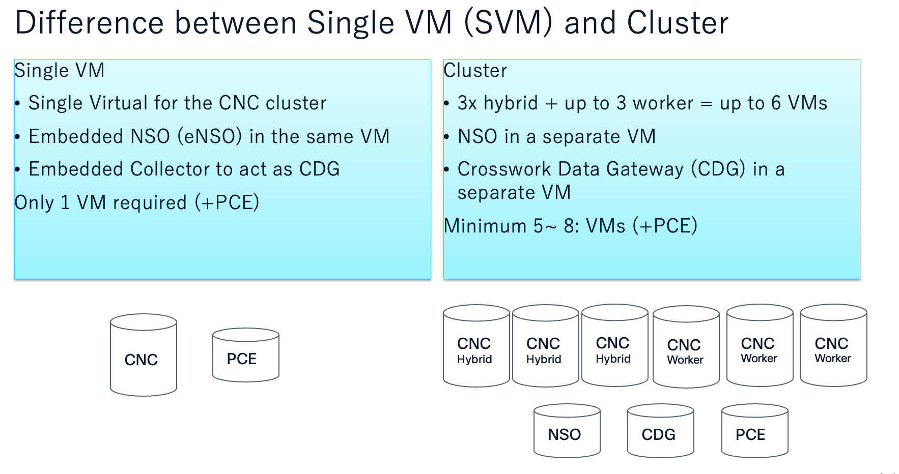

## 1.2 Disable maintenance mode

Use maintenance mode to temporarily suspend Crosswork Network Controller operations for maintenance or restart activities, and then resume normal service.
Maintenance mode gracefully shuts down the system for updates and synchronizes application data before it suspends services.

For more information about maintenance mode, refer to the following:

[https://www.cisco.com/c/en/us/td/docs/cloud-systems-management/crosswork-infrastructure/7-2/AdminGuide/b-cisco-crosswork-admin-guide-7-2/g-vm-management/t-manage-maintenance-mode-settings.html](https://www.cisco.com/c/en/us/td/docs/cloud-systems-management/crosswork-infrastructure/7-2/AdminGuide/b-cisco-crosswork-admin-guide-7-2/g-vm-management/t-manage-maintenance-mode-settings.html)

Follow the steps below to confirm that maintenance mode is off. If it is on, disable it.

1. Sign in to dCloud and click the "View" button (note that the scenario name may be different).
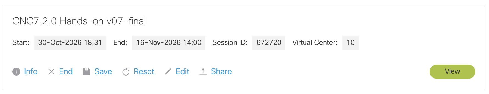
2. Access Ubuntu2204-1T-Desktop (use VM Console) and run Firefox on the desktop.
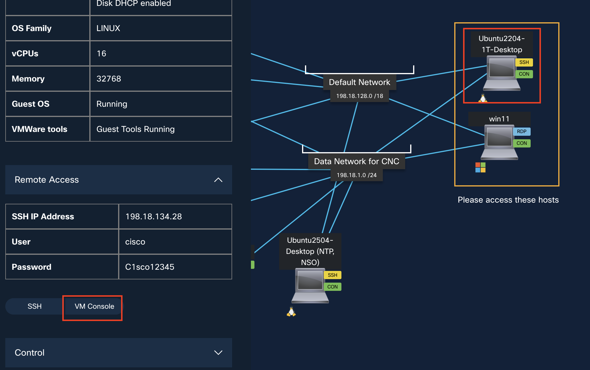
Click the "CNC" bookmark to access CNC (https://[2001:db8:134::200]:30603).
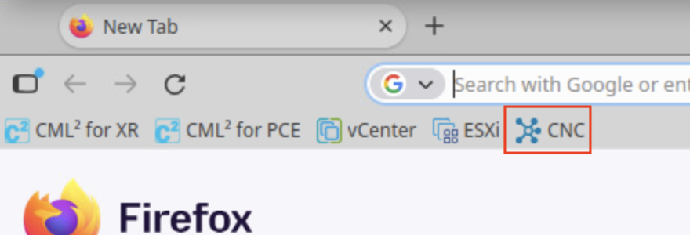
After you log in, the dashboard is displayed.
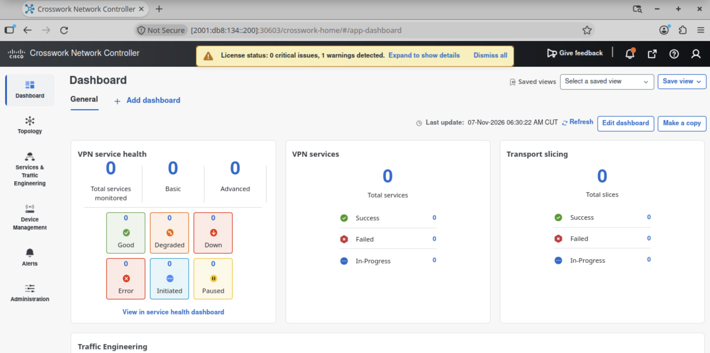
3. Go to **Administration > Settings > System Settings > Maintenance Mode**.
4. If a popup already offers to turn maintenance mode off, accept it.
5. If the Maintenance slider is On, drag it to Off.
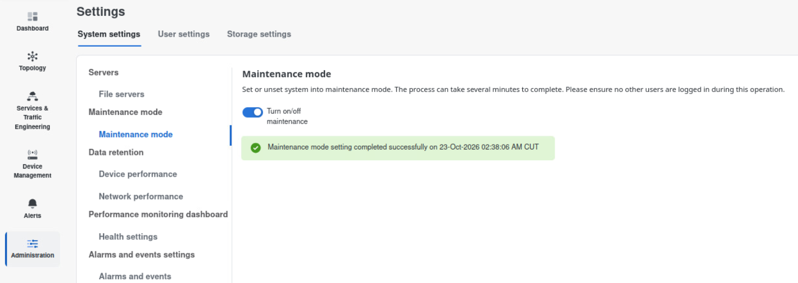

6. Wait for about 20 to 30 minutes for the applications to restart.

**Result:** The maintenance slider stays Off, and the UI loads the normal home page.

## 1.3 Confirm CML labs are running
In this lab, two CML instances are connected through multiple external connectors.
Review the network topology and familiarize yourself with the connections.

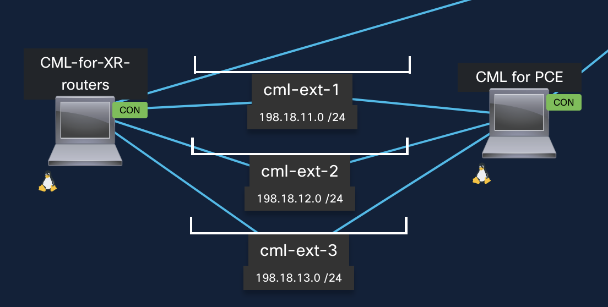

Follow the steps below to confirm that both CML instances are up and running.

1. Open another tab in Firefox and click the "CML2 for XR" bookmark.
2. Confirm that the "5-nodes_L3VPN 8711-32FH 25.4.2-ipv6" scenario is running. If not, start the scenario.
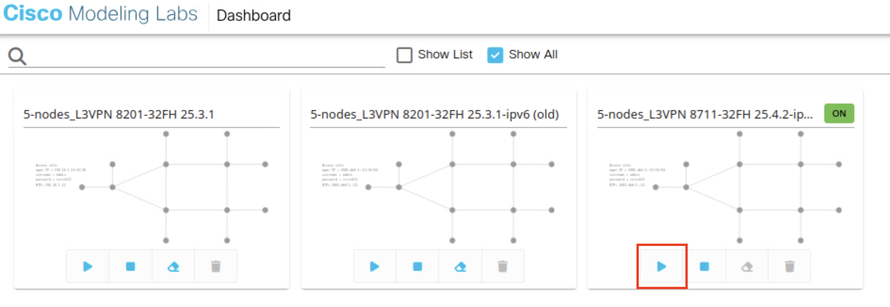
3. Open another tab in Firefox and click the "CML2 for PCE" bookmark.
4. Confirm that the "xrv9k-25.4.1-pce-for-CNC7.2-ipv6" scenario is running. If not, start the scenario.
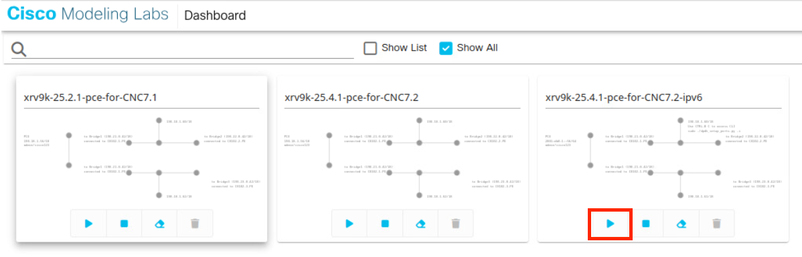

**Result:** The labs are booted. CNC can reach the devices once the providers and the Data Gateway are healthy. You confirm that reachability in the next chapter.

## 1.4 Sync-from devices

A key component of CNC is Network Services Orchestrator (NSO).
NSO stores device configurations in an internal database called CDB.
The device configuration and the CDB must be in sync for CNC to provision services.

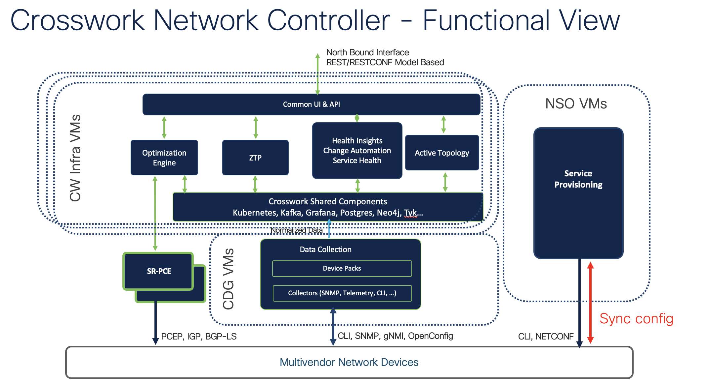

If there is a difference, the state changes to "out-of-sync".
In that case, run "sync-from" in **Device Management** to synchronize the configuration between NSO and the devices.

Follow the steps below to get familiar with the sync operation.

1. Access CNC and go to **Device Management > Network Devices**.
2. Select all devices and choose **Sync-from devices to NSO** from **Actions**.
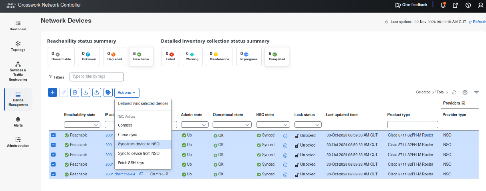
3. Go to **Inventory Jobs** and wait for the job to complete.
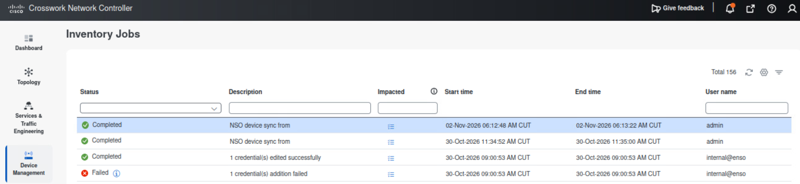
4. Open NSO by clicking the "NSO" button in the top right.
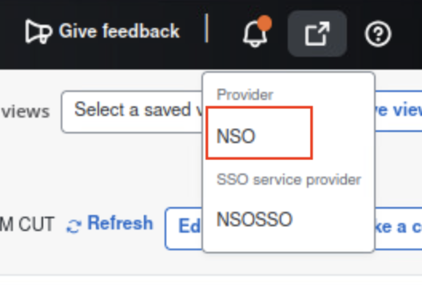
5. Click "SSO Login" to log in to NSO. You do not need to enter a username or password.
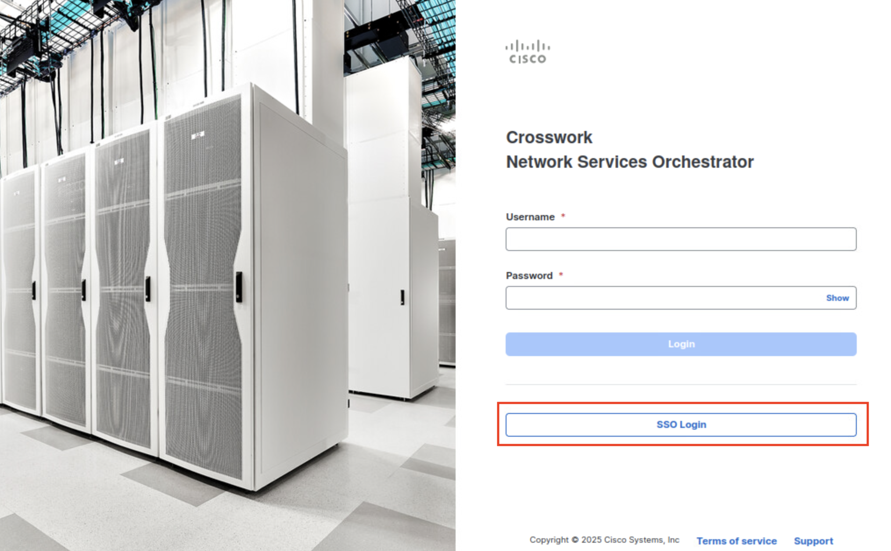

**Result:** All devices are synced with CNC.
You are logged in to the UI, and the controller is in normal operating mode.

## Done when

- [ ] You are logged in to CNC.
- [ ] Maintenance mode is Off.
- [ ] The CML labs are booted.
- [ ] All devices are synced.
