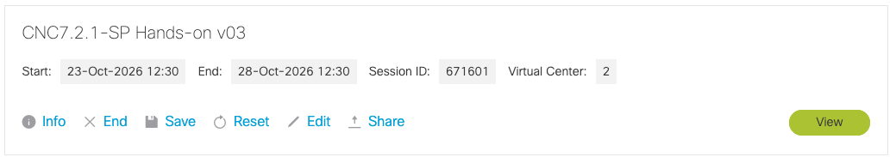
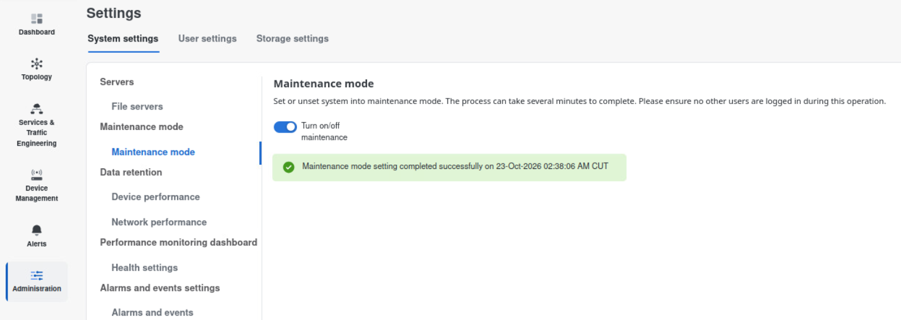
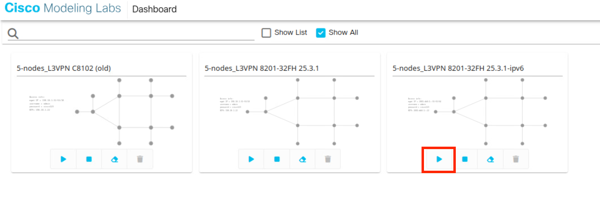
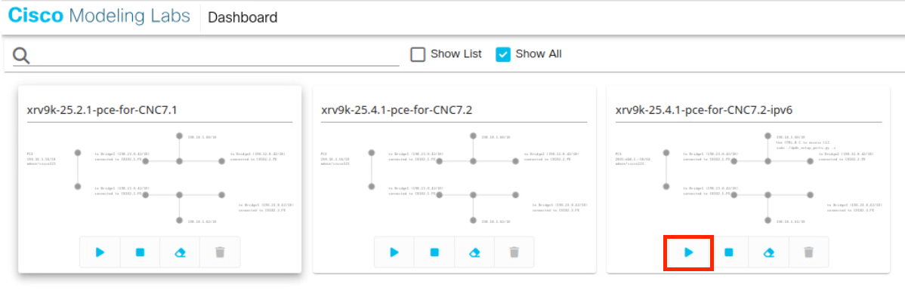

# 1. Preparation

**Time:** 20 minutes, most of it waiting.

**Objective:** Leave maintenance mode, start the CML lab, and log in to a controller that is ready for work.

!!! note "Instructor"
    Maintenance mode shuts the applications down gracefully, and bringing them back takes several minutes.

## 1.1 Disable maintenance mode

Maintenance mode is how CNC stops itself cleanly for a reboot, a backup, or a restore. After a reboot that began in maintenance mode, the cluster comes back in maintenance mode and waits for the slider to be turned off.

1. Sign in to the dCloud and click "View" button (Note, the scenario name could be different).

2. Access Ubuntu2204-1T-Desktop, run Firefox on the Desktop and open CNC UI (username and password are shared in the session).

    https://[2001:db8:134::200]:30603

3. Go to **Administration > Settings > System Settings > Maintenance Mode**.
4. If a popup already offers to turn maintenance mode off, accept it.
5. If the Maintenance slider is On, drag it to Off.

6. Wait. The applications need several minutes.

**Result:** The maintenance slider stays Off, the UI loads the normal home page.

## 1.2 Confirm CML labs are running

1. Open another tab on Firefox and click "CML2 for XR" in the bookmark.
2. Confirm "5-nodes_L3VPN 8201-32FH 25.3.1-ipv6" scenario is running. If not, start the scenario.

3. Open another tab on Firefox and click "CML2 for PCE" in the bookmark.
4. Confirm "xrv9k-25.4.1-pce-for-CNC7.2-ipv6" scenario is running. IF not, start the scenario.

**Result:** The lab is booted. CNC can reach the devices after the providers and the Data Gateway are healthy. You confirm that reachability in the next chapter.

**Result:** You are in the UI as yourself, and the controller is in normal operating mode.

## Done when

- Maintenance mode is Off.
- Log in to CNC
- The CML labs are booted.
