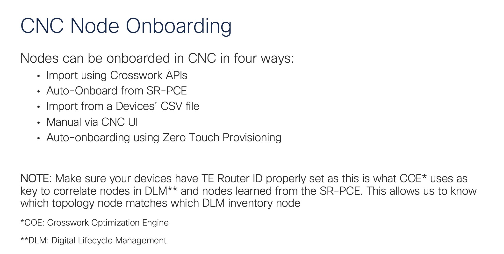
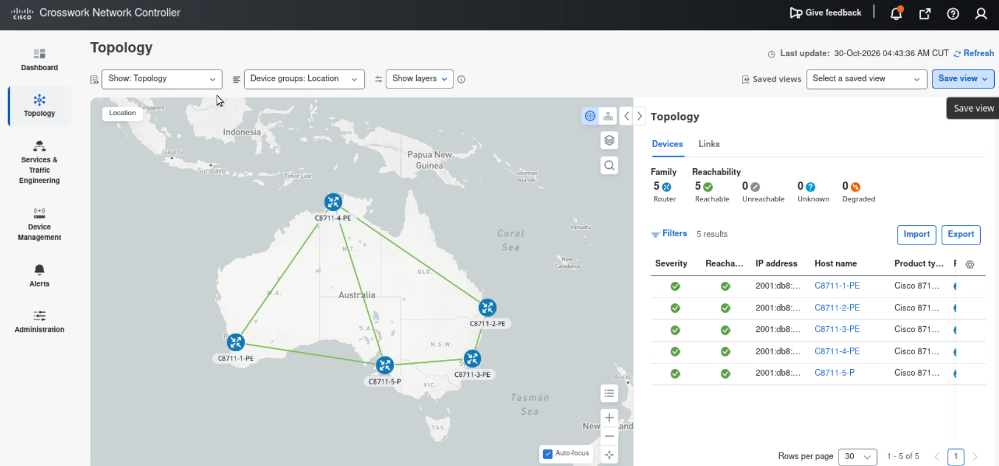
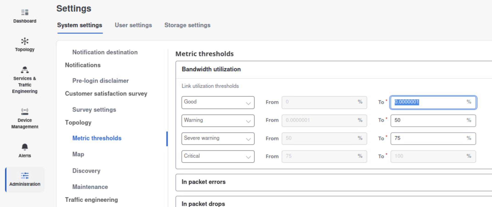
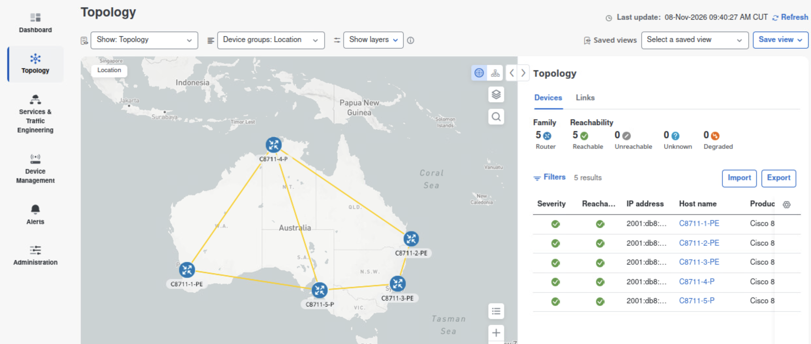
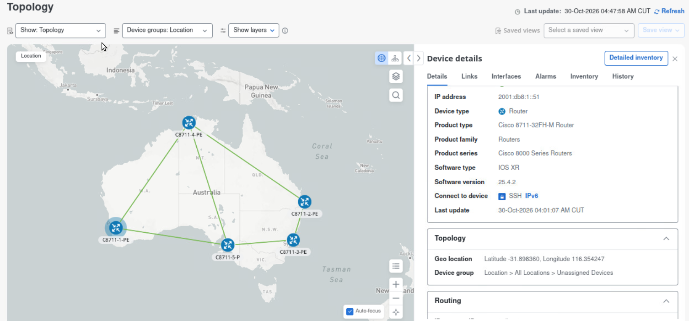
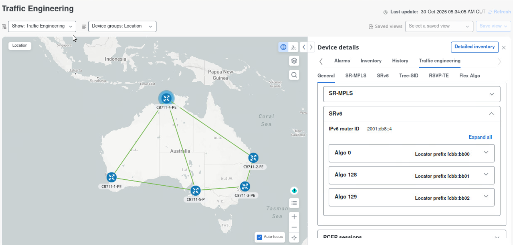

# 3. Active Topology

**Time:** 15 minutes.

**Objective:** Use Crosswork Active Topology to identify where a device is located and how it is connected, then verify the same facts from the IOS-XR CLI.

Active Topology is the map. Optimization Engine draws traffic-engineering objects on top of the same topology. You will use both views, then open a PE console from CML.

This lab uses IPv6. The IS-IS, BGP-LS, SRv6 locator, and PCEP information on the routers should match what the map shows.

## 3.1 Open the map

There are many ways for CNC to onboard devices. In this lab, devices are onboarded via PCE (Path Computation Element). The benefit of onboarding devices via PCE is that the topology is also automatically discovered by using link-state information.



For more information about onboarding devices, please refer to following:

[https://www.cisco.com/c/en/us/td/docs/cloud-systems-management/crosswork-infrastructure/7-2/AdminGuide/b-cisco-crosswork-admin-guide-7-2/g-add-and-configure-devices/c-device-onboarding-methods.html](https://www.cisco.com/c/en/us/td/docs/cloud-systems-management/crosswork-infrastructure/7-2/AdminGuide/b-cisco-crosswork-admin-guide-7-2/g-add-and-configure-devices/c-device-onboarding-methods.html)

Follow the steps below to confirm the onboarded devices and topology.

1. From the main menu, open **Topology**.
2. Wait for the devices from `5-nodes_L3VPN 8711-32FH 25.4.2-ipv6` to appear. An empty map usually means that the SR-PCE provider is up but BGP-LS is still down, or that the CML nodes are still booting. Recheck chapter 2.

3. Routers are placed on the geographic map based on the longitude and latitude configured in Device Management.
4. Identify the three provider-edge (PE) routers. They serve as the headend and the endpoints in chapters 5 through 8.
5. Each line color indicates the utilization of the link. The threshold for the color can be customized by going to **Administration > Settings > Topology > Metric thresholds**.

Try 0.0000001 (six zeros after the dot) and see if the link color changes.



**Result:** You can find all three PEs and at least one IGP path between them.

## 3.2 Read a device and a link in CNC

1. Select the headend. Open the Device details panel.
2. Record hostname, management IPv6 address, reachability, and IGP router ID.

3. Select a core link on a path between any two routers.
4. In the link details, record:
    - Interface names on each side
    - IGP metric
    - TE metric
    - Utilization
5. Switch the layer to Traffic Engineering and confirm SRv6 locators.



## 3.3 Confirm the same topology from XR CLI

Open a new tab in Firefox and click the "CML2 for XR" bookmark to access the XR routers. Open a console on the headend PE. Stay in EXEC mode. Do not enter configuration mode.

### Neighbors and IGP

```text
show isis neighbors
show isis ipv6 topology
```

If the lab uses a named IS-IS instance, the instructor will give you the instance name. In that case, use:

```text
show isis instance <name> neighbors
show isis instance <name> ipv6 topology
```

Match each IS-IS neighbor to a node on the CNC map. The neighbor count and the path you traced in section 3.2 should agree.

### Addressing

```text
show ipv6 interface brief
show interface <core-interface> brief
```

Confirm that the core interface you clicked on the map is up/up and that its IPv6 address matches the link details in CNC.

### SRv6

```text
show segment-routing srv6 locator
show segment-routing srv6 sid
```

The locator prefix on the PE should match the SRv6 layer on the map. If the map shows a locator and the CLI does not, the topology feed is stale. Wait and refresh; do not configure a locator.

### How CNC learned this topology

On the PE:

```text
show bgp link-state link-state
show bgp link-state link-state summary
```

On the SR-PCE (in the second CML lab), if the instructor gives you access to that console:

```text
show pce ipv6 peer
show pce ipv6 topology summary
```

The PCE should list the PEs as BGP-LS and PCEP peers. That is the feed behind the CNC map.

**Result:** Hostname, neighbor, core interface, and SRv6 locator agree between CNC and CLI.

## 3.4 Dashboard baseline

1. Return to the home page or the topology dashboard.
2. Record the reachable-device count and the SR policy count.
3. Zero SR policies is acceptable before chapter 5. You will compare the policy count after you create the SR policies in chapter 5.

**Result:** You have a baseline count of devices and policies.

## Done when

- [ ] All three lab PEs are on the map and reachable.
- [ ] `show isis neighbors` (or the named-instance form) matches the map.
- [ ] The core interface and SRv6 locator you recorded in CNC appear in XR CLI.
- [ ] You know the baseline SR policy count.
