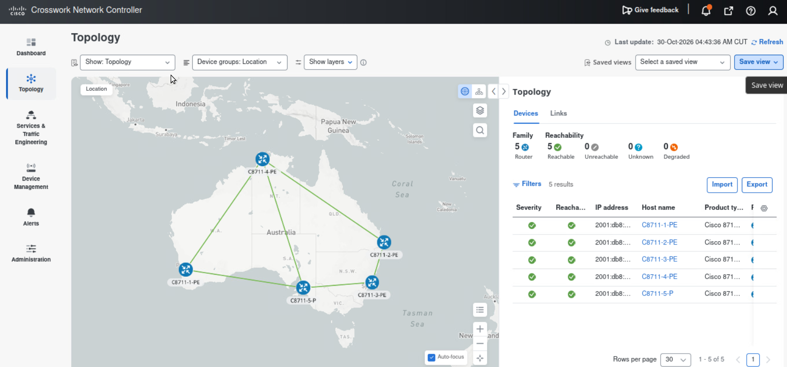
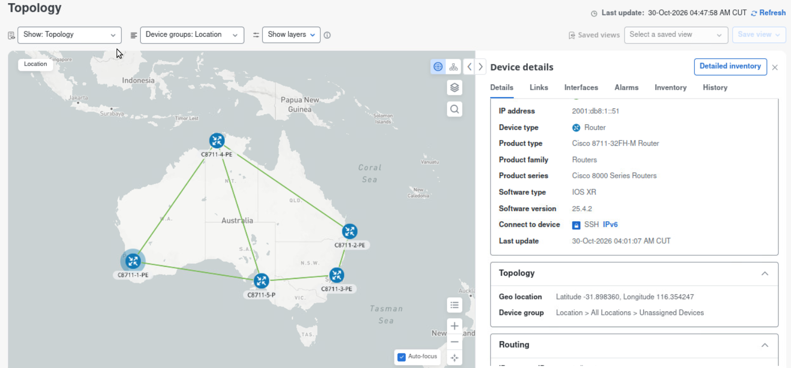
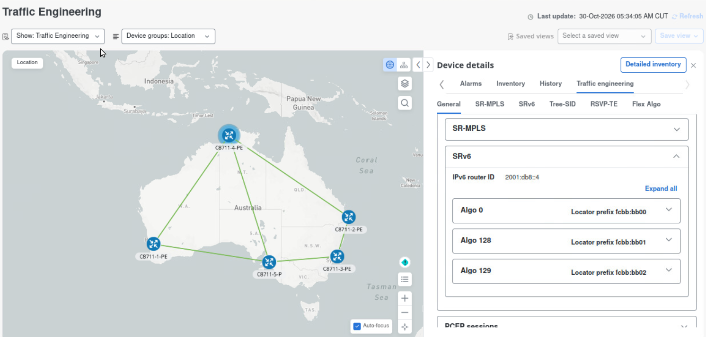

# 3. Active Topology

**Time:** 45 minutes.

**Objective:** Use Crosswork Active Topology to answer where a device sits and how it is connected, then prove the same facts from IOS-XR CLI.

Active Topology is the map. Optimization Engine draws traffic-engineering objects on top of the same topology. You will use both views, then open a PE console from CML.

This lab is IPv6. IS-IS, BGP-LS, SRv6 locators, and PCEP should match what the map shows.

## 3.1 Open the map

1. From the main menu, open **Topology**.
2. Wait for the devices from `5-nodes_L3VPN 8201-32FH 25.3.1-ipv6` to appear. An empty map usually means the SR-PCE provider is up and BGP-LS is still down, or the CML nodes are still booting. Recheck chapter 2.

3. Routers are located on the geographic map based on the longitude/latitude configured in the Device Management.
4. Identify three provider-edge routers. Those become the headend and the endpoint for chapters 5 through 8.

**Result:** You can find both PEs and at least one IGP path between them.

## 3.2 Read a device and a link in CNC

1. Select the headend. Open the Device details panel.
2. Record hostname, management IPv6 address, reachability, and IGP router ID.

3. Select a core link on a path between any router.
4. In the link details, record:
    - Interface names on each side
    - IGP metric
    - TE metric
    - Utilization
5. Switch the layer to Traffic Engineering and confirm SRv6 locators.



## 3.3 Confirm the same topology from XR CLI

Open a new tab in Firefox and click "CML2 for XR" to access XR routers. Open a console on the headend PE. Stay in EXEC. Do not enter configuration mode.

### Neighbors and IGP

```text
show isis neighbors
show isis ipv6 topology
```

If the lab uses a named IS-IS instance, the instructor will give you the instance name and you will use:

```text
show isis instance <name> neighbors
show isis instance <name> ipv6 topology
```

Match each IS-IS neighbor to a node on the CNC map. The neighbor count and the path you traced in section 3.2 should agree.

### Addressing

```text
show ipv6 interface brief
show interface <core-interface> brief
```

Confirm the core interface you clicked on the map is up/up and that the IPv6 address matches the link panel in CNC.

### SRv6

```text
show segment-routing srv6 locator
show segment-routing srv6 sid
```

The locator prefix on the PE should match the SRv6 layer on the map. If the map shows a locator and the CLI does not, the topology feed is stale. Wait and refresh; do not configure a locator.

### How CNC learned this topology

On the PE:

```text
show bgp link-state link-state
show bgp link-state link-state summary
```

On the SR-PCE (the second CML lab), if the instructor opens that console:

```text
show pce ipv6 peer
show pce ipv6 topology summary
```

PCE should list the PEs as BGP-LS and PCEP peers. That is the feed behind the CNC map.

**Result:** Hostname, neighbor, core interface, and SRv6 locator agree between CNC and CLI.

## 3.4 Dashboard baseline

1. Return to the home page or the topology dashboard.
2. Record the reachable-device count and the SR policy count.
3. Zero SR policies is acceptable before chapter 5. You will compare the policy count after you create a PCE-initiated policy.

**Result:** You have a baseline count of devices and policies.

## Done when

- Both lab PEs are on the map and reachable.
- `show isis neighbors` (or the named-instance form) matches the map.
- The core interface and SRv6 locator you recorded in CNC appear in XR CLI.
- You know the baseline SR policy count.
