# 4. Element management

**Time:** 50 minutes.

**Objective:** Use CNC Element Management Functions the way an operations team already uses SolarWinds: node status, hardware inventory, configuration archive, alarms, and interface performance. Deploy nothing from this chapter.

Element Management Functions in CNC 7.2 cover device onboarding, inventory, faults, metrics, software images, configuration backup, and configuration templates. You will map each SolarWinds-style view to a CNC page, then open that page.

## 4.1 SolarWinds to CNC

CNC is not a replacement of every SolarWinds poller. It is the controller view of the same devices, with IGP and SR context that SolarWinds does not have.

| What you do in SolarWinds | Where you do it in CNC | What is different |
| --- | --- | --- |
| Node list, ICMP/SNMP reachability | **Device Management > Network Devices** | CNC also shows the credential profile and the Data Gateway mapping that collection uses |
| Hardware inventory (chassis, modules, serials) | **Device Management > Network Inventory** | Same idea: serial, product id, alarm badge on the part |
| Network map | **Topology** (chapter 3) | CNC map is IGP/SRv6 from SR-PCE, not only Layer-3 discovery |
| Alert console / trap viewer | **Alerts > Alarms and Events** | CNC splits system, network, and device alarms. An alarm stays until it clears; an event is a point in time |
| Interface utilization and thresholds | **Device Management > Performance Policies**, plus link utilization on the topology map | CNC Optimization Engine colors links from collected counters. Performance Policies raise threshold-crossing alarms |
| NCM config archive, compare, restore | **Device Management > Configuration Backup and Restore** | CNC can also backup on configuration change. Restore is out of scope for this lab |
| NCM config change jobs / scripts | **Device Management > Configuration Templates** | Parameterized CLI (Apache Velocity). Different from NSO L2/L3VPN templates in chapters 6 and 7 |

Use the table as a translation layer. The rest of this chapter is the CNC side.

## 4.2 Network devices and inventory

1. Go to **Device Management > Network Devices**.
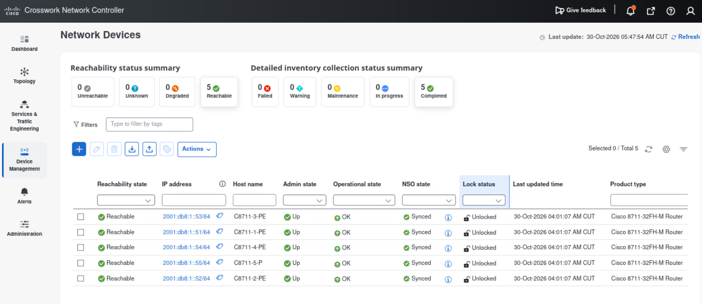
2. Find the headend from chapter 3. Record operational state, reachability, and the credential profile name.
3. Go to **Device Management > Network Inventory**.
4. Filter to the headend hostname or product family (C8711-1-PE).
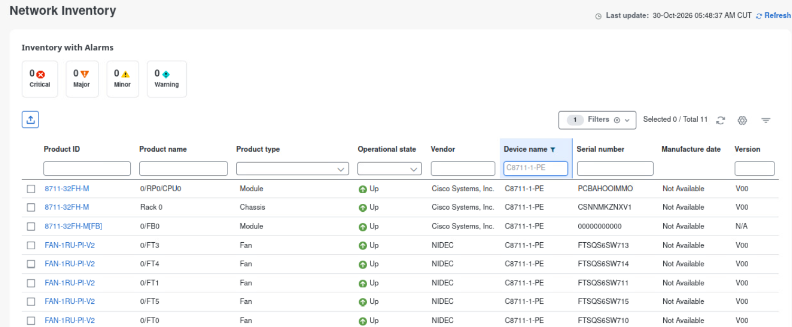
5. Open the chassis, one route processor or line card, and one pluggable if the inventory has them.
6. Read the alarm summary on that inventory row.

**Result:** You can walk from a hostname to a chassis and a module, the same way you would drill into a SolarWinds node.

A device that stays unreachable needs credentials, IPv6 reachability to the management address, and a booted CML node.

## 4.3 Configuration backup

CNC archives device configuration, compares two archives, and can restore. This lab uses the archive as a reader, like NCM config view.

1. Go to **Device Management > Configuration Backup and Restore**.
2. Find the headend.
3. Open the latest archived configuration. Identify hostname and the segment-routing or IS-IS section.
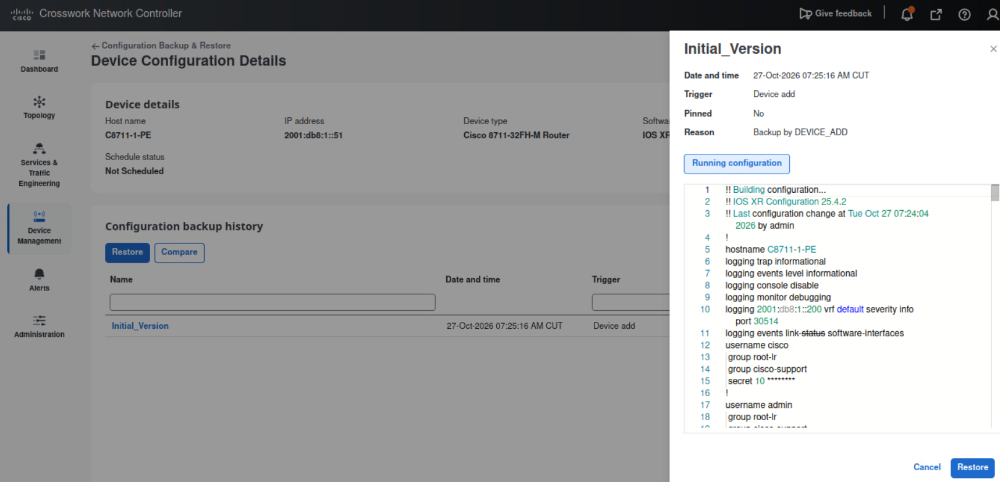
4. If two archives exist, open compare and name one difference, or state that they match.
5. Leave **Schedule backup** and **Restore** unused.

**Result:** You have seen a real archived configuration for the headend.

Automatic backup on configuration change, when it is enabled under **Device Management > Configuration Preferences**, is what makes this archive useful after chapters 6 and 7. Read the preference. Leave the values as you found them.
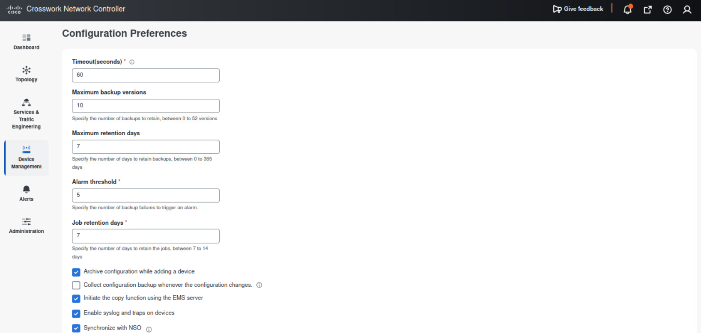

## 4.4 Configuration templates (read only)

Device templates under Device Management are parameterized CLI. They are for repeating underlay or day-1 configuration. They are not the NSO L2VPN/L3VPN function-pack templates, and they are not the custom template you may attach to a VPWS in chapter 7.

1. Go to **Device Management > Configuration Templates**.
2. Open one existing template, if any exist. Read the device types it targets and one variable it expects.
3. Configuration templates can be used to execute a set of commands. Create a new template and put following values.
    - Name: collect-outputs
    - Enable "Read template for troubleshooting"
    - Authorization: admin
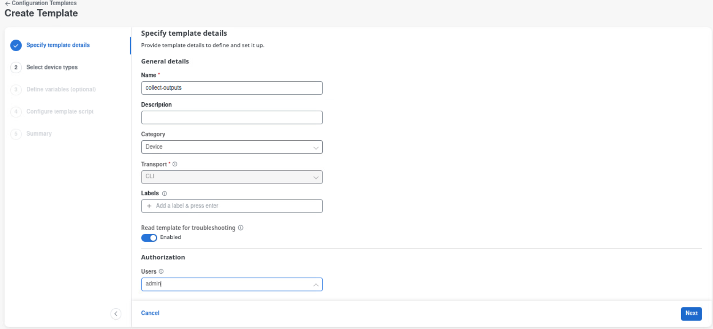
4. Select "Cisco 8711-32FH" as a device type.
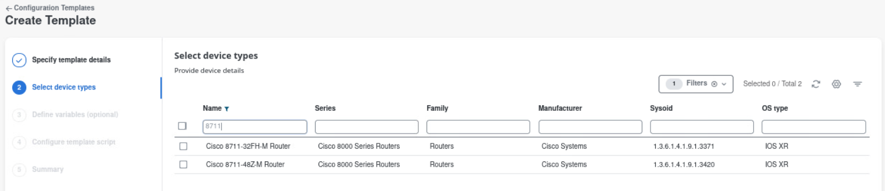
5. No input for Define variable, just click Next
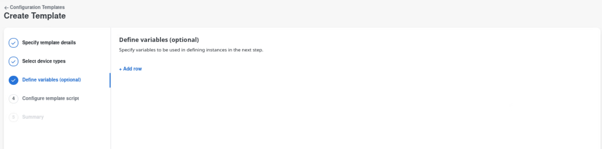
6. Put show commands in Configure template script
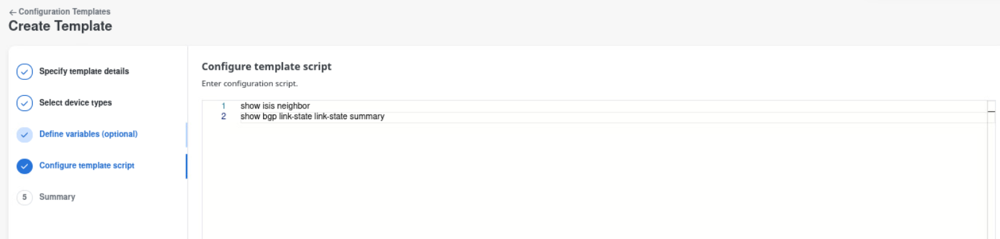
7. Deploy created template
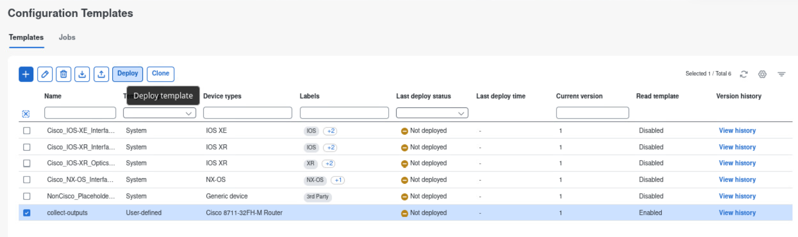
8. Go to Jobs to see the progress.
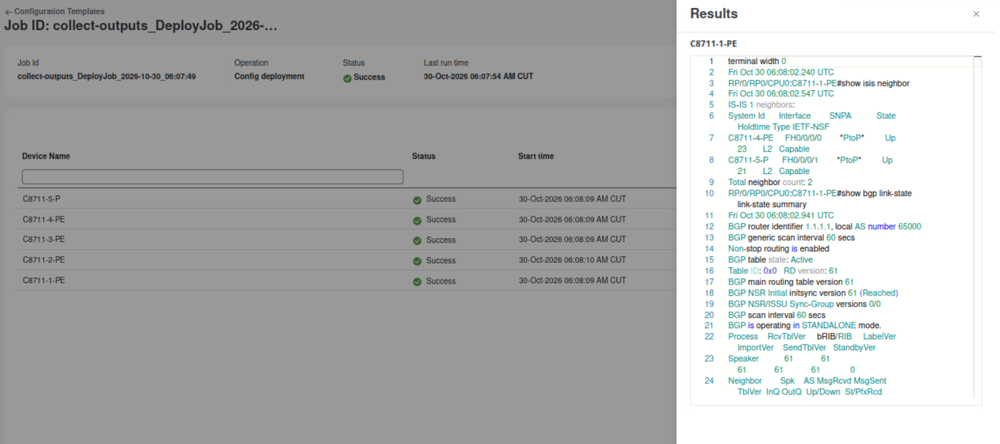

## 4.5 Alarms and events

1. Go to **Alerts > Alarms and Events**.
2. Stay on **Alarms**. Use the category list to see system, network, and device alarms as separate sets.
3. Filter to the headend if the filter allows it.
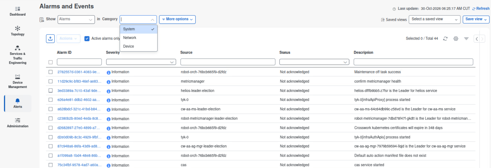
4. If an alarm is present, record severity, source, and whether it is acknowledged. Leave acknowledge, clear, and annotate unused unless the instructor gives you a lab alarm of your own.
5. Switch **Show** from Alarms to **Events**.
6. Read the newest event. An event is a moment in time. An alarm remains until it clears.
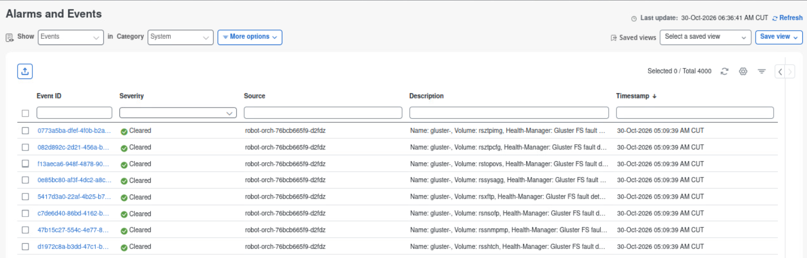

**Result:** You can open both views. An empty alarm list is valid on a healthy CML lab.

You will use this page again in chapter 9.

## 4.6 Performance

Link colors on the topology map come from interface utilization collected for Optimization Engine. Element management adds polling policies, which is the CNC equivalent of a SolarWinds threshold on an interface.

1. Go to **Device Management > Performance Policies**.
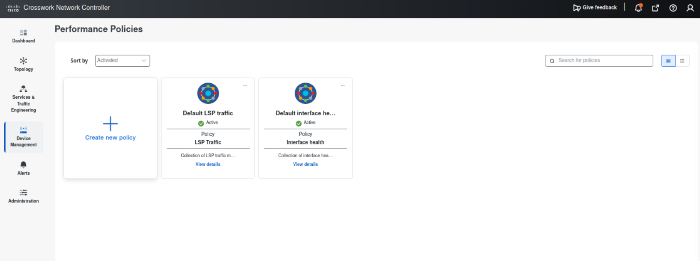
2. Open one existing policy, if any exist. Read which devices it covers, how often it polls, and which threshold raises an alarm.
3. Return to the **Topology** and click any link. Open **History** and confirm the utilization and traffic rate.
4. Leave the policy switch as you found it.

**Result:** You can say where a threshold is defined, and you can point at one live counter.

## Done when

- You can map node list, inventory, alerts, config archive, and utilization from SolarWinds to a CNC page.
- The headend is in Network Devices and in Network Inventory.
- You opened an archived configuration and did not restore it.
- You opened Alarms and Events.
- You compared one interface counter with the topology utilization from chapter 3.
