# 4. Element management

**Time:** 50 minutes.

**Objective:** Use CNC Element Management Functions to check node status, hardware inventory, configuration archive, alarms, and interface performance. Do not change any device configuration in this chapter.

Element Management Functions in CNC 7.2 cover device onboarding, inventory, faults, metrics, software images, configuration backup, and configuration templates.

## Compare CNC with a generic NMS (Network Management System)

CNC is the controller view of the same devices, with IGP and SR context. The following table compares CNC with a generic NMS.

| Generic NMS | CNC | What is different |
| --- | --- | --- |
| Node list, ICMP/SNMP reachability | **Device Management > Network Devices** | CNC also shows the credential profile and the Data Gateway mapping that collection uses |
| Hardware inventory (chassis, modules, serials) | **Device Management > Network Inventory** | Same concept: serial number, product ID, and alarm badge on each part |
| Network map | **Topology** (chapter 3) | The CNC map is built from IGP/SRv6 information from SR-PCE, not only from Layer 3 discovery |
| Alert console / trap viewer | **Alerts > Alarms and Events** | CNC splits system, network, and device alarms. An alarm stays until it clears; an event is a point in time |
| Interface utilization and thresholds | **Device Management > Performance Policies**, plus link utilization on the topology map | CNC Optimization Engine colors links from collected counters. Performance Policies raise threshold-crossing alarms |
| NCM config archive, compare, restore | **Device Management > Configuration Backup and Restore** | CNC can also back up on configuration change. Restore is out of scope for this lab |
| NCM config change jobs / scripts | **Device Management > Configuration Templates** | Parameterized CLI (Apache Velocity). These are different from the NSO L2/L3VPN templates in chapters 6 and 7 |

Use the table to map generic NMS functions to CNC. The rest of this chapter covers the CNC side.

## 4.1 Detailed inventory
1. In Topology, click any node, for example **C8711-4-P**, then click **Detailed inventory** button.
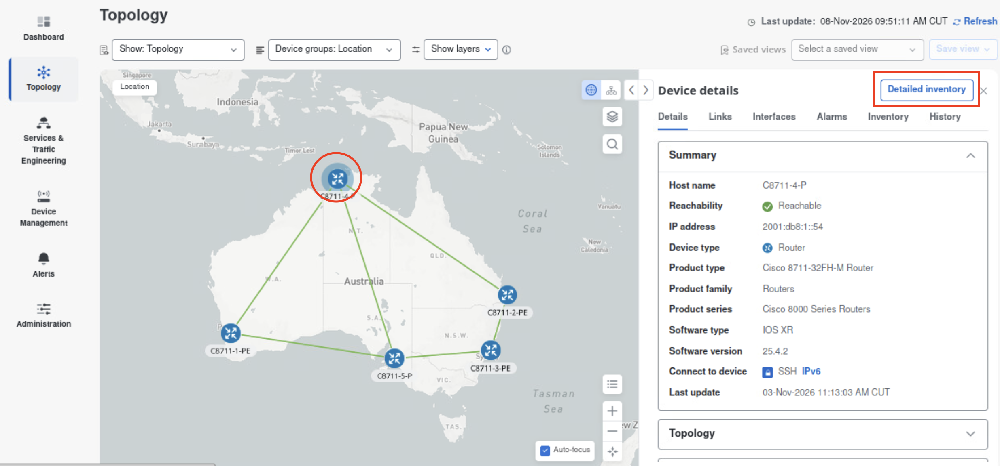
2. You will see the hierarchical view of the inventory. Explore the graph and see how easy it is to grasp the relationship between the inventory. 
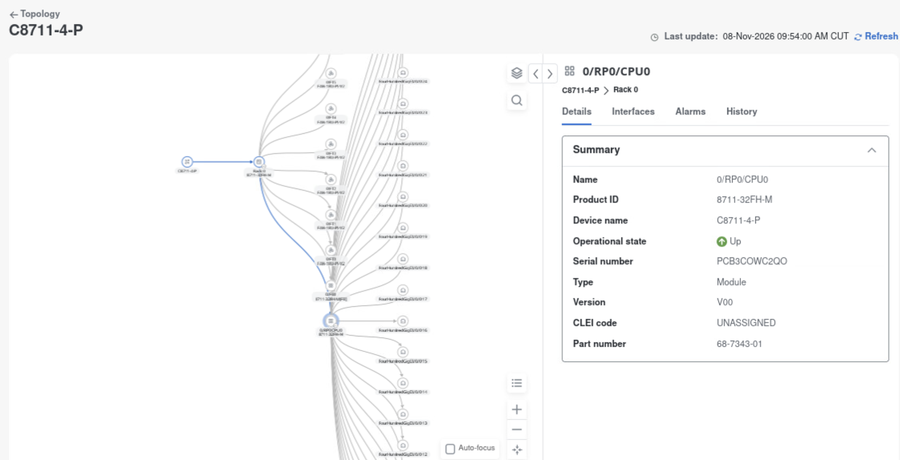

## 4.2 Network devices and inventory

1. Go to **Device Management > Network Devices**.
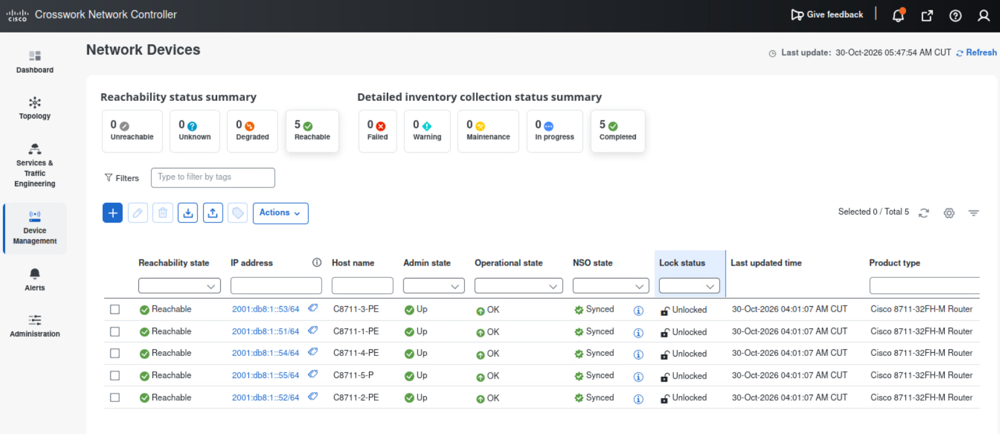
2. Find the headend from chapter 3. Record operational state, reachability, and the credential profile name.
3. Go to **Device Management > Network Inventory**.
4. Filter by the headend hostname (C8711-1-PE) or product family.
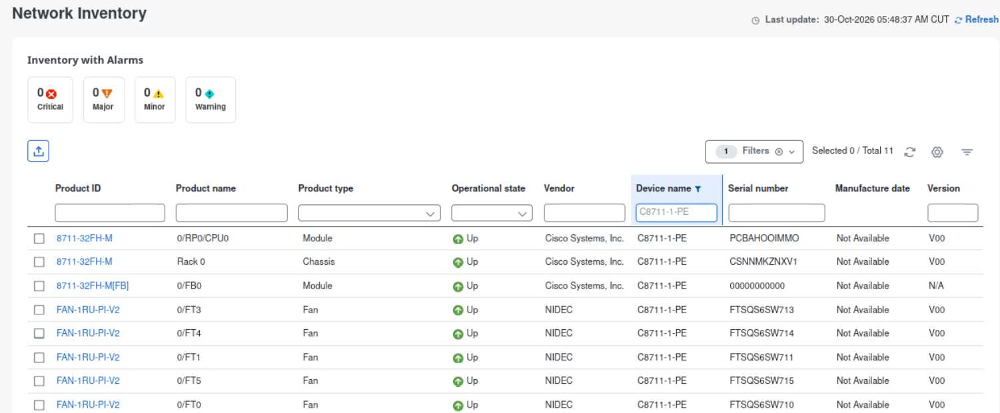
5. Open the chassis, one route processor or line card, and one pluggable if the inventory lists them.
6. Read the alarm summary on that inventory row.

**Result:** You can navigate from a hostname to a chassis and a module.

If a device stays unreachable, check its credentials, IPv6 reachability to the management address, and whether the CML node has booted.

## 4.3 Configuration backup

CNC archives device configurations, compares two archives, and can restore them. In this lab, you only view the archive, as in an NCM config view.

1. Go to **Device Management > Configuration Backup and Restore**.
2. Find the headend.
3. Open the latest archived configuration. Identify the hostname and the segment-routing or IS-IS section.
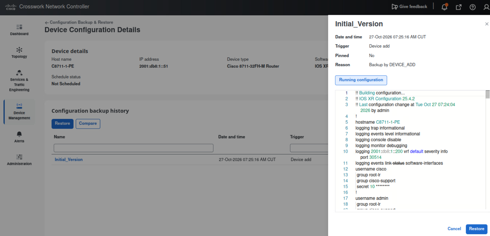
4. If two archives exist, open the comparison and note one difference, or confirm that they match.
5. Do not use **Schedule backup** or **Restore**.

**Result:** You have viewed an actual archived configuration for the headend.

When automatic backup on configuration change is enabled under **Device Management > Configuration Preferences**, the archive stays useful after chapters 6 and 7. Check the preference and leave the values unchanged.
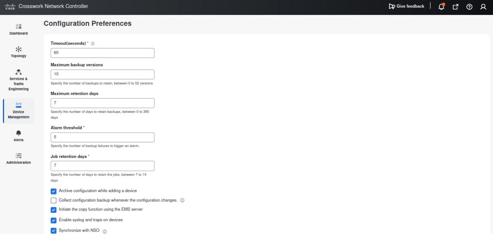

## 4.4 Configuration templates (read only)

Device templates under Device Management are parameterized CLI scripts. They are intended for repeatable underlay or day-1 configuration. They are not the NSO L2VPN/L3VPN function-pack templates.

1. Go to **Device Management > Configuration Templates**.
2. Open one existing template, if any exist. Read the device types it targets and one variable it expects.
3. You can use configuration templates to run a set of commands. Create a new template with the following values:
    - Name: collect-outputs
    - Enable "Read template for troubleshooting"
    - Authorization: admin
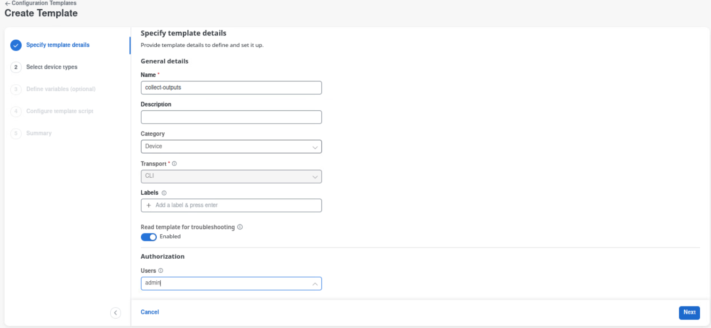
4. Select "Cisco 8711-32FH" as the device type.
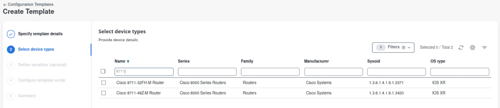
5. Do not define any variables. Click **Next**.
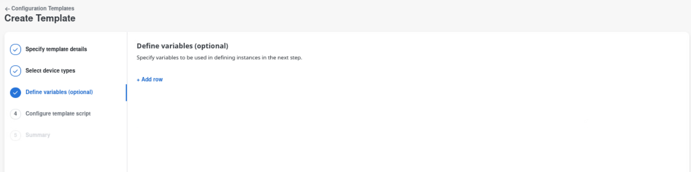
6. Enter the show commands in **Configure template script**.
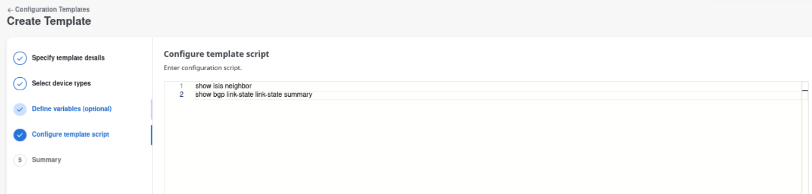
7. Deploy the template you created.
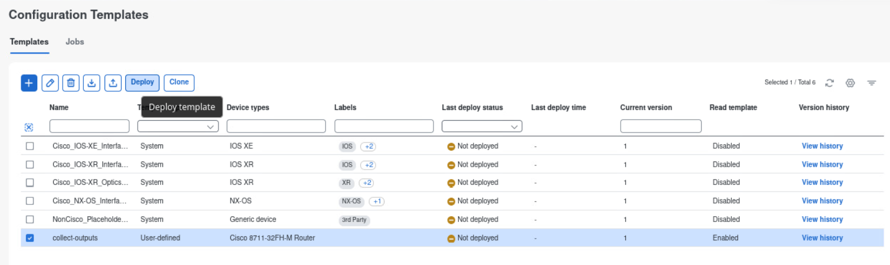
8. Go to **Jobs** to check the progress.
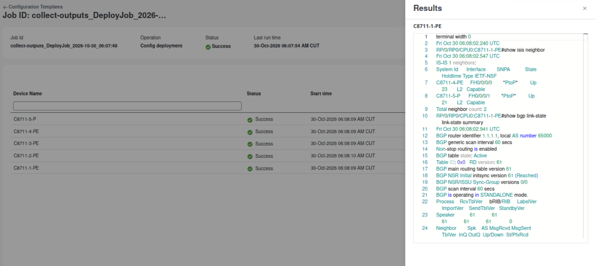

## 4.5 Alarms and events

1. Go to **Alerts > Alarms and Events**.
2. Stay on **Alarms**. Use the category list to see system, network, and device alarms as separate sets.
3. Filter to the headend if the filter allows it.
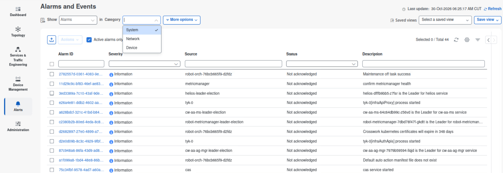
4. If an alarm is present, record severity, source, and whether it is acknowledged. Do not acknowledge, clear, or annotate alarms unless the instructor assigns a lab alarm to you.
5. Switch **Show** from Alarms to **Events**.
6. Read the newest event. An event is a moment in time. An alarm remains until it clears.
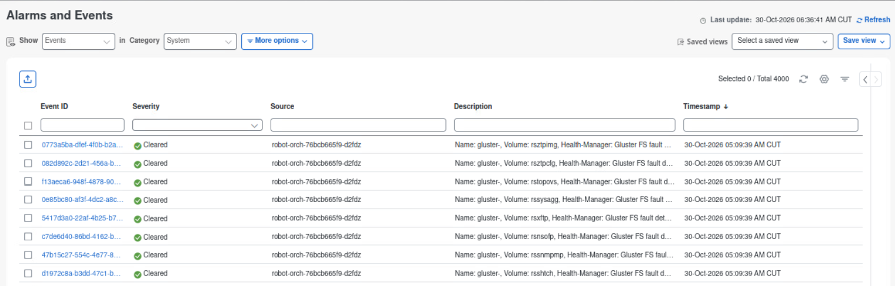

**Result:** You can open both views. An empty alarm list is normal on a healthy CML lab.

You will use this page again in chapter 9.

## 4.6 Performance

Link colors on the topology map come from interface utilization collected for Optimization Engine. Element Management Functions add polling policies.

1. Go to **Device Management > Performance Policies**.
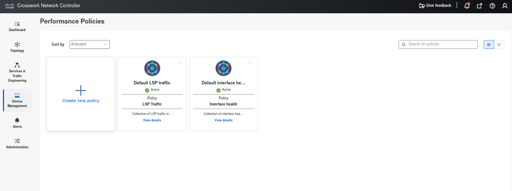
2. Open one existing policy, if any exist. Read which devices it covers, how often it polls, and which threshold raises an alarm.
3. Return to the **Topology** and click any link. Open **History** and confirm the utilization and traffic rate.
4. Leave the policy enable/disable switch unchanged.

**Result:** You know where a threshold is defined, and you can identify one live counter.

## Done when

- [ ] You can map the generic NMS functions (node list, inventory, alerts, config archive, and utilization) to the corresponding CNC pages.
- [ ] The headend is in Network Devices and in Network Inventory.
- [ ] You opened an archived configuration and did not restore it.
- [ ] You opened Alarms and Events.
- [ ] You compared one interface counter with the topology utilization from chapter 3.
