# 5. SR-TE and SRv6

**Time:** 60 minutes.

**Objective:** Create various PCC-initiated SRv6 policies with PCE-delegated dynamic paths from CNC.

!!! warning "Note"
    Cisco 8000 does not support SRv6 policies with head-end computed dynamic paths or PCE-initiated SRv6 policies. In addition, the CNC 7.2 built-in function pack does not support explicit paths that use IPv6 addresses or SRv6 SIDs. Therefore, this hands-on focuses on PCC-initiated SRv6 policies with PCE-delegated dynamic paths.  
    For details, see [Cisco 8000 Configuration Guide: Segment Routing over IPv6 Traffic Engineering (SRv6-TE)](https://www.cisco.com/c/en/us/td/docs/iosxr/cisco8000/segment-routing-v6/srv6-config-guide-cisco8000/traffic-engineering-in-ipv6-networks-using-srv6-te/srv6-te-overview.html)

## 5.1 Terminology

| Term | Meaning in this lab |
| --- | --- |
| PCC | The headend router. It holds the policy configuration and has a PCEP session with SR-PCE. |
| PCE | SR-PCE in the second CML lab. It learns the topology through BGP-LS, computes paths, and reports the policies to CNC. |
| PCC-initiated | The policy configuration resides on the headend. In this lab, you create it in CNC, and CNC provisions the configuration on the headend through NSO. This is the type used in this chapter. |
| PCE-delegated dynamic path | A PCC-initiated candidate path with `dynamic` + `pce`. The headend delegates path computation to SR-PCE, and SR-PCE returns the SID list through PCEP. |
| PCE-initiated | The policy is created on SR-PCE and pushed to the headend through PCEP, without any configuration on the headend. Not used in this lab because Cisco 8000 does not support it for SRv6. |
| Color | A number that identifies the intent. Together with the endpoint, it identifies the policy. Chapter 6 binds an L3VPN to this color. |
| Candidate path | One way to reach the endpoint. The preference value determines which candidate path is selected. |

## 5.2 Confirming the initial state

SR-PCE requires topology and SRv6 locator/SID information to compute paths. It acquires this information from the routers in the SRv6 topology via BGP-LS. In this scenario, BGP-LS sessions are established with the three PEs.

Open Firefox in private browsing mode and click the "CML2 for PCE" bookmark.
Then, on the SR-PCE console:

```text
RP/0/RP0/CPU0:pce#show bgp link-state link-state neighbors brief
Wed Nov  4 06:02:58.271 UTC

Neighbor         Spk    AS  Description                         Up/Down  NBRState
2001:db8:1::51    0 65000                                         4d20h Established 
2001:db8:1::52    0 65000                                         4d20h Established 
2001:db8:1::53    0 65000                                         4d20h Established 
RP/0/RP0/CPU0:pce#
```

You can check the TEDB (Topology Database) that the PCE builds from BGP-LS by using the following command.

On the SR-PCE:

```text
RP/0/RP0/CPU0:pce#show pce ipv6 topology                        
Wed Nov  4 06:08:39.763 UTC

PCE's topology database - detail:
---------------------------------
Node 1
  IPv6 router ID: 2001:db8::1
  Host name: C8711-1-PE
  ISIS system ID: 0000.0000.0001 level-2 Area-id: 49 ASN: 65000 domain ID: 32
  SR Algo INFO:
    ISIS system ID: 0000.0000.0001 level-2 Area-id: 49 ASN: 65000 domain ID: 32
      SR Algo Participation:
         0, 1, 128, 129
      Flex-Algo Definition:
         Flex-Algo number: 128, Priority: 128, Metric Type: IGP (0)
         Flex-Algo number: 129, Priority: 128, Metric Type: IGP (0)
  uN SIDs:
    SID[0]:    ISIS system ID: 0000.0000.0001 level-2 Area-id: 49 ASN: 65000 domain ID: 32
      SID: fcbb:bb00:1:: Behavior: uN (PSP/USD) (48)
      LBL:32 LNL:16 FL:0 AL:80 Algo:0
    SID[1]:    ISIS system ID: 0000.0000.0001 level-2 Area-id: 49 ASN: 65000 domain ID: 32
      SID: fcbb:bb01:1:: Behavior: uN (PSP/USD) (48)
      LBL:32 LNL:16 FL:0 AL:80 Algo:128
    SID[2]:    ISIS system ID: 0000.0000.0001 level-2 Area-id: 49 ASN: 65000 domain ID: 32
      SID: fcbb:bb02:1:: Behavior: uN (PSP/USD) (48)
< --- omitted --->
```

PCEP (Path Computation Element Communication Protocol) is a signaling protocol for exchanging SRv6-TE path information between an SR-PCE, which performs path computation, and the head-end routers (PCCs) in the network (RFC 5440).

PCEP handles bidirectional communication between routers and PCEs, including path computation requests (Request), reporting and updating of computed paths (Report/Update), and delegation of control (Delegation).

On the SR-PCE:

```
RP/0/RP0/CPU0:pce#show pce ipv6 peer 
Wed Nov  4 06:19:07.824 UTC

PCE's peer database: 
--------------------
Peer address: 2001:db8::1
  State: Up
  Capabilities: Stateful, Segment-Routing, Update, Instantiation, SRv6, SR-P2MP

Peer address: 2001:db8::2
  State: Up
  Capabilities: Stateful, Segment-Routing, Update, Instantiation, SRv6, SR-P2MP

Peer address: 2001:db8::3
  State: Up
  Capabilities: Stateful, Segment-Routing, Update, Instantiation, SRv6, SR-P2MP

Peer address: 2001:db8::4
  State: Up
  Capabilities: Stateful, Segment-Routing, Update, Instantiation, SRv6, SR-P2MP

Peer address: 2001:db8::5
  State: Up
  Capabilities: Stateful, Segment-Routing, Update, Instantiation, SRv6, SR-P2MP

RP/0/RP0/CPU0:pce#
```

PCEP sessions are established with both P routers, P4 and P5. However, this configuration is unnecessary unless P4 or P5 acts as a head-end.

Open Firefox in private browsing mode and click the "CML2 for XR" bookmark.
On the PCC routers (PE1, PE2, PE3):

```
RP/0/RP0/CPU0:C8711-1-PE#show segment-routing traffic-eng pcc ipv6 peer 
Wed Nov  4 06:20:23.622 UTC

PCC's peer database:
--------------------

Peer address: 2001:db8::6, 
  Precedence: 255, (best PCE)
  State up
  Capabilities: Stateful, Update, Segment-Routing, Instantiation, SRv6, SR P2MP

RP/0/RP0/CPU0:C8711-1-PE#
```

In addition, the affinity color RED (bit-position 3) is set on the link between P4 and PE2.

On the P4 and PE2 routers:

```
RP/0/RP0/CPU0:C8711-4-P#show run segment-routing traffic-eng interface FourHundredGigE0/0/0/1
Wed Nov  4 06:24:46.097 UTC
segment-routing
 traffic-eng
  interface FourHundredGigE0/0/0/1
   affinity
    name RED
   !
  !
 !
!

RP/0/RP0/CPU0:C8711-4-P#show run segment-routing traffic-eng affinity-map 
Wed Nov  4 06:24:55.533 UTC
segment-routing
 traffic-eng
  affinity-map
   name RED bit-position 3
  !
 !
!
```

You can also check the affinity bit in the Admin groups field by clicking the link between P4 and PE2 in the CNC GUI.

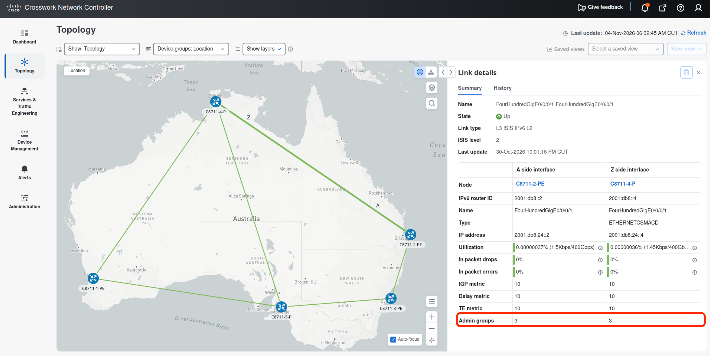


## 5.3 Create PCC-initiated policy 1 (Exclude RED link)

Configure an SRv6-TE policy with the following conditions:

- Policy Name: PE1-PE2_color10
- Headend: PE1
- Endpoint: PE2
- Optimization: IGP
- Constraint: exclude RED link

Since all links in this topology use the default cost, the path from PE1 to PE2 is computed as follows, avoiding the link between P4 and PE2.

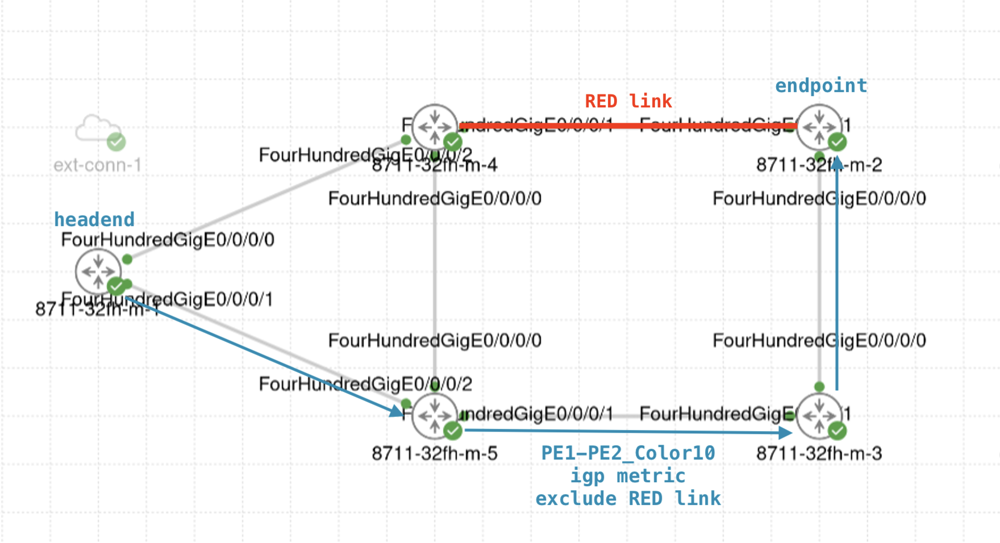

You can configure the policy using either of the following two methods.  
[Option 1: Manually configure parameters](#option-5-3-1-manually-configure-parameters)  
[Option 2: Import JSON](#option-5-3-2-import-json)  

### Option 5-3-1: Manually configure parameters

1. Go to **Services & Traffic Engineering > Traffic Engineering**, **SRv6** tab, then click **Create** > **PCC-init**.
    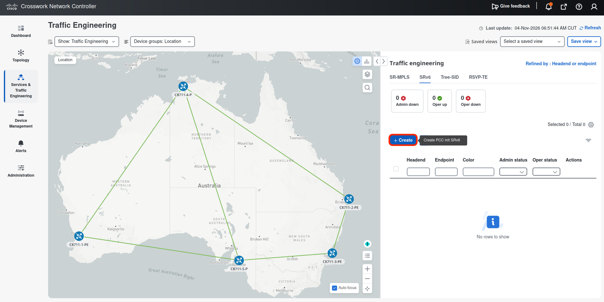

2. Click the **+** button.
    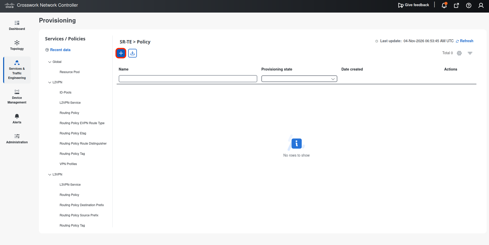

3. Set the following:
    - name: `PE1-PE2_color10`
    - headend: C8711-1-PE
    - tail-end: 2001:db8::2
    - color: 10
    - preference: 100
    - st-te-path-choice: dynamic-path (enable `dynamic` and select `pce`)
    - metric-type: `igp`
    - constraints: enable `affinity` and add a rule with an action `exclude-any` color `RED`.
    - srv6: enable `locator` (locator-name: `srv6`, behavior: `ub6-insert-reduced`, and binding-sid-type: `srv6-dynamic`).

    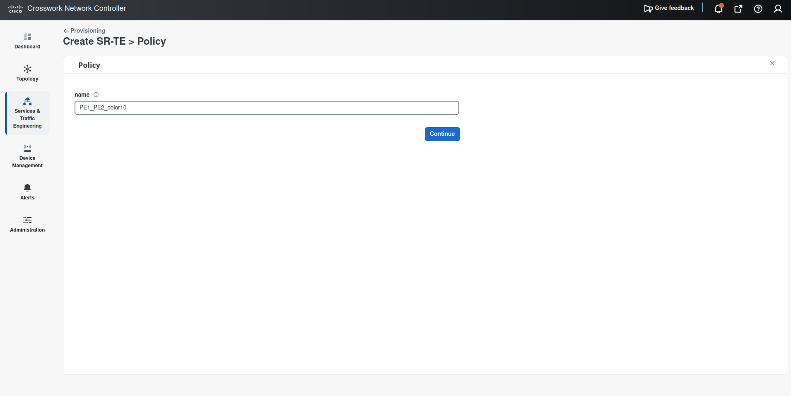
    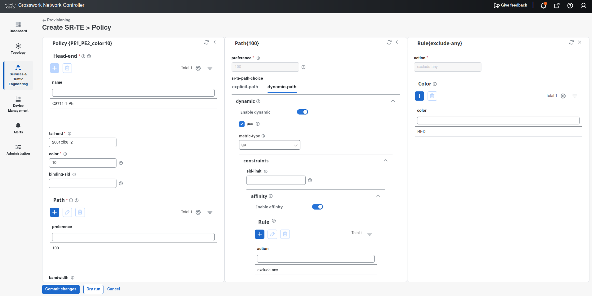
    

4. Click **Dry-run** to confirm the configuration.

    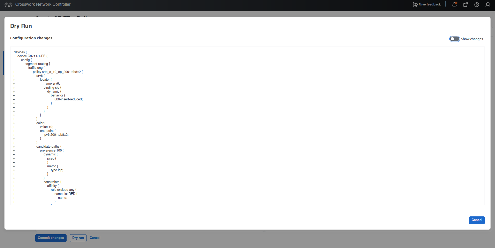

    You can switch the display by using **Show changes** in the upper right.
    

5. Click **Commit changes**.

    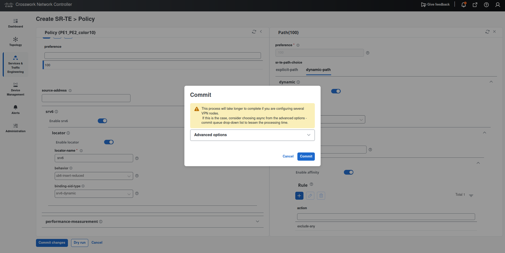

### Option 5-3-2: Import JSON

You can also configure the policy by loading a JSON file.
The sample JSON files were exported from the following screen.

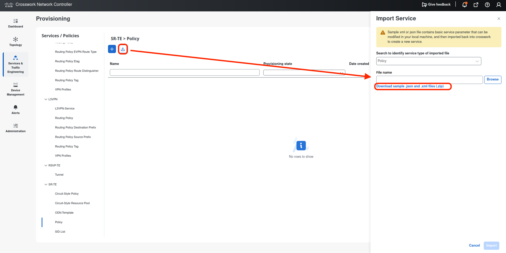

In this lab, load the JSON file prepared in advance by using the procedure below.

1. Open a terminal and clone the JSON file repository from Git.

    ```
    git clone https://github.com/mekawaba/cnc-payloads.git
    ```

    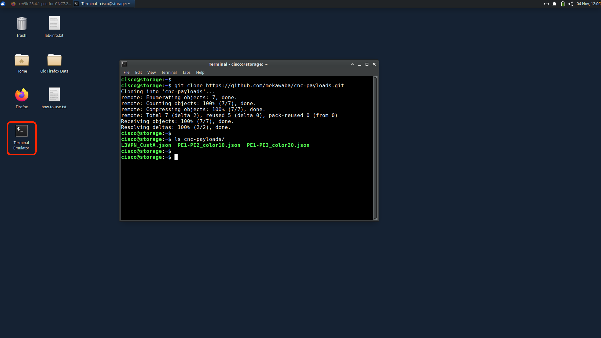

2. Load **Home > cnc-payloads > PE1-PE2_color10.json**.

    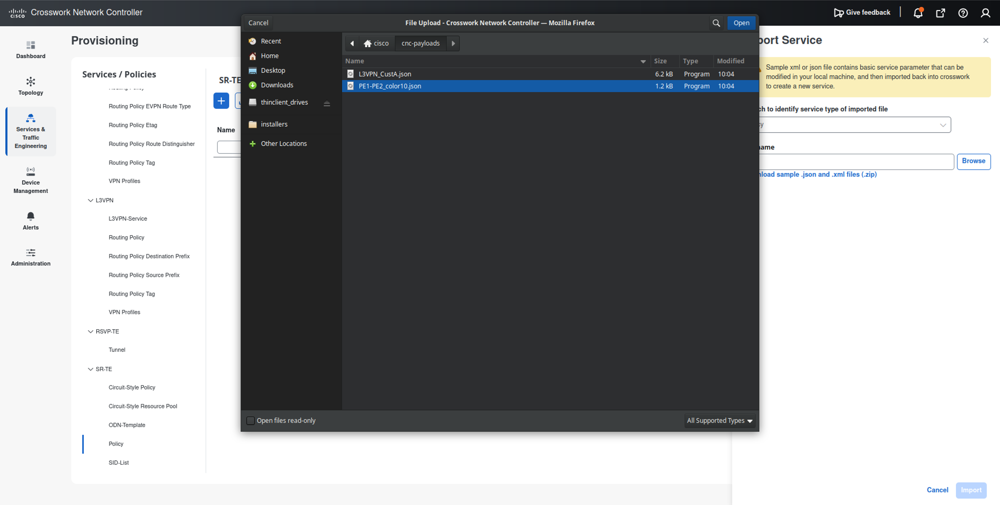

    ??? note "PE1-PE2_color10.json"
        ```json
        {
            "cisco-sr-te-cfp:sr-te": {
              "cisco-sr-te-cfp-sr-policies:policies": {
                "policy": [
                  {
                    "name": "PE1-PE2_color10",
                    "head-end": [
                      {
                        "name": "C8711-1-PE"
                      }
                    ],
                    "srv6": {
                      "locator": {
                        "locator-name": "srv6",
                        "behavior": "ub6-insert-reduced",
                        "binding-sid-type": "srv6-dynamic"
                      }
                    },
                    "tail-end": "2001:db8::2",
                    "color": 10,
                    "path": [
                      {
                        "preference": 100,
                        "dynamic": {
                          "constraints": {
                            "affinity": {
                              "rule": [
                                {
                                  "action": "exclude-any",
                                  "color": [
                                    "RED"
                                  ]
                                }
                              ]
                            }
                          },
                          "pce": {},
                          "metric-type": "igp"
                        }
                      }
                    ]
                  }
                ]
              }
            }
          }
        ```

3. Confirm that the following parameters are set.
    - name: `PE1-PE2_color10`
    - headend: C8711-1-PE
    - endpoint: 2001:db8::2
    - color: 10
    - preference: 100
    - st-te-path-choice: dynamic-path (enable `dynamic` and select `pce`)
    - metric-type: `igp`
    - constraints: enable `affinity` and add a rule with an action `exclude-any` color `RED`.
    - srv6: enable `locator` (locator-name: `srv6`, behavior: `ub6-insert-reduced`, and binding-sid-type: `srv6-dynamic`).

    
    

4. Click **Dry-run** to confirm the configuration. 

    

    You can switch the display by using **Show changes** in the upper right.
    

5. Click **Commit changes**.

    


## 5.4 Confirm PCC-initiated policy 1 (Exclude RED link)

### via CNC GUI

1. Click **PE1-PE2_color10**

    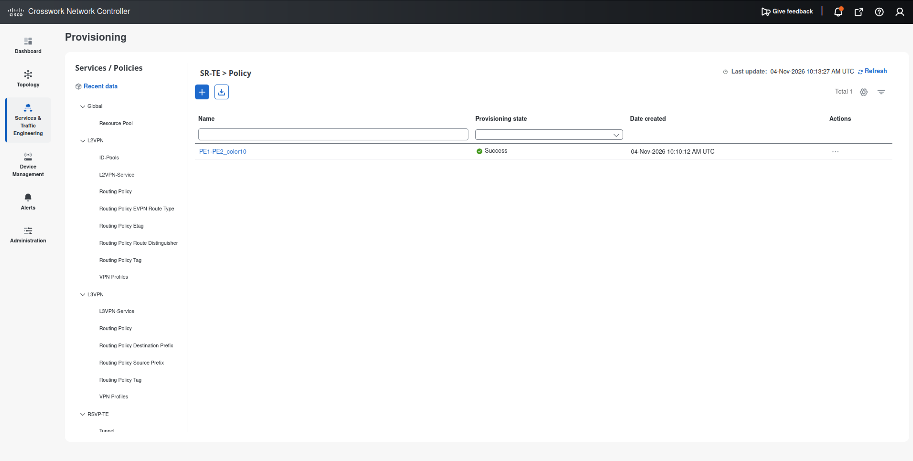

2. Confirm the details of the SR policy.

    As expected, the path avoids the RED link and goes through PE3.
    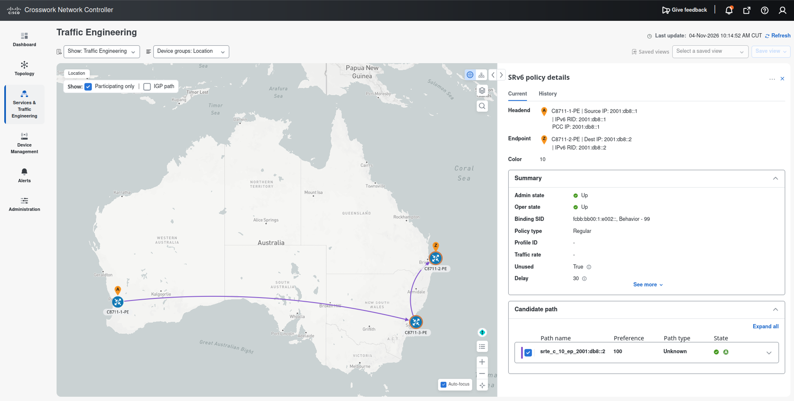

    In the IGP path, you can see that it goes through P5. In the Summary on the right, you can also confirm that the Admin state and Oper state are Up, and check the Binding SID.
    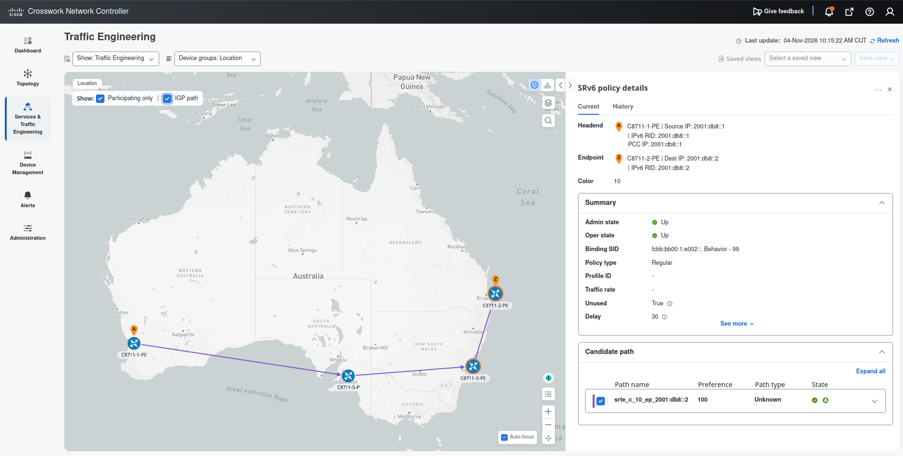

    In the Candidate path, you can see that the uN SIDs of PE3 and PE2 are included in the SID list.
    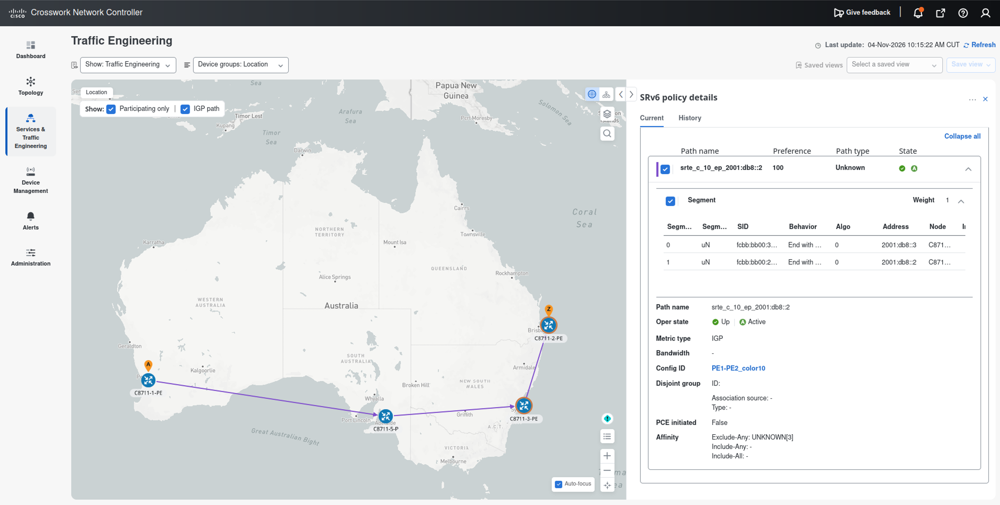

### via CLI

On PE1:

```text
RP/0/RP0/CPU0:C8711-1-PE#show segment-routing traffic-eng policy name srte_c_10_ep_2001:db8::2
Wed Nov  4 10:27:57.961 UTC

SR-TE policy database
---------------------

Color: 10, End-point: 2001:db8::2
  Name: srte_c_10_ep_2001:db8::2
  Status:
    Admin: up  Operational: up for 00:17:41 (since Nov  4 10:10:16.196)
  Candidate-paths:
    Preference: 100 (configuration) (active)
      Name: srte_c_10_ep_2001:db8::2
      Requested BSID: dynamic
      PCC info:
        Symbolic name: cfg_srte_c_10_ep_2001:db8::2_discr_100
        PLSP-ID: 2
      Constraints:
        Protection Type: protected-preferred
        Affinity:
          exclude-any:
          RED
        Maximum SID Depth: 7 
      Dynamic (pce 2001:db8::6) (valid)
        Metric Type: IGP (IANA PCEP/IGP: 1/0), Path Accumulated Metric: 30 
          SID[0]: fcbb:bb00:3::/48 Behavior: uN (PSP/USD) (48)
                  Format: f3216
                  LBL:32 LNL:16 FL:0 AL:80
                  Address: 2001:db8::3
          SID[1]: fcbb:bb00:2::/48 Behavior: uN (PSP/USD) (48)
                  Format: f3216
                  LBL:32 LNL:16 FL:0 AL:80
                  Address: 2001:db8::2
      SRv6 Information: 
        Locator: srv6
        Binding SID requested: Dynamic
        Binding SID behavior: uB6 (PSP/USD Insert.Red)
        Explicit binding SID enforced: No
        Install Final Node SID: No
  Attributes:
    Binding SID: fcbb:bb00:1:e002::
    Forward Class: Not Configured
    Steering labeled-services disabled: no
    Steering BGP disabled: no
    IPv6 caps enable: yes
    Invalidation drop enabled: no
    Max Install Standby Candidate Paths: 0
    Path Type: SRV6

RP/0/RP0/CPU0:C8711-1-PE#
RP/0/RP0/CPU0:C8711-1-PE#show segment-routing srv6 locator srv6 sid
Wed Nov  4 10:36:42.046 UTC
SID                         Behavior          Identification                    Owner               State  RW
--------------------------  ----------------  --------------------------------  ------------------  -----  --
fcbb:bb00:1::               uN (PSP/USD)      'default':1                       sidmgr              InUse  Y 
fcbb:bb00:1:e000::          uA (PSP/USD)      [FH0/0/0/0, Link-Local]:0         isis-1              InUse  Y 
fcbb:bb00:1:e001::          uA (PSP/USD)      [FH0/0/0/1, Link-Local]:0         isis-1              InUse  Y 
fcbb:bb00:1:e002::          uB6 (PSP/USD Insert.Red)  'srte_c_10_ep_2001:db8::2' (10, 2001:db8::2)  xtc_srv6            InUse  Y 
RP/0/RP0/CPU0:C8711-1-PE#
```

On the SR-PCE:

```
RP/0/RP0/CPU0:pce#show pce lsp detail
Wed Nov  4 10:33:48.887 UTC

PCE's tunnel database: 
----------------------
PCC 2001:db8::1: 

Tunnel Name: cfg_srte_c_10_ep_2001:db8::2_discr_100
Color: 10
Interface Name: srte_c_10_ep_2001:db8::2
 LSPs:
  LSP[0]:
   source 2001:db8::1, destination 2001:db8::2, tunnel ID 2, LSP ID 2
   State: Admin up, Operation active
   Setup type: SRv6
   Binding SID: fcbb:bb00:1:e002:: Behavior: uB6 (PSP/USD Insert.Red) (79)
                LBL:32 LNL:16 FL:16 AL:0
   Maximum SID Depth: 7
   Preference: 100
   Bandwidth: requested 0 kbps, applied 0 kbps
   Affinity: exclude-any 0x8 include-any 0x0 include-all 0x0
   Protection type: protected-preferred
   Prefix-SID algorithm: 0 (set: 0)
   PCEP information: 
     PLSP-ID 0x2, flags: D:1 S:0 R:0 A:1 O:2 C:0
   LSP Role: Single LSP
   State-sync PCE: None
   PCC: 2001:db8::1
   LSP is subdelegated to: None
   LSP is subdelegated over GRPC: None
   Reported path: 
     Metric type: IGP (1), Accumulated Metric 30
      SID[0]: fcbb:bb00:3:: Behavior: uN (PSP/USD) (48)
              LBL:32 LNL:16 FL:0 AL:80 Algo:0
              Address 2001:db8::3
      SID[1]: fcbb:bb00:2:: Behavior: uN (PSP/USD) (48)
              LBL:32 LNL:16 FL:0 AL:80 Algo:0
              Address 2001:db8::2
   Computed path: (Local PCE)
     Computed Time: Wed Nov 04 10:10:35 UTC 2026 (00:23:13 ago)
     Metric type: IGP (1), Accumulated Metric 30
      SID[0]: fcbb:bb00:3:: Behavior: uN (PSP/USD) (48)
              LBL:32 LNL:16 FL:0 AL:80 Algo:0
              Address 2001:db8::3
      SID[1]: fcbb:bb00:2:: Behavior: uN (PSP/USD) (48)
              LBL:32 LNL:16 FL:0 AL:80 Algo:0
              Address 2001:db8::2
   Reverse path: (Local PCE) 
     None 
     Computed Time: Wed Nov 04 10:10:35 UTC 2026 (00:23:13 ago)
   Recorded path: 
     None
   Disjoint Group Information: 
     None
   SR Policy Association Group:
     Color: 10, Endpoint: 2001:db8::2
     Policy Name: srte_c_10_ep_2001:db8::2
     Preference: 100
     CP Name: srte_c_10_ep_2001:db8::2
  
RP/0/RP0/CPU0:pce#
```

## 5.5 Create PCC-initiated policy 2 (TE metric)

First, configure a TE metric on the link between P5 and PE3.
```
segment-routing
 traffic-eng
  interface FourHundredGigE0/0/0/1
   metric 100
  !
 !
!
```

On the P5 and PE3:
```
RP/0/RP0/CPU0:C8711-5-P#conf t
Wed Nov  4 10:55:54.104 UTC
RP/0/RP0/CPU0:C8711-5-P(config)#segment-routing traffic-eng 
RP/0/RP0/CPU0:C8711-5-P(config-sr-te)#interface FourHundredGigE 0/0/0/1
RP/0/RP0/CPU0:C8711-5-P(config-sr-if)#metric 100
RP/0/RP0/CPU0:C8711-5-P(config-sr-if)#commit
Wed Nov  4 10:56:26.557 UTC
RP/0/RP0/CPU0:C8711-5-P(config-sr-if)#end
RP/0/RP0/CPU0:C8711-5-P#
```
```
RP/0/RP0/CPU0:C8711-3-PE#conf t
Wed Nov  4 10:57:27.819 UTC
RP/0/RP0/CPU0:C8711-3-PE(config)#segment-routing
RP/0/RP0/CPU0:C8711-3-PE(config-sr)#traffic-eng
RP/0/RP0/CPU0:C8711-3-PE(config-sr-te)#interface FourHundredGigE0/0/0/1
RP/0/RP0/CPU0:C8711-3-PE(config-sr-if)#metric 100
RP/0/RP0/CPU0:C8711-3-PE(config-sr-if)#commit
Wed Nov  4 10:57:34.299 UTC
RP/0/RP0/CPU0:C8711-3-PE(config-sr-if)#end
RP/0/RP0/CPU0:C8711-3-PE#
```

Then, go to **Device Management > Network Devices**, select **P5** and **PE3**, and choose **Sync-from devices to NSO**.

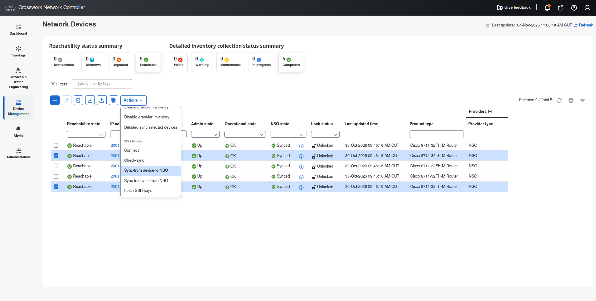

Configure an SRv6-TE policy with the following conditions:  

  - Policy Name: PE1-PE3_color20
  - Headend: PE1
  - Endpoint: PE3 
  - Optimization: TE
  - Constraint: None  

Since all links except the link between P5 and PE3 use the default cost, the path from PE1 to PE3 is computed as follows, avoiding the link between P5 and PE3.

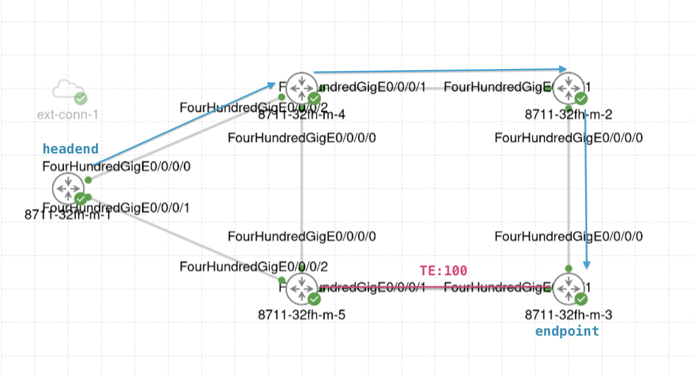

You can configure the policy using either of the following two methods.  
[Option 1: Manually configure parameters](#option-5-5-1-manually-configure-parameters)  
[Option 2: Import JSON](#option-5-5-2-import-json)  

### Option 5-5-1: Manually configure parameters

1. Go to **Services & Traffic Engineering > Traffic Engineering**, **SRv6** tab, then click **Create** > **PCC-init**.
    

2. Click the **+** button.
    

3. Set the following:
    - name: `PE1-PE3_color20`
    - headend: C8711-1-PE
    - tail-end: 2001:db8::3
    - color: 20
    - preference: 100
    - st-te-path-choice: dynamic-path (enable `dynamic` and select `pce`)
    - metric-type: `te`
    - srv6: enable `locator` (locator-name: `srv6`, behavior: `ub6-insert-reduced`, and binding-sid-type: `srv6-dynamic`).

    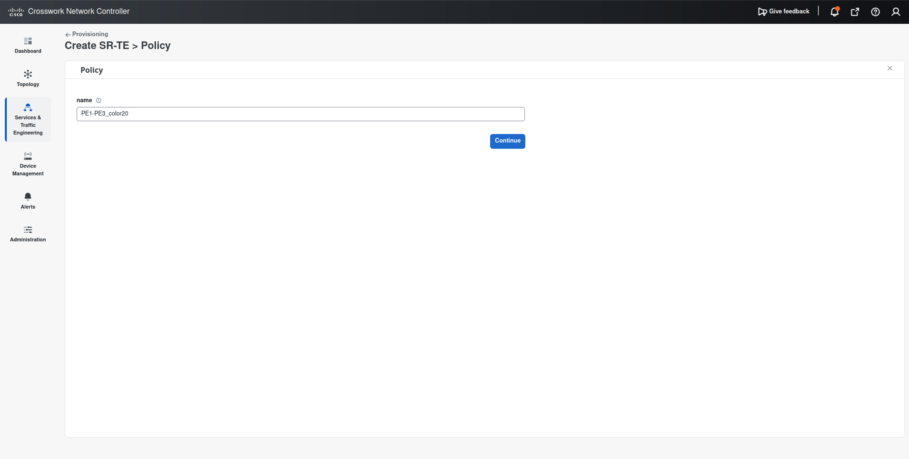
    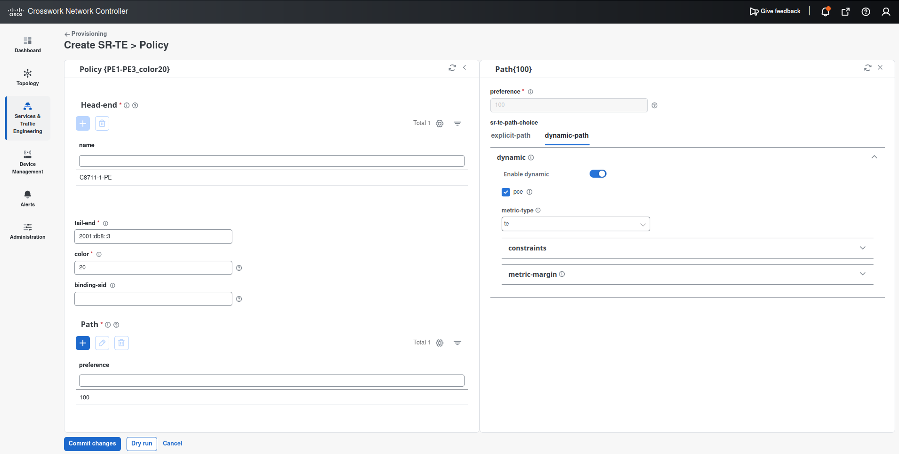
    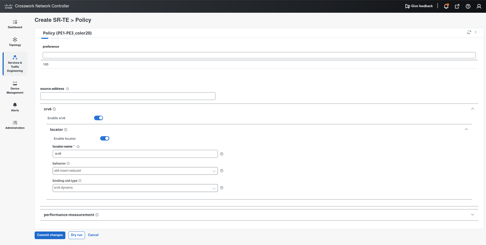

4. Click **Dry-run** to confirm the configuration. 

    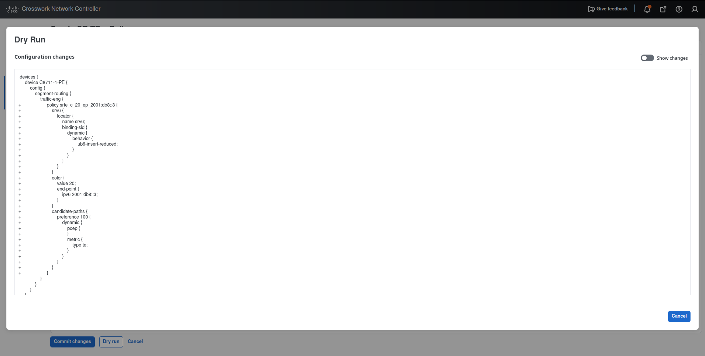

    You can switch the display by using **Show changes** in the upper right.
    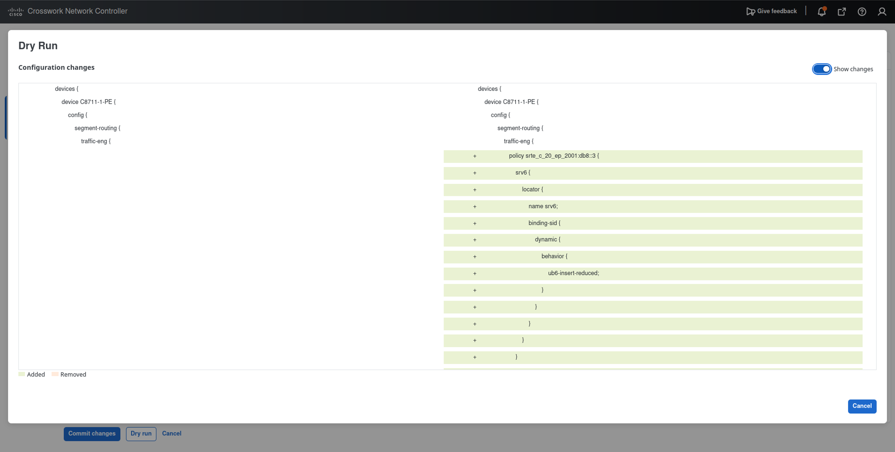

5. Click **Commit changes**.

    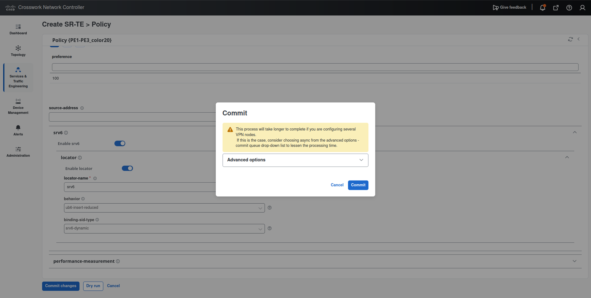

### Option 5-5-2: Import JSON

1. Load **Home > cnc-payloads > PE1-PE3_color20.json**.

    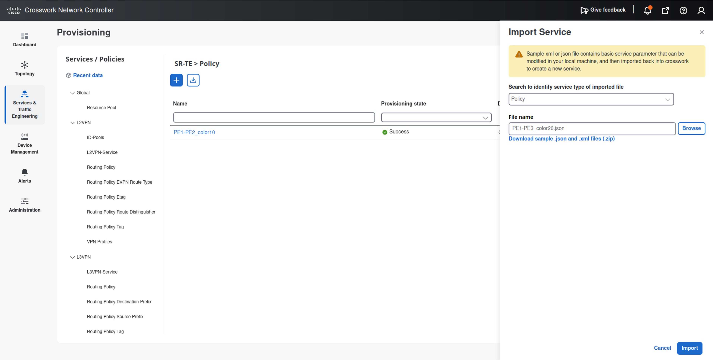

    ??? note "PE1-PE3_color20.json"
        ```json
        {
            "cisco-sr-te-cfp:sr-te": {
              "cisco-sr-te-cfp-sr-policies:policies": {
                "policy": [
                  {
                    "name": "PE1-PE3_color20",
                    "head-end": [
                      {
                        "name": "C8711-1-PE"
                      }
                    ],
                    "srv6": {
                      "locator": {
                        "locator-name": "srv6",
                        "behavior": "ub6-insert-reduced",
                        "binding-sid-type": "srv6-dynamic"
                      }
                    },
                    "tail-end": "2001:db8::3",
                    "color": 20,
                    "path": [
                      {
                        "preference": 100,
                        "dynamic": {
                          "pce": {},
                          "metric-type": "te"
                        }
                      }
                    ]
                  }
                ]
              }
            }
          }
        ```

2. Confirm that the following parameters are set.
    - name: `PE1-PE3_color20`
    - headend: C8711-1-PE
    - endpoint: 2001:db8::3
    - color: 20
    - preference: 100
    - st-te-path-choice: dynamic-path (enable `dynamic` and select `pce`)
    - metric-type: `te`
    - srv6: enable `locator` (locator-name: `srv6`, behavior: `ub6-insert-reduced`, and binding-sid-type: `srv6-dynamic`).

    
    

3. Click **Dry-run** to confirm the configuration. 

    

    You can switch the display by using **Show changes** in the upper right.
    

4. Click **Commit changes**.

    


## 5.6 Confirm PCC-initiated policy 2 (TE metric)

### via CNC GUI

1. Click **PE1-PE3_color20**

    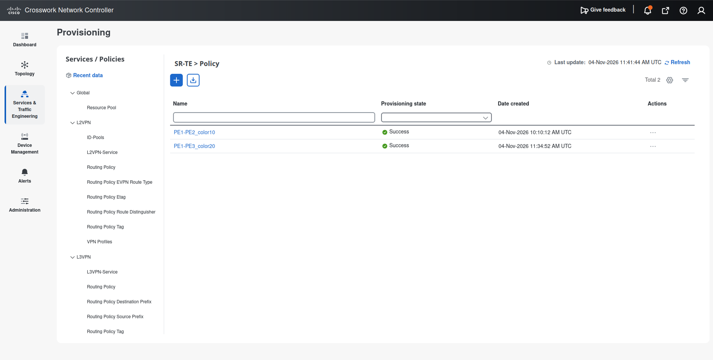

2. Confirm the details of the SR policy.

    As expected, the path avoids the link between P5 and PE3 and goes through PE2.
    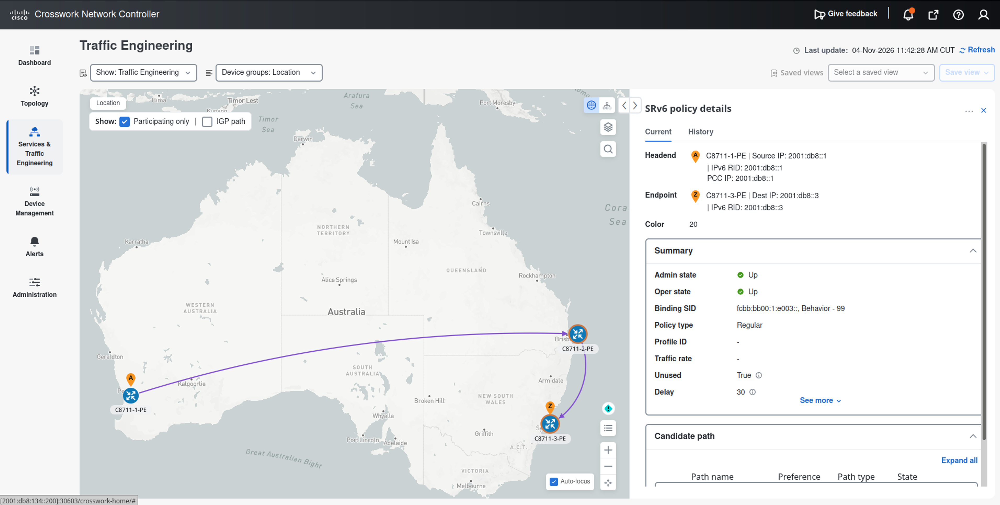

    In the IGP path, you can see that it goes through P4. In the Summary on the right, you can also confirm that the Admin state and Oper state are Up, and check the Binding SID.
    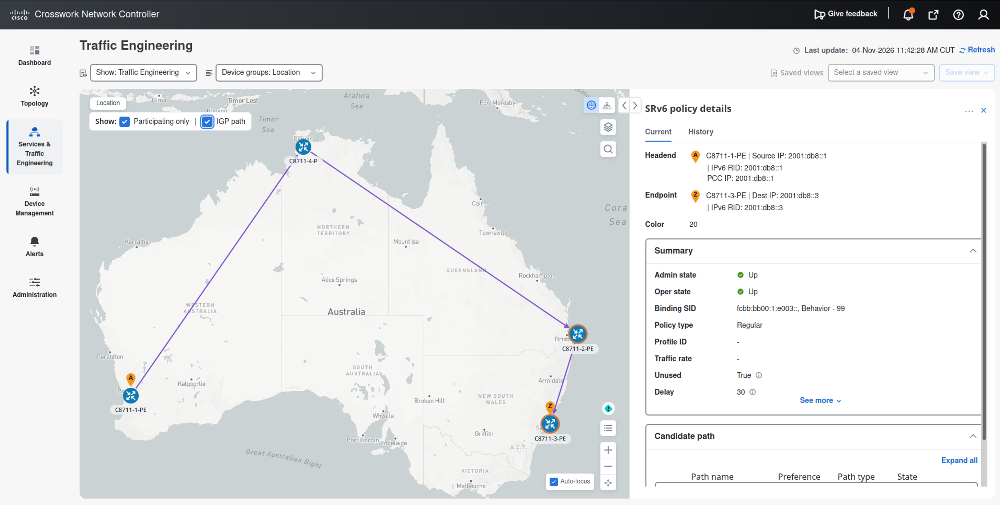

    In the Candidate path, you can see that the uN SIDs of PE2 and PE3 are included in the SID list.
    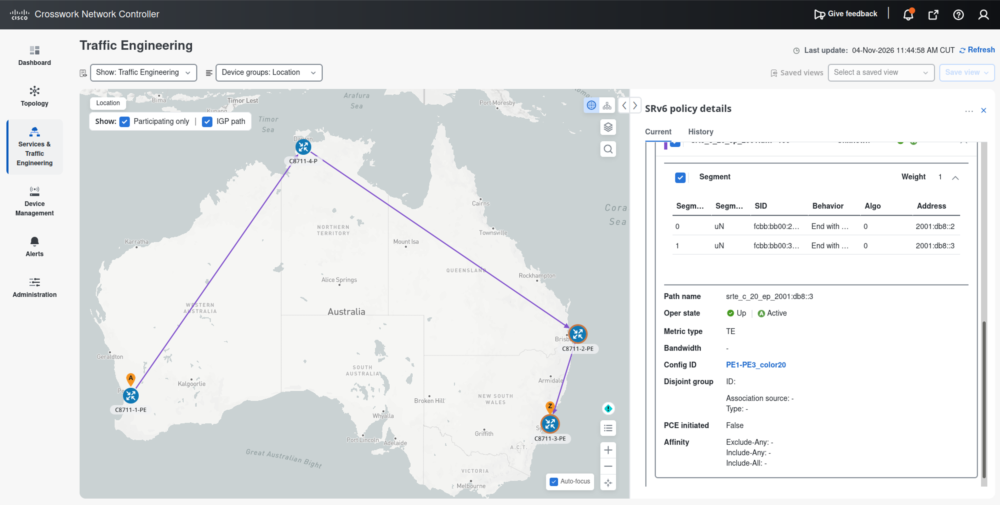

### via CLI

On PE1:

```text
RP/0/RP0/CPU0:C8711-1-PE#show segment-routing traffic-eng policy name srte_c_20_ep_2001:db8::3
Wed Nov  4 11:48:48.937 UTC

SR-TE policy database
---------------------

Color: 20, End-point: 2001:db8::3
  Name: srte_c_20_ep_2001:db8::3
  Status:
    Admin: up  Operational: up for 00:13:52 (since Nov  4 11:34:56.433)
  Candidate-paths:
    Preference: 100 (configuration) (active)
      Name: srte_c_20_ep_2001:db8::3
      Requested BSID: dynamic
      PCC info:
        Symbolic name: cfg_srte_c_20_ep_2001:db8::3_discr_100
        PLSP-ID: 4
      Constraints:
        Protection Type: protected-preferred
        Maximum SID Depth: 7 
      Dynamic (pce 2001:db8::6) (valid)
        Metric Type: TE (IANA PCEP/IGP: 2/2), Path Accumulated Metric: 30 
          SID[0]: fcbb:bb00:2::/48 Behavior: uN (PSP/USD) (48)
                  Format: f3216
                  LBL:32 LNL:16 FL:0 AL:80
                  Address: 2001:db8::2
          SID[1]: fcbb:bb00:3::/48 Behavior: uN (PSP/USD) (48)
                  Format: f3216
                  LBL:32 LNL:16 FL:0 AL:80
                  Address: 2001:db8::3
      SRv6 Information: 
        Locator: srv6
        Binding SID requested: Dynamic
        Binding SID behavior: uB6 (PSP/USD Insert.Red)
        Explicit binding SID enforced: No
        Install Final Node SID: No
  Attributes:
    Binding SID: fcbb:bb00:1:e003::
    Forward Class: Not Configured
    Steering labeled-services disabled: no
    Steering BGP disabled: no
    IPv6 caps enable: yes
    Invalidation drop enabled: no
    Max Install Standby Candidate Paths: 0
    Path Type: SRV6

RP/0/RP0/CPU0:C8711-1-PE#
RP/0/RP0/CPU0:C8711-1-PE#show segment-routing srv6 locator srv6 sid 
Wed Nov  4 11:49:49.059 UTC
SID                         Behavior          Identification                    Owner               State  RW
--------------------------  ----------------  --------------------------------  ------------------  -----  --
fcbb:bb00:1::               uN (PSP/USD)      'default':1                       sidmgr              InUse  Y 
fcbb:bb00:1:e000::          uA (PSP/USD)      [FH0/0/0/0, Link-Local]:0         isis-1              InUse  Y 
fcbb:bb00:1:e001::          uA (PSP/USD)      [FH0/0/0/1, Link-Local]:0         isis-1              InUse  Y 
fcbb:bb00:1:e002::          uB6 (PSP/USD Insert.Red)  'srte_c_10_ep_2001:db8::2' (10, 2001:db8::2)  xtc_srv6            InUse  Y 
fcbb:bb00:1:e003::          uB6 (PSP/USD Insert.Red)  'srte_c_20_ep_2001:db8::3' (20, 2001:db8::3)  xtc_srv6            InUse  Y 
RP/0/RP0/CPU0:C8711-1-PE#
```

On the SR-PCE:

```
RP/0/RP0/CPU0:pce#show pce lsp tabular 
Wed Nov  4 11:51:19.152 UTC
PCC            Tunnel Name     Color Source         Destination    TunID LSPID Admin Oper  
2001:db8::1    cfg_srte_c_10_e 10    2001:db8::1    2001:db8::2    2     2     up    active
2001:db8::1    cfg_srte_c_20_e 20    2001:db8::1    2001:db8::3    4     2     up    active
RP/0/RP0/CPU0:pce#
RP/0/RP0/CPU0:pce#
RP/0/RP0/CPU0:pce#show pce lsp detail                     
Wed Nov  4 11:52:06.452 UTC

PCE's tunnel database: 
----------------------
PCC 2001:db8::1: 

<--- omitted --->
  
Tunnel Name: cfg_srte_c_20_ep_2001:db8::3_discr_100
Color: 20
Interface Name: srte_c_20_ep_2001:db8::3
 LSPs:
  LSP[0]:
   source 2001:db8::1, destination 2001:db8::3, tunnel ID 4, LSP ID 2
   State: Admin up, Operation active
   Setup type: SRv6
   Binding SID: fcbb:bb00:1:e003:: Behavior: uB6 (PSP/USD Insert.Red) (79)
                LBL:32 LNL:16 FL:16 AL:0
   Maximum SID Depth: 7
   Preference: 100
   Bandwidth: requested 0 kbps, applied 0 kbps
   Protection type: protected-preferred
   Prefix-SID algorithm: 0 (set: 0)
   PCEP information: 
     PLSP-ID 0x4, flags: D:1 S:0 R:0 A:1 O:2 C:0
   LSP Role: Single LSP
   State-sync PCE: None
   PCC: 2001:db8::1
   LSP is subdelegated to: None
   LSP is subdelegated over GRPC: None
   Reported path: 
     Metric type: TE (2), Accumulated Metric 30
      SID[0]: fcbb:bb00:2:: Behavior: uN (PSP/USD) (48)
              LBL:32 LNL:16 FL:0 AL:80 Algo:0
              Address 2001:db8::2
      SID[1]: fcbb:bb00:3:: Behavior: uN (PSP/USD) (48)
              LBL:32 LNL:16 FL:0 AL:80 Algo:0
              Address 2001:db8::3
   Computed path: (Local PCE)
     Computed Time: Wed Nov 04 11:35:15 UTC 2026 (00:16:51 ago)
     Metric type: TE (2), Accumulated Metric 30
      SID[0]: fcbb:bb00:2:: Behavior: uN (PSP/USD) (48)
              LBL:32 LNL:16 FL:0 AL:80 Algo:0
              Address 2001:db8::2
      SID[1]: fcbb:bb00:3:: Behavior: uN (PSP/USD) (48)
              LBL:32 LNL:16 FL:0 AL:80 Algo:0
              Address 2001:db8::3
   Reverse path: (Local PCE) 
     None
     Computed Time: Wed Nov 04 11:35:15 UTC 2026 (00:16:51 ago)
   Recorded path: 
     None
   Disjoint Group Information: 
     None
   SR Policy Association Group:
     Color: 20, Endpoint: 2001:db8::3
     Policy Name: srte_c_20_ep_2001:db8::3
     Preference: 100
     CP Name: srte_c_20_ep_2001:db8::3
  
RP/0/RP0/CPU0:pce#
```

## Done when

- [ ] `PE1-PE2_color10` is up with color 10 and is displayed on the map.
- [ ] `PE1-PE3_color20` is up with color 20 and is displayed on the map.
