# 6. L3VPN provisioning

**Time:** 60 minutes.

**Objective:** Create one L3VPN from CNC. NSO renders the device configuration from the IETF L3VPN network model. Steer the VPN onto the PCC-initiated SRv6 policy from chapter 5.

## 6.1 What you are about to commit

| Field | Value |
| --- | --- |
| Service name | `CustA` |
| Endpoints | PE1, PE2, PE3 |
| Route distinguisher and route targets | 100:100 |
| Steering | `PE1-PE2_color10` |
| Transport | SRv6 |

## 6.2 Pre-check

MP-BGP configration is not supported by the Built-in Function Pack in CNC 7.2.  
Due to CML licensing constraints (limited to 5 devices), an RR is not used in this topology. Therefore, we will verify that MP-BGP is configured between full-mesh PEs.

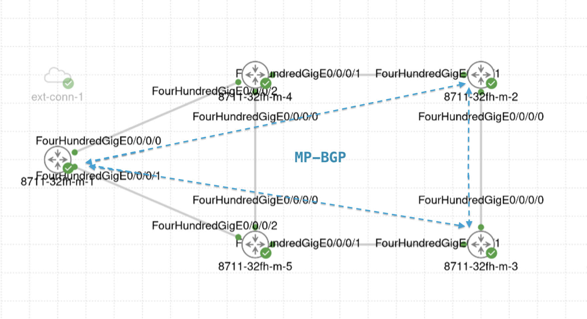

On the PEs:
<pre><code>
RP/0/RP0/CPU0:C8711-1-PE#show bgp vpnv4 unicast neighbors brief
Wed Nov  4 13:07:17.984 UTC

Neighbor         Spk    AS  Description                         Up/Down  NBRState
2001:db8::2       0 65000                                         5d03h <mark>Established</mark> 
2001:db8::3       0 65000                                         5d03h <mark>Established</mark> 
RP/0/RP0/CPU0:C8711-1-PE#
RP/0/RP0/CPU0:C8711-1-PE#show run router bgp
Wed Nov  4 13:07:27.597 UTC
router bgp 65000
 bgp router-id 1.1.1.1
 <mark>address-family vpnv4 unicast</mark>
 !
 address-family l2vpn evpn
 !
 address-family link-state link-state
 !
 neighbor-group ibgp
  remote-as 65000
  update-source Loopback0
  <mark>address-family vpnv4 unicast</mark>
  !
  address-family l2vpn evpn
  !
 !
 neighbor 2001:db8::2
  use neighbor-group ibgp
 !
 neighbor 2001:db8::3
  use neighbor-group ibgp
 !
 neighbor 2001:db8:1::56
  remote-as 65000
  address-family link-state link-state
  !
 !
!
</code></pre>


## 6.3 Create L3VPN service

Since there are many configuration parameters, we will load a JSON file to perform the L3VPN settings.

1. Go to **Services & Traffic Engineering > Provisioning (NSO)**, then click **L3VPN-Service**.

2. Load **Home > cnc-payloads > L3VPN_CustA.json**.

    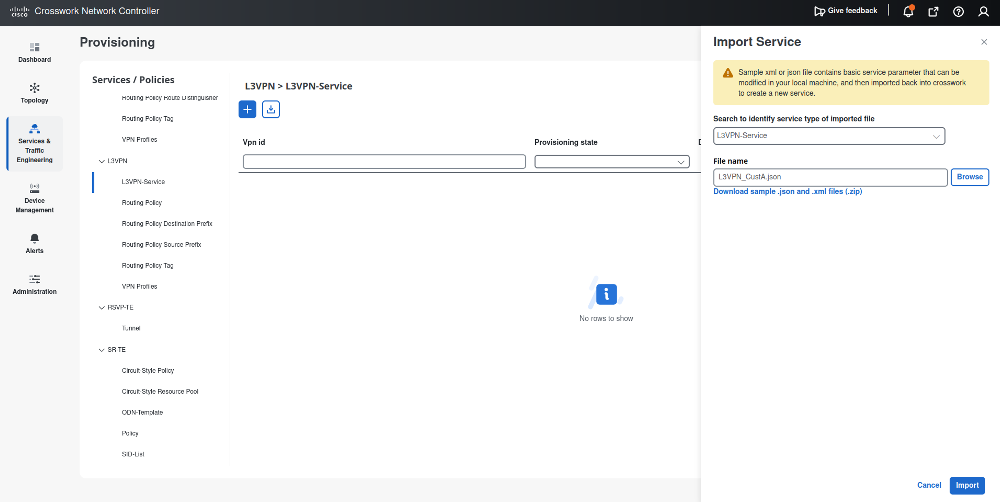

    ??? note "L3VPN_CustA.json"
        ```json
            {
            "ietf-l3vpn-ntw:l3vpn-ntw": {
                "vpn-services": {
                "vpn-service": [
                    {
                    "vpn-id": "CustA",
                    "vpn-service-topology": "ietf-vpn-common:custom",
                    "vpn-instance-profiles": {
                        "vpn-instance-profile": [
                        {
                            "profile-id": "default",
                            "rd": "0:100:100",
                            "address-family": [
                            {
                                "address-family": "ietf-vpn-common:ipv4",
                                "vpn-targets": {
                                "vpn-target": [
                                    {
                                    "id": 0,
                                    "route-targets": [
                                        {
                                        "route-target": "0:100:100"
                                        }
                                    ],
                                    "route-target-type": "both"
                                    }
                                ]
                                }
                            }
                            ],
                            "cisco-l3vpn-ntw:srv6": {
                            "address-family": [
                                {
                                "name": "ietf-vpn-common:ipv4",
                                "locator-name": "srv6"
                                }
                            ]
                            }
                        }
                        ]
                    },
                    "vpn-nodes": {
                        "vpn-node": [
                        {
                            "vpn-node-id": "C8711-1-PE",
                            "active-vpn-instance-profiles": {
                            "vpn-instance-profile": [
                                {
                                "profile-id": "default"
                                }
                            ]
                            },
                            "vpn-network-accesses": {
                            "vpn-network-access": [
                                {
                                "id": "0",
                                "interface-id": "FourHundredGigE0/0/0/2",
                                "connection": {
                                    "encapsulation": {
                                    "type": "ietf-vpn-common:dot1q",
                                    "dot1q": {
                                        "cvlan-id": 100
                                    }
                                    }
                                },
                                "ip-connection": {
                                    "ipv4": {
                                    "local-address": "192.168.1.1",
                                    "prefix-length": 24
                                    }
                                },
                                "routing-protocols": {
                                    "routing-protocol": [
                                    {
                                        "id": "0",
                                        "type": "ietf-vpn-common:direct-routing"
                                    }
                                    ]
                                }
                                }
                            ]
                            }
                        },
                        {
                            "vpn-node-id": "C8711-2-PE",
                            "active-vpn-instance-profiles": {
                            "vpn-instance-profile": [
                                {
                                "profile-id": "default"
                                }
                            ]
                            },
                            "vpn-network-accesses": {
                            "vpn-network-access": [
                                {
                                "id": "0",
                                "interface-id": "FourHundredGigE0/0/0/2",
                                "connection": {
                                    "encapsulation": {
                                    "type": "ietf-vpn-common:dot1q",
                                    "dot1q": {
                                        "cvlan-id": 100
                                    }
                                    }
                                },
                                "ip-connection": {
                                    "ipv4": {
                                    "local-address": "192.168.2.1",
                                    "prefix-length": 24
                                    }
                                },
                                "routing-protocols": {
                                    "routing-protocol": [
                                    {
                                        "id": "0",
                                        "type": "ietf-vpn-common:direct-routing"
                                    }
                                    ]
                                }
                                }
                            ]
                            }
                        },
                        {
                            "vpn-node-id": "C8711-3-PE",
                            "active-vpn-instance-profiles": {
                            "vpn-instance-profile": [
                                {
                                "profile-id": "default"
                                }
                            ]
                            },
                            "vpn-network-accesses": {
                            "vpn-network-access": [
                                {
                                "id": "0",
                                "interface-id": "FourHundredGigE0/0/0/2",
                                "connection": {
                                    "encapsulation": {
                                    "type": "ietf-vpn-common:dot1q",
                                    "dot1q": {
                                        "cvlan-id": 100
                                    }
                                    }
                                },
                                "ip-connection": {
                                    "ipv4": {
                                    "local-address": "192.168.3.1",
                                    "prefix-length": 24
                                    }
                                },
                                "routing-protocols": {
                                    "routing-protocol": [
                                    {
                                        "id": "0",
                                        "type": "ietf-vpn-common:direct-routing"
                                    }
                                    ]
                                }
                                }
                            ]
                            }
                        }
                        ]
                    },
                    "cisco-l3vpn-ntw:service-assurance": {
                        "monitoring-state": "enable",
                        "profile-name": "Gold_L3VPN_ConfigProfile system",
                        "rule-name": "Rule-L3VPN-NM system"
                    }
                    }
                ]
                }
            }
            }
        ```

3. Confirm that the following parameters are set.
    - vpn-id: `CustA`
    - vpn-service-topology: `custom`

    **vpn-instance-profile** (common configurations for all PEs)

    - profile-id: default
    - rd: 0:100:100
    - address-family: ipv4
    - route-target: 0:100:100
    - route-target-type: both
    - srv6: enable srv6 and set locator `srv6`

    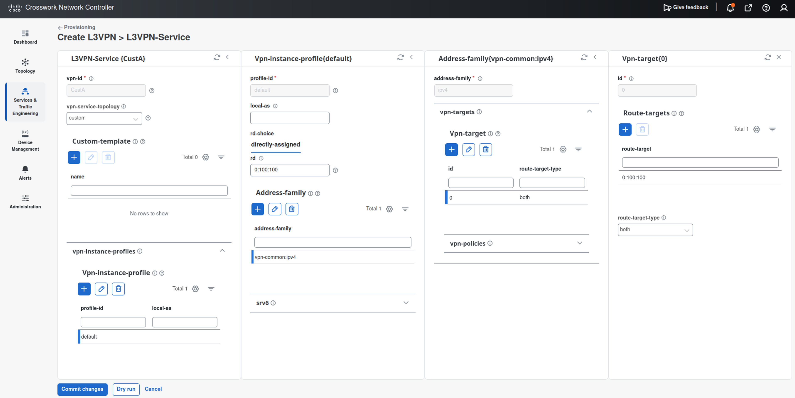  
    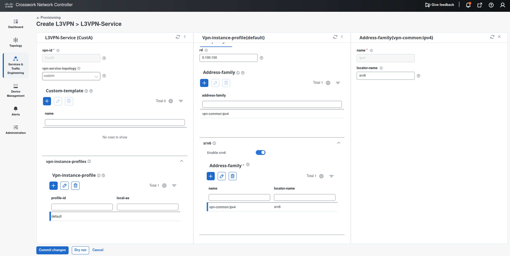

    - vpn-node: **C8711-1-PE**
    - vpn-instance-profile: default
    - vpn-network-access: FourHundredGigE0/0/0/2
    - encapsulation type: dot1q
    - cvlan-id: 100
    - ip-connection ipv4 
        - local-address: 192.168.**1**.1
        - prefix-length: 24
    - routing-protocol: direct-routing

    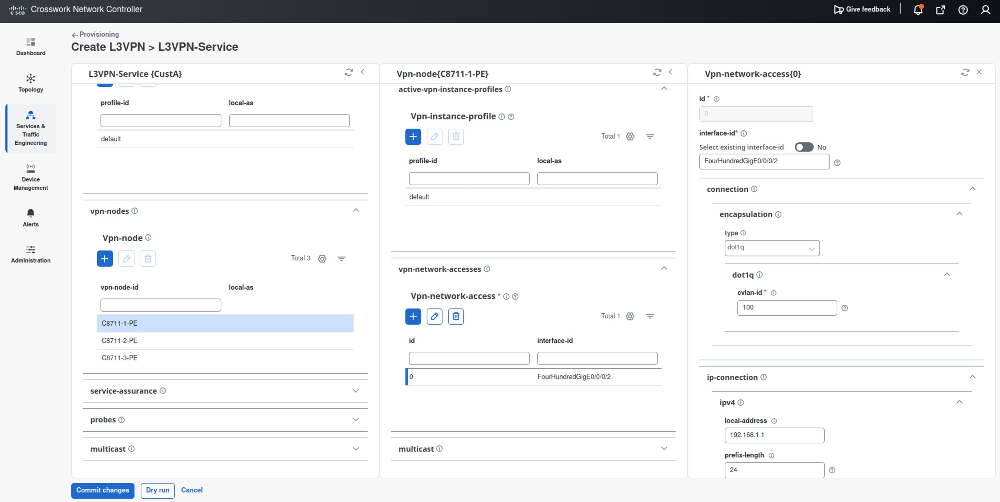
    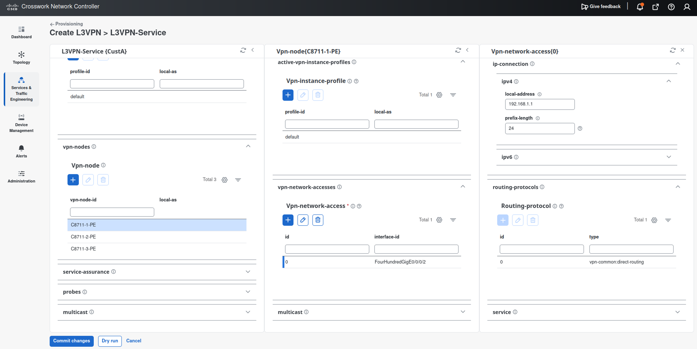

    - vpn-node: **C8711-2-PE**
    - vpn-instance-profile: default
    - vpn-network-access: FourHundredGigE0/0/0/2
    - encapsulation type: dot1q
    - cvlan-id: 100
    - ip-connection ipv4 
        - local-address: 192.168.**2**.1
        - prefix-length: 24
    - routing-protocol: direct-routing

    
    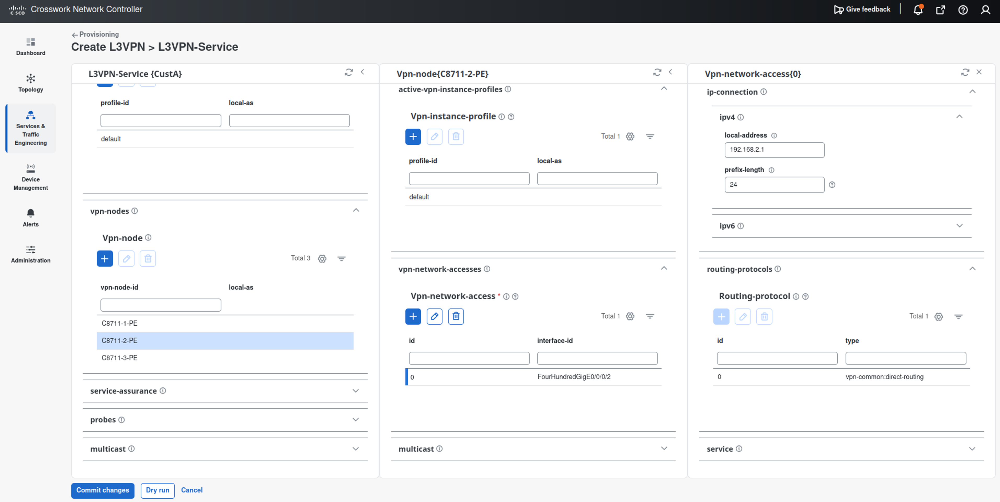

    - vpn-node: **C8711-3-PE**
    - vpn-instance-profile: default
    - vpn-network-access: FourHundredGigE0/0/0/2
    - encapsulation type: dot1q
    - cvlan-id: 100
    - ip-connection ipv4 
        - local-address: 192.168.**3**.1
        - prefix-length: 24
    - routing-protocol: direct-routing

    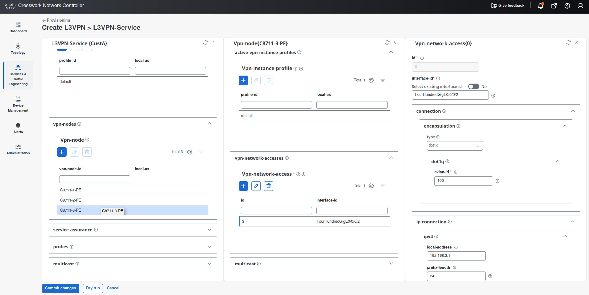
    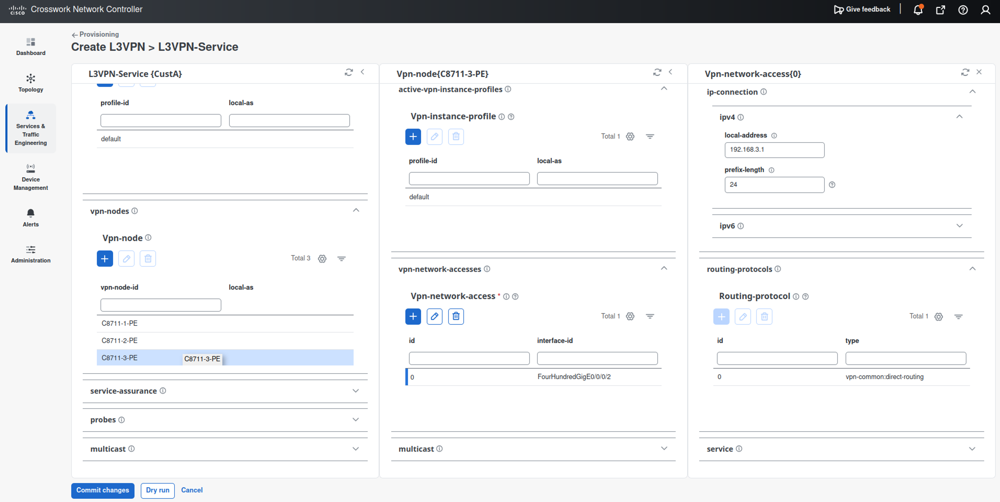

    **Service Assurance** 

    - enable `service-assurance`
    - monitoring state: enable
    - preservation: remove (delete all histrical data when stop monitoring)
    - profile-name: `Gold_L3VPN_ConfigProfile system`
    - rule-name: `Rule-L3VPN-NM system`

    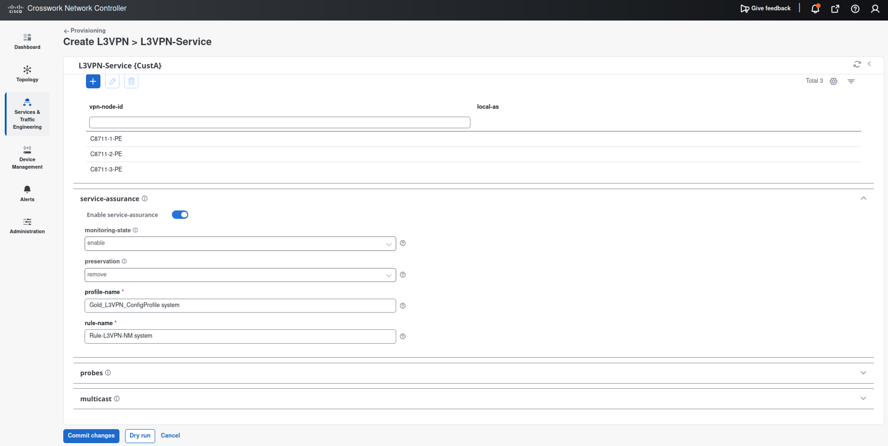

4. **Dry-run** to confirm the configuration. 

    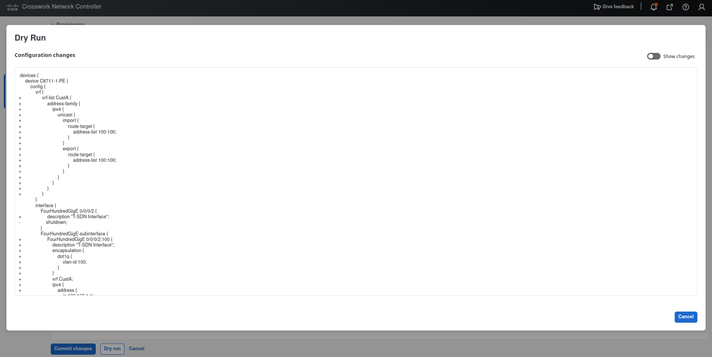

    You can switch the display with **Show changes** on the upper right.
    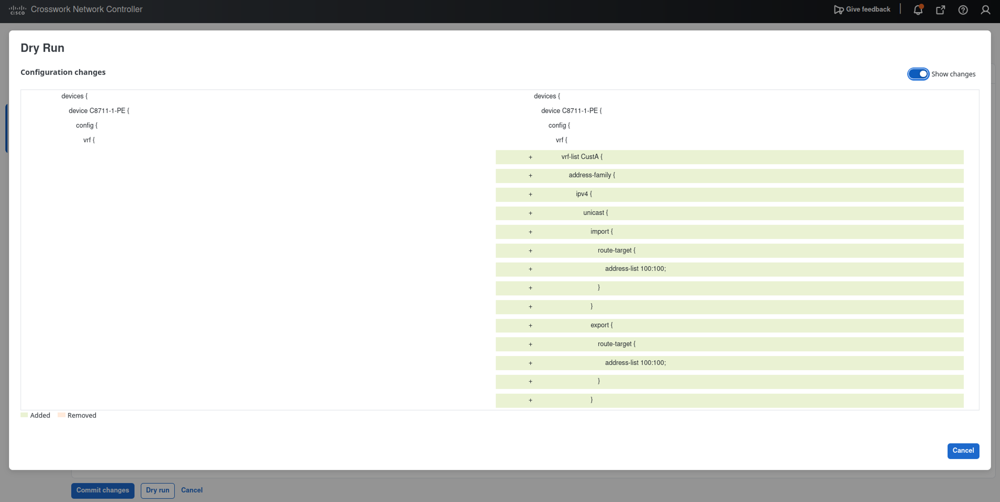

5. **Commit changes**

    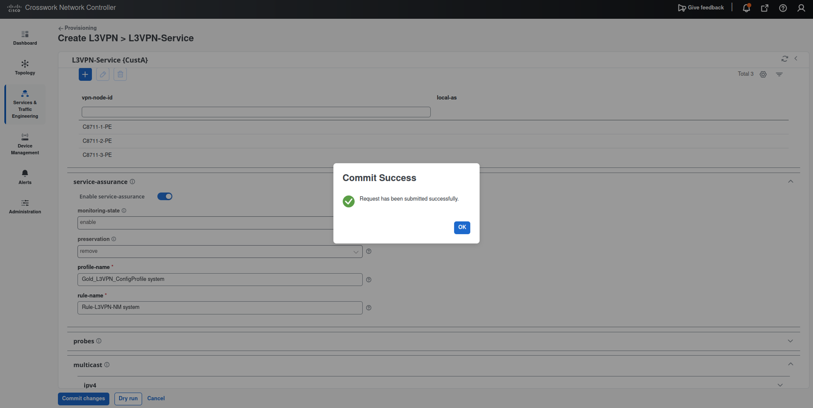


## 6.4 Confirmation of L3VPN

### via CNC GUI
1. Open **Services & Traffic Engineering > VPN Services**.
2. Select `CustA`.

    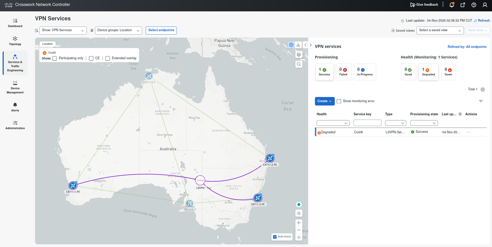

### via CLI

On the PEs:  
The uDT4 SID is assigned to `CustA`.
<pre><code>
RP/0/RP0/CPU0:C8711-1-PE#show segment-routing srv6 locator srv6 sid
Wed Nov  4 14:47:40.914 UTC
SID                         Behavior          Identification                    Owner               State  RW
--------------------------  ----------------  --------------------------------  ------------------  -----  --
fcbb:bb00:1::               uN (PSP/USD)      'default':1                       sidmgr              InUse  Y 
fcbb:bb00:1:e000::          uA (PSP/USD)      [FH0/0/0/0, Link-Local]:0         isis-1              InUse  Y 
fcbb:bb00:1:e001::          uA (PSP/USD)      [FH0/0/0/1, Link-Local]:0         isis-1              InUse  Y 
fcbb:bb00:1:e002::          uB6 (PSP/USD Insert.Red)  'srte_c_10_ep_2001:db8::2' (10, 2001:db8::2)  xtc_srv6            InUse  Y 
fcbb:bb00:1:e003::          uB6 (PSP/USD Insert.Red)  'srte_c_20_ep_2001:db8::3' (20, 2001:db8::3)  xtc_srv6            InUse  Y 
<mark>fcbb:bb00:1:e004::          uDT4              'CustA'                           bgp-65000           InUse  Y </mark>
RP/0/RP0/CPU0:C8711-1-PE#
</code></pre>

The customer routes for the remote PEs are being learned via MP-BGP.
```
RP/0/RP0/CPU0:C8711-1-PE#show  ip route vrf CustA
Wed Nov  4 14:48:09.301 UTC

<--- omitted --->

Gateway of last resort is not set

C    192.168.1.0/24 is directly connected, 00:11:14, FourHundredGigE0/0/0/2.100
L    192.168.1.1/32 is directly connected, 00:11:14, FourHundredGigE0/0/0/2.100
B    192.168.2.0/24 [200/0] via 2001:db8::2 (nexthop in vrf default), 00:11:13
B    192.168.3.0/24 [200/0] via 2001:db8::3 (nexthop in vrf default), 00:11:13
RP/0/RP0/CPU0:C8711-1-PE#
```

Looking at the CEF table from PE1 to the CE-facing interface address of PE2, it can be seen that customer packets are encapsulated with PE2's uDT4 SID.

<pre><code>RP/0/RP0/CPU0:C8711-1-PE#show cef vrf CustA 192.168.2.1
Wed Nov  4 14:48:53.148 UTC
192.168.2.0/24, version 3, SRv6 Headend, internal 0x5000001 0x30 (ptr 0x9e336dc8) [1], 0x0 (0x0), 0x0 (0x9f553a58)
 Updated Nov  4 14:37:08.702
 Prefix Len 24, traffic index 0, precedence n/a, priority 3
  gateway array (0xb5039098) reference count 1, flags 0x2010, source rib (7), 0 backups
                [1 type 3 flags 0x48441 (0x9e0fdf98) ext 0x0 (0x0)]
  LW-LDI[type=0, refc=0, ptr=0x0, sh-ldi=0x0]
  gateway array update type-time 1 Nov  4 14:37:08.702
 LDI Update time Nov  4 14:37:08.715

  Level 1 - Load distribution: 0
  [0] via fcbb:bb00:2::/128, recursive

   via fcbb:bb00:2::/128, 3 dependencies, recursive [flags 0x6000]
    path-idx 0 NHID 0x0 [0x9ea494b8 0x0]
    next hop VRF - 'default', table - 0xe0800000
    next hop fcbb:bb00:2::/128 via fcbb:bb00:2::/48
    SRv6 H.Encaps.Red SID-list {<mark>fcbb:bb00:2:e002::</mark>}
      SRv6 H.Insert.Red SID-list {}

    Load distribution: 0 (refcount 1)

    Hash  OK  Interface                 Address
    0     Y   FourHundredGigE0/0/0/0    fe80::26d:66ff:fe90:9010

RP/0/RP0/CPU0:C8711-1-PE#
</code></pre>

Looking at the CEF table from PE1 to the CE-facing interface address of PE3, it can be seen that customer packets are encapsulated with PE3's uDT4 SID.

<pre><code>
RP/0/RP0/CPU0:C8711-1-PE#show cef vrf CustA 192.168.3.1
Wed Nov  4 14:49:04.777 UTC
192.168.3.0/24, version 4, SRv6 Headend, internal 0x5000001 0x30 (ptr 0x9e336eb8) [1], 0x0 (0x0), 0x0 (0x9f553ab8)
 Updated Nov  4 14:37:08.713
 Prefix Len 24, traffic index 0, precedence n/a, priority 3
  gateway array (0xb5039198) reference count 1, flags 0x2010, source rib (7), 0 backups
                [1 type 3 flags 0x48441 (0x9e0fe058) ext 0x0 (0x0)]
  LW-LDI[type=0, refc=0, ptr=0x0, sh-ldi=0x0]
  gateway array update type-time 1 Nov  4 14:37:08.713
 LDI Update time Nov  4 14:37:08.713

  Level 1 - Load distribution: 0
  [0] via fcbb:bb00:3::/128, recursive

   via fcbb:bb00:3::/128, 3 dependencies, recursive [flags 0x6000]
    path-idx 0 NHID 0x0 [0x9ea4a3b8 0x0]
    next hop VRF - 'default', table - 0xe0800000
    next hop fcbb:bb00:3::/128 via fcbb:bb00:3::/48
    SRv6 H.Encaps.Red SID-list {<mark>fcbb:bb00:3:e002::</mark>}
      SRv6 H.Insert.Red SID-list {}

    Load distribution: 0 (refcount 1)

    Hash  OK  Interface                 Address
    0     Y   FourHundredGigE0/0/0/1    fe80::2d9:b8ff:fe11:c810

RP/0/RP0/CPU0:C8711-1-PE#
</code></pre>

Connectivity can also be checked via Ping.

```
RP/0/RP0/CPU0:C8711-1-PE#ping vrf CustA 192.168.2.1
Wed Nov  4 15:19:24.760 UTC
Type escape sequence to abort.
Sending 5, 100-byte ICMP Echos to 192.168.2.1 timeout is 2 seconds:
!!!!!
Success rate is 100 percent (5/5), round-trip min/avg/max = 6/9/13 ms
RP/0/RP0/CPU0:C8711-1-PE#
RP/0/RP0/CPU0:C8711-1-PE#ping vrf CustA 192.168.3.1
Wed Nov  4 15:19:32.993 UTC
Type escape sequence to abort.
Sending 5, 100-byte ICMP Echos to 192.168.3.1 timeout is 2 seconds:
!!!!!
Success rate is 100 percent (5/5), round-trip min/avg/max = 7/24/86 ms
RP/0/RP0/CPU0:C8711-1-PE#
```

## 6.5 Packet Capture (Option)

We will use the packet capture feature of CML to observe the encapsulation in an IPv6 header.

1. Start ping to the CE-facing interface address of `PE2` at `PE1`.
    ```
    RP/0/RP0/CPU0:C8711-1-PE# ping vrf CustA 192.168.2.1 count 100000
    ```

2. Right click the link between `P4` and `PE2`

3. Start a packet capture.

4. Click the ICMP echo from 192.168.1.1 to 192.168.2.1.

5. Find the IPv6 header. The destination address should be the PE2 uDT4 (ex. fcbb:bb00:2:e002::).

    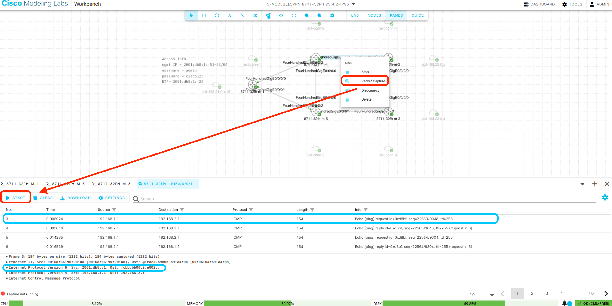


## Clean up

Before going to the chapter 7, please delete all L3VPN services because we use the same CE-facing interfaces for L2VPN provisionings.

1. Go to **Service & Traffic Engineering > Provisioning(NSO) > L3VPN-Service**

2. Click **Actions > Delete dry run**

    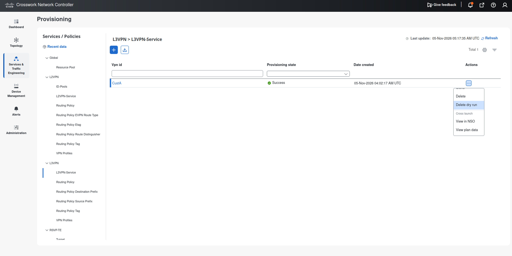

3. Confirm the dry-run result and click `Delete`

    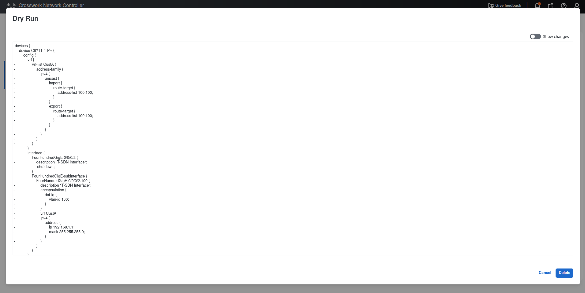


## Done when

- [ ] The `CustA` service provisioning is completed.
- [ ] The vrf ping between PEs is succeeed.
