# 7. L2VPN VPWS provisioning

**Time:** 60 minutes

**Objective:** Provision a point-to-point L2VPN (VPWS) from CNC.


CNC 7.2 provisions IETF L2VPN network models through NSO. VPWS is a wire between two attachment circuits. 

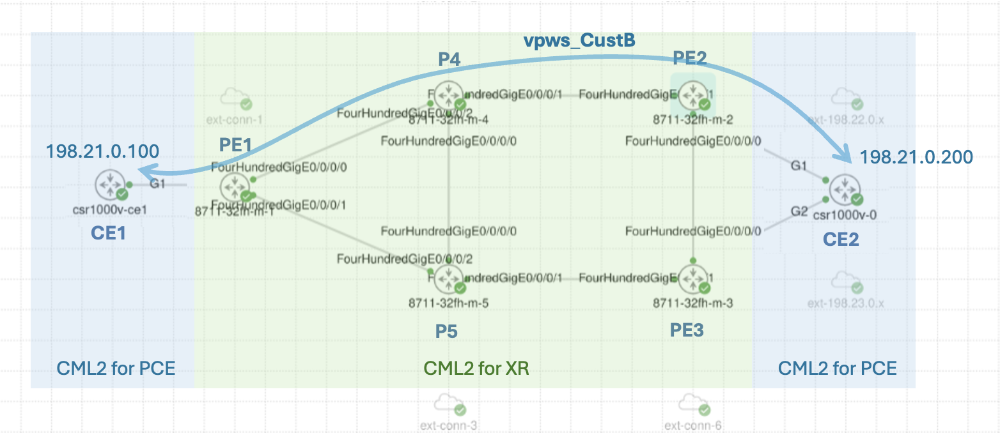

| Field | Value |
| --- | --- |
| Service name | `CustD_vpws` |
| vpn-type | point-to-point (vpws-evpn) |
| Endpoints | PE1, PE2 |
| Transport | SRv6, steering to SRv6 Policy with color 10 |

### 7.1 Pre-check (ID-Pools)

EVI IDs and Source/Target IDs can be automatically assigned from predefined pools. It is also possible to set fixed values.

In this instance, we will confirm that those pools are already configured.

1.	Resource Pools (the range of assignable values) are located under **Service & Traffic Engineering > Provisioning (NSO) > Global > Resource Pool**.

    - evi-id-pool: Pool for EVI IDs
    - evi-source-target-pool: Pool for Source/Target IDs

    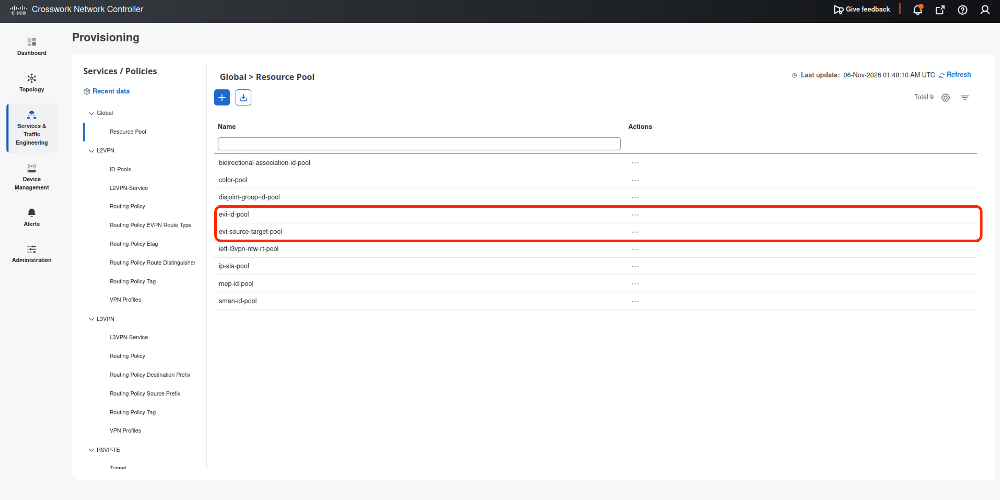

    By clicking Edit under Actions, you can see that the following values are set for each. Please close with Cancel after confirmation.

    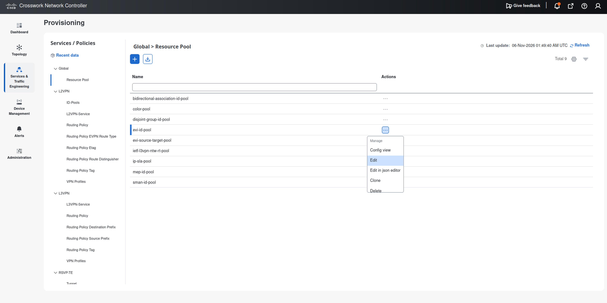

    - evi-id-pool: 100-500

    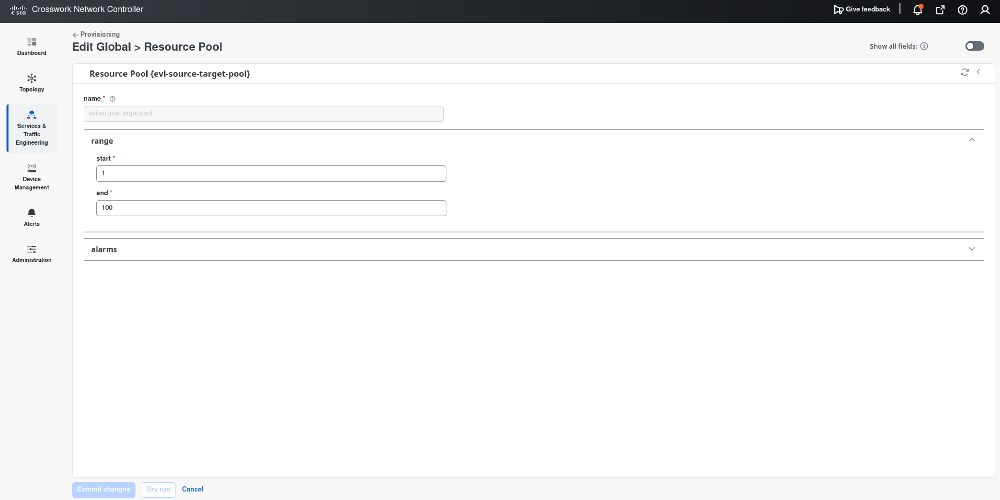

    - evi-source-target-pool: 1-100

    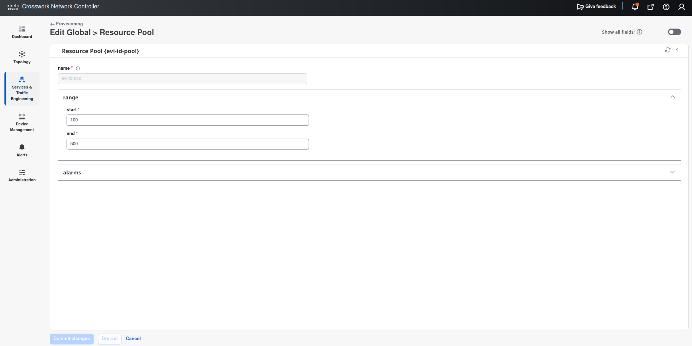

2. Confirm that these pools are used in the L2VPN configuration under **L2VPN > ID-Pools**.

    - evi-id-pool-name: evi-id-pool
    - evi-source-target-pool-name: evi-source-target-pool

    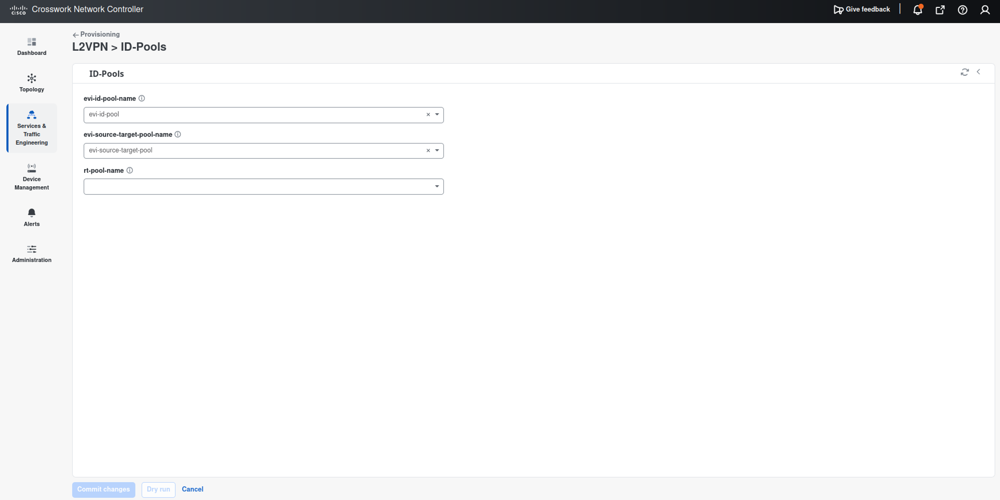


### 7.2 Pre-check (MP-BGP Configuration)

MP-BGP configuration is not performed within the built-in L2VPN service model. Therefore, ensure that this configuration is set up in advance and that the BGP Neighbor is up.

**PE1 (C8711-1-PE)**
<pre><code>
RP/0/RP0/CPU0:C8711-1-PE#show run router bgp
Fri Nov  6 06:20:18.478 UTC
router bgp 65000
 bgp router-id 1.1.1.1
 address-family vpnv4 unicast
 !
 <mark>address-family l2vpn evpn</mark>
 !
 address-family link-state link-state
 !
 neighbor-group ibgp
  remote-as 65000
  update-source Loopback0
  address-family vpnv4 unicast
  !
  <mark>address-family l2vpn evpn</mark>
  !
 !
 neighbor 2001:db8::2
  use neighbor-group ibgp
 !
 neighbor 2001:db8::3
  use neighbor-group ibgp
 !
 neighbor 2001:db8:1::56
  remote-as 65000
  address-family link-state link-state
  !
 !
!
</code></pre>

<pre><code>
RP/0/RP0/CPU0:C8711-1-PE#show bgp l2vpn evpn neighbors brief
Fri Nov  6 06:20:52.752 UTC

Neighbor         Spk    AS  Description                         Up/Down  NBRState
2001:db8::2       0 65000                                         6d20h <mark>Established</mark>
2001:db8::3       0 65000                                         6d20h <mark>Established</mark>
RP/0/RP0/CPU0:C8711-1-PE#
</code></pre>

### 7.3 Pre-configuration (CEs)

The CEs exist in `CML for PCE` (a different CML instance from the P/PE routers).
Please open `CML for PCE` from the Firefox Bookmark Bar. 

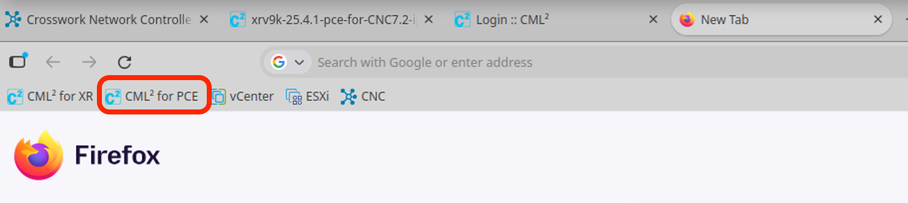

Then, select the lab `xrv9k-25.4.1-pce-for-CNC7.2-ipv6`.

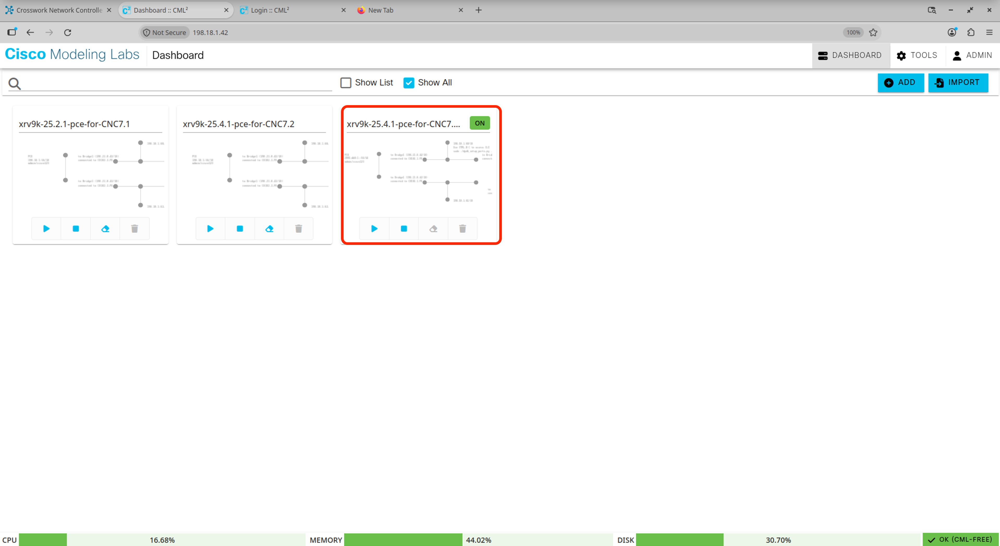

CE1 is named `csr1000v-ce1`, and CE2 is named `csr1000v-0` in the CML.

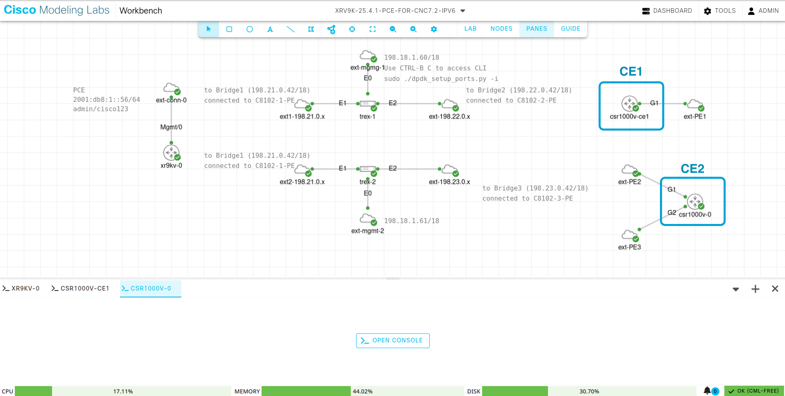


**CE1 (CSR1000V-CE1)**

Confirm that `198.21.0.100` is already configured on interface `Gi1` facing PE1 on the CE1 side.

<pre><code>
ce1>en
ce1#show run int GigabitEthernet 1
Building configuration...

Current configuration : 121 bytes
!
interface GigabitEthernet1
 <mark>ip address 198.21.0.100 255.255.255.0</mark>
 negotiation auto
 no mop enabled
 no mop sysid
end

ce1#
</code></pre>

**CE2 (CSR1000V-0)**

Please clear the configuration of the interface `Gi1` on the CE2 side facing PE2, and reconfigure it with `198.21.0.200`.

<pre><code>
ce2>en
ce2#conf t
ce2(config)#default interface Gi 1
Interface GigabitEthernet1 set to default configuration
ce2(config)#interface GigabitEthernet 1
ce2(config-if)#ip address 198.21.0.<mark>200</mark> 255.255.255.0
ce2(config-if)#end
ce2#
</code></pre>


### 7.4 Pre-configuration (Route-Policy)

Steer VPWS traffic to the SRv6 policy "PE1-PE2_Color10" created in Chapter 5. 

To do this, add a route-policy and configure MP-BGP to attach the extended community: color 10 to all EVPN advertisements.

Since no Color 10 SR policy is currently configured on devices other than PE1, incoming customer packets on PE2 will be forwarded via the IGP shortest path.

### 7.4.1 Routing Policy Tag

1. Go to **Services & Traffic Engineering > Provisioning (NSO)**, then click **L2VPN > Routing Policy Tag**.

2. Add a routing policy tag with the following parameters.

    - name: COLOR_10
    - tag-value: 10

    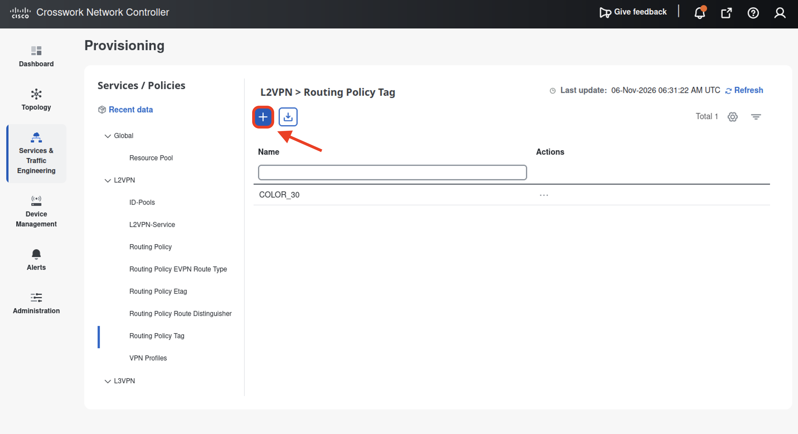
    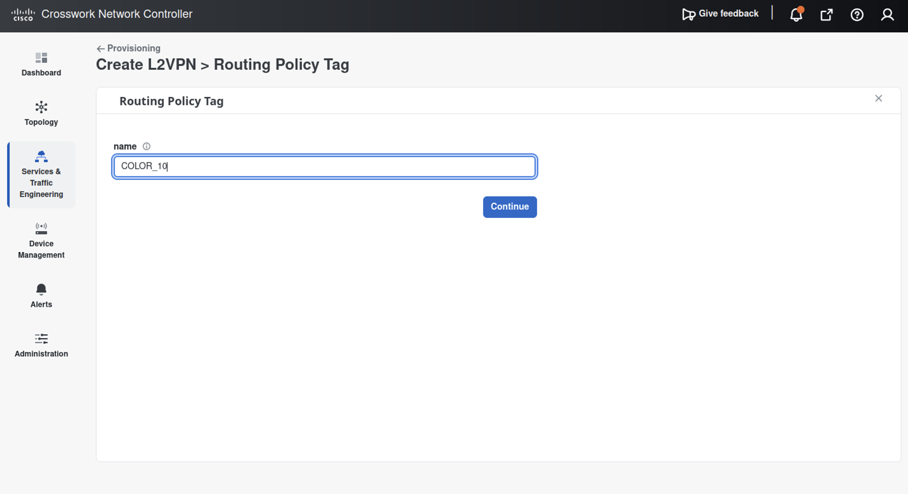
    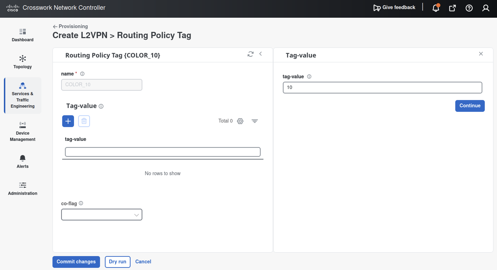

3. Commit changes


### 7.4.2 Routing Policy

1. Go to **L2VPN > Routing Policy**.

2. Add a routing policy with the following parameters.

    - name: POLICY1
    - statement name: statement1
    - actions
        - bgp-actions
            - enable `bgp-actions`
            - enable `set-ext-community`
            - ext-community-set-ref: COLOR_10

    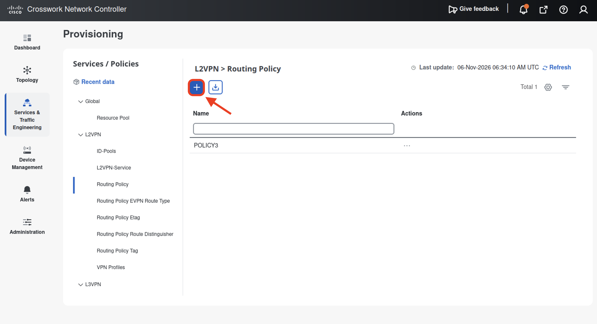
    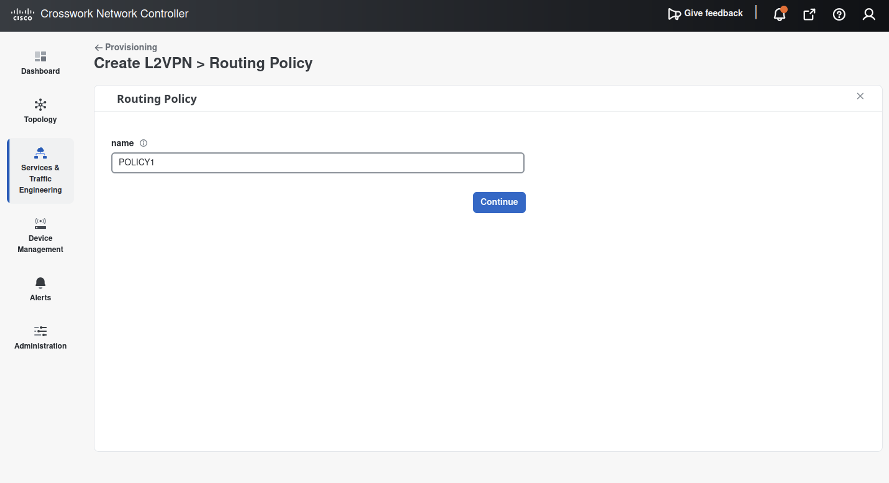
    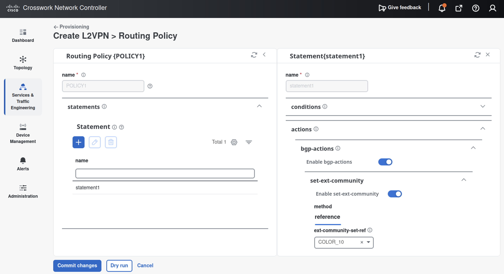

3. Commit changes


### 7.5 VPWS Provisioining

1. Go to **Services & Traffic Engineering > Provisioning (NSO)**, then click **L2VPN-Service**.

2. Load **Home > cnc-payloads > VPWS_CustB.json**.

    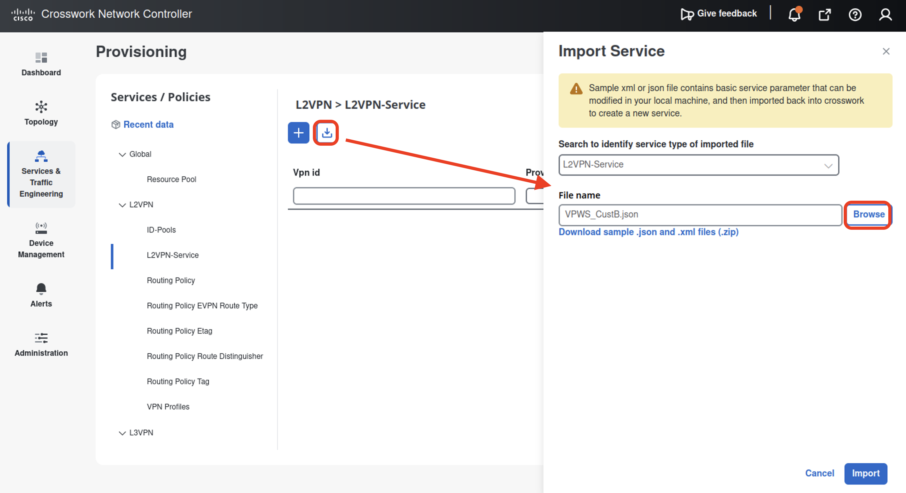

    ??? note "VPWS_CustB.json"
        ```json
            {
            "ietf-l2vpn-ntw:l2vpn-ntw": {
                "vpn-services": {
                "vpn-service": [
                    {
                    "vpn-id": "CustB_vpws",
                    "vpn-type": "ietf-vpn-common:vpws-evpn",
                    "vpn-nodes": {
                        "vpn-node": [
                        {
                            "vpn-node-id": "C8711-1-PE",
                            "vpn-network-accesses": {
                            "vpn-network-access": [
                                {
                                "id": "0",
                                "interface-id": "FourHundredGigE0/0/0/2",
                                "connection": {
                                    "encapsulation": {
                                    "encap-type": "ietf-vpn-common:untagged-int"
                                    }
                                }
                                }
                            ]
                            },
                            "cisco-l2vpn-ntw:te-service-mapping": {
                            "srv6": {
                                "locator": "srv6"
                            },
                            "te-mapping": {
                                "odn": {
                                "route-policy": [
                                    "POLICY1"
                                ]
                                }
                            }
                            }
                        },
                        {
                            "vpn-node-id": "C8711-2-PE",
                            "vpn-network-accesses": {
                            "vpn-network-access": [
                                {
                                "id": "0",
                                "interface-id": "FourHundredGigE0/0/0/2",
                                "connection": {
                                    "encapsulation": {
                                    "encap-type": "ietf-vpn-common:untagged-int"
                                    }
                                }
                                }
                            ]
                            },
                            "cisco-l2vpn-ntw:te-service-mapping": {
                            "srv6": {
                                "locator": "srv6"
                            },
                            "te-mapping": {
                                "odn": {
                                "route-policy": [
                                    "POLICY1"
                                ]
                                }
                            }
                            }
                        }
                        ]
                    },
                    "cisco-l2vpn-ntw:auto-evi-id": [
                        null
                    ],
                    "cisco-l2vpn-ntw:auto-evi-source": [
                        null
                    ],
                    "cisco-l2vpn-ntw:auto-evi-target": [
                        null
                    ],
                    "cisco-l2vpn-ntw:service-assurance": {
                        "monitoring-state": "enable",
                        "profile-name": "Gold_L2VPN_ConfigProfile system",
                        "rule-name": "Rule-L2VPN-NM system"
                    }
                    }
                ]
                }
            }
            }
        ```

3. Confirm that the following parameters are set.
    - vpn-id: `CustB_vpws`
    - vpn-type: `vpws-evpn`

    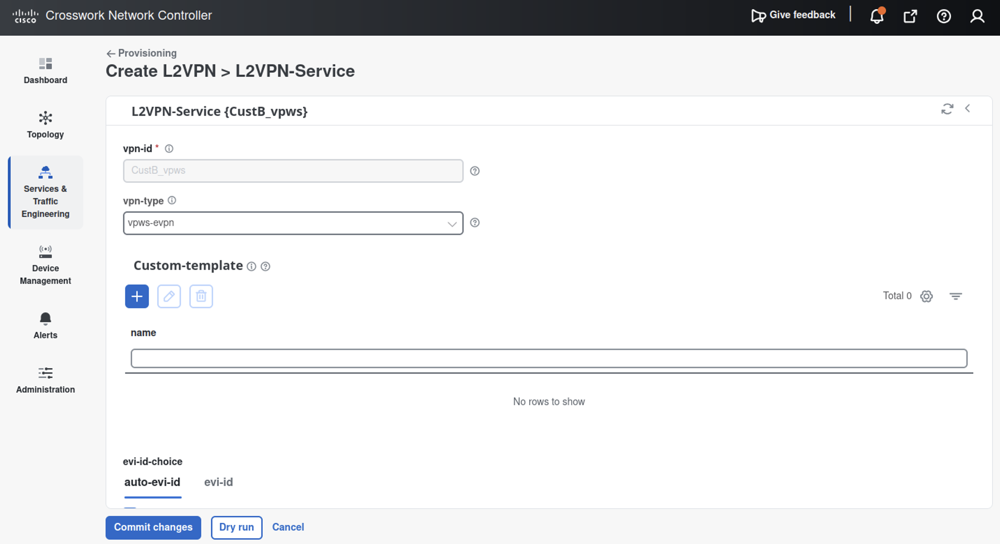

    - auto-evi-id: enabled
    - auto-evi-source: enabled
    - auto-evi-target: enabled

    (With these settings, EVI IDs and Source/Target IDs are automatically assigned from predefined pools.)

    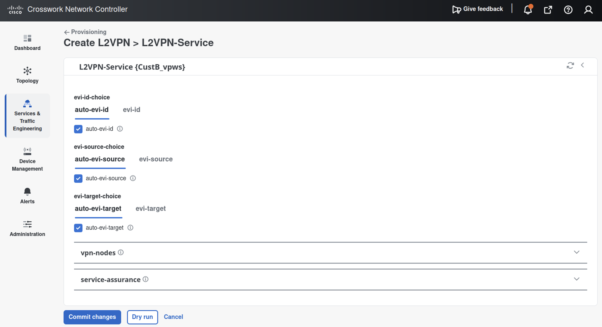

    - vpn-node: **C8711-1-PE**
    - vpn-network-access: FourHundredGigE0/0/0/2
    - encap-type: untagged-int
    - srv6 locator: `srv6`
    - te-mapping: odn policy `POLICY1`

    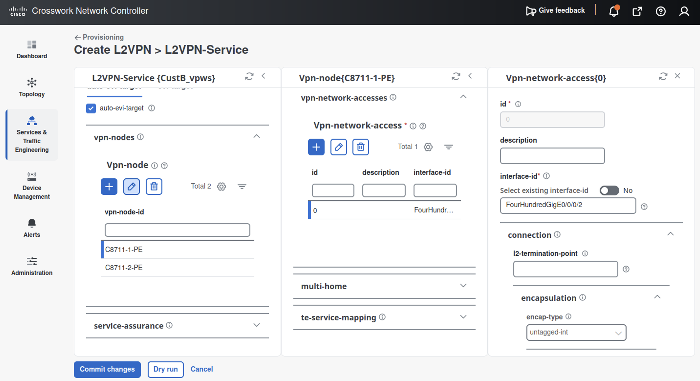
    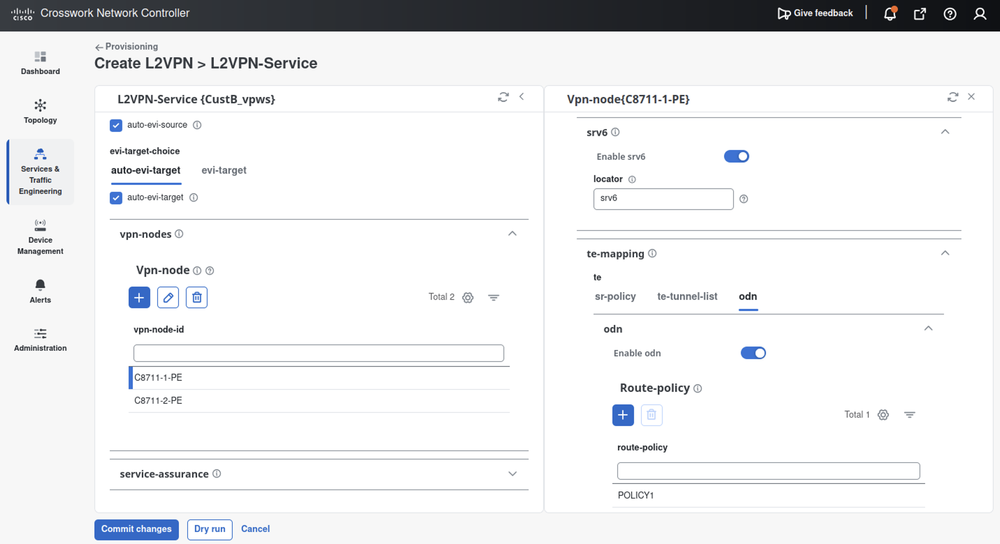

    - vpn-node: **C8711-2-PE**
    - vpn-network-access: FourHundredGigE0/0/0/2
    - encap-type: untagged-int
    - srv6 locator: `srv6`
    - te-mapping: odn policy `POLICY1`

    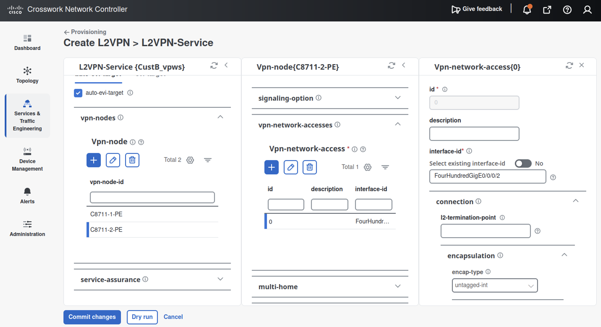
    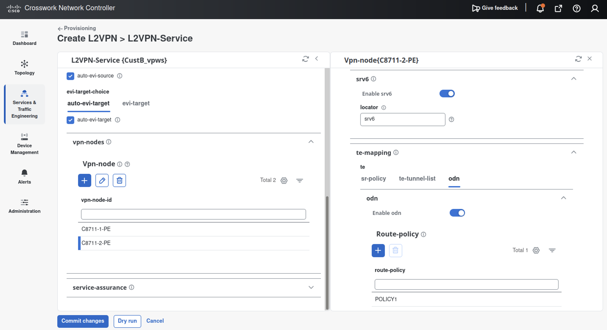

    **Service Assurance** 

    - enable `service-assurance`
    - monitoring state: enable
    - preservation: remove (delete all histrical data when stop monitoring)
    - profile-name: `Gold_L2VPN_ConfigProfile system`
    - rule-name: `Rule-L2VPN-NM system`

    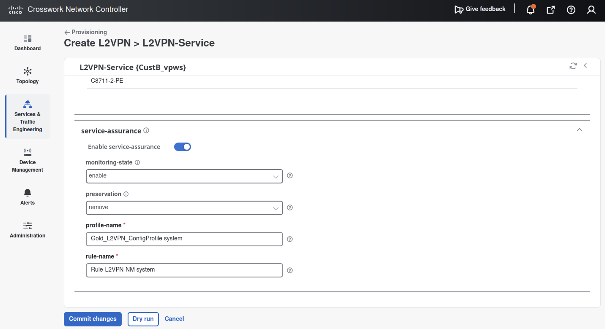

4. **Dry-run** to confirm the configuration. 

    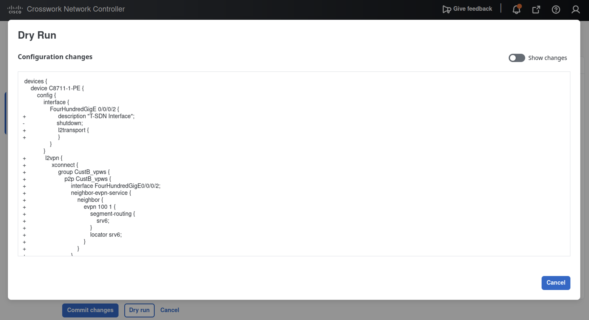

    You can switch the display with **Show changes** on the upper right.
    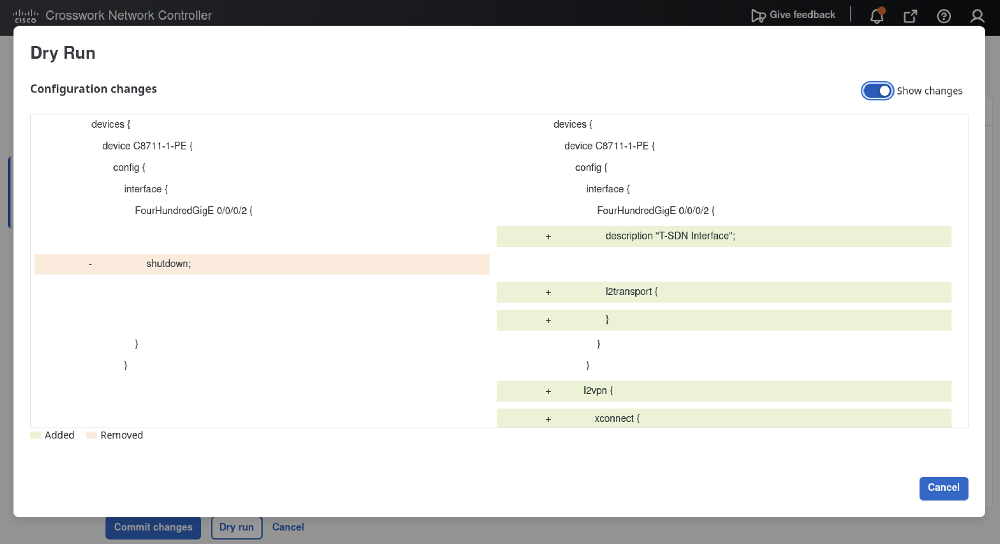

5. **Commit changes**

    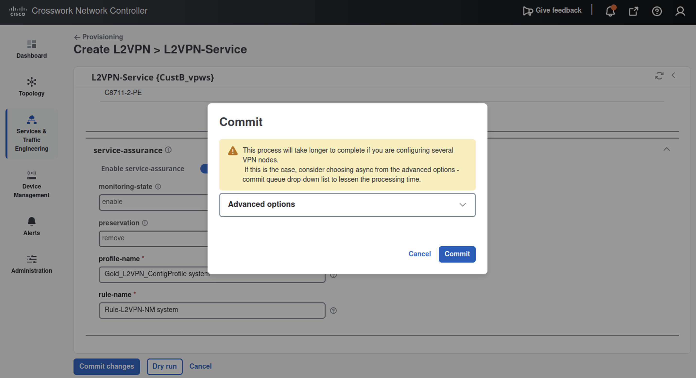


## 7.6 Confirmation of L2VPN

### via CNC GUI
1. Open **Services & Traffic Engineering > VPN Services**.
2. Select `CustB_vpws`.

    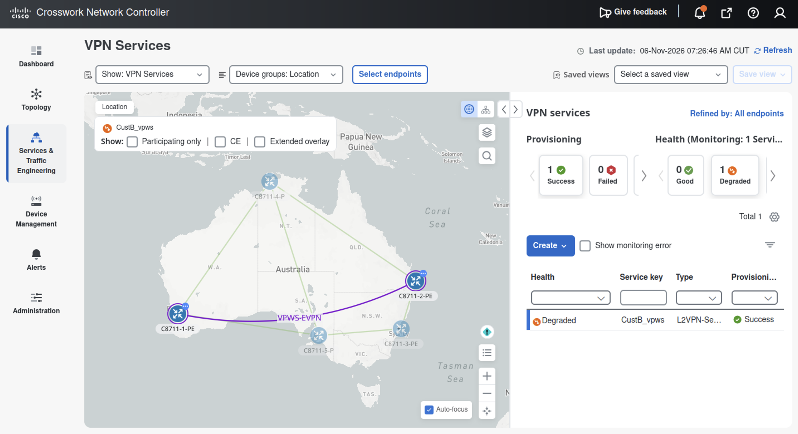


### via CLI

On the PE1/PE2:  

The uDX2 SID is assigned to `CustB_vpws`.

<pre><code>
RP/0/RP0/CPU0:C8711-1-PE#show segment-routing srv6 locator srv6 sid
Fri Nov  6 08:20:24.085 UTC
SID                         Behavior          Identification                    Owner               State  RW
--------------------------  ----------------  --------------------------------  ------------------  -----  --
fcbb:bb00:1::               uN (PSP/USD)      'default':1                       sidmgr              InUse  Y
fcbb:bb00:1:e000::          uA (PSP/USD)      [FH0/0/0/0, Link-Local]:0         isis-1              InUse  Y
fcbb:bb00:1:e001::          uA (PSP/USD)      [FH0/0/0/1, Link-Local]:0         isis-1              InUse  Y
fcbb:bb00:1:e002::          uB6 (PSP/USD Insert.Red)  'srte_c_10_ep_2001:db8::2' (10, 2001:db8::2)  xtc_srv6            InUse  Y
fcbb:bb00:1:e003::          uB6 (PSP/USD Insert.Red)  'srte_c_20_ep_2001:db8::3' (20, 2001:db8::3)  xtc_srv6            InUse  Y
<mark>fcbb:bb00:1:e004::          uDX2              100:1                             l2vpn_srv6          InUse  Y</mark>
RP/0/RP0/CPU0:C8711-1-PE#
</code></pre>


The VPWS `CustB_vpws` is up.

<pre><code>
RP/0/RP0/CPU0:C8711-1-PE#show l2vpn xconnect
Fri Nov  6 08:21:20.013 UTC
Legend: ST = State, UP = Up, DN = Down, AD = Admin Down, UR = Unresolved,
        SB = Standby, SR = Standby Ready, (PP) = Partially Programmed,
        LU = Local Up, RU = Remote Up, CO = Connected, (SI) = Seamless Inactive

XConnect                   Segment 1                       Segment 2
Group      Name       ST   Description            ST       Description            ST
------------------------   -----------------------------   -----------------------------
CustB_vpws CustB_vpws UP   FH0/0/0/2              UP       EVPN 100,1,1           UP
----------------------------------------------------------------------------------------
RP/0/RP0/CPU0:C8711-1-PE#
</code></pre>


## 7.7 Automated Steering

### 7.7.1 Enable Route-Policy

In the built-in L2VPN service model, MP-BGP-related settings are not performed as described above. Therefore, please configure the following on PE1 and PE2 to enable the route-policy.

On the PE1 and PE2:
```
conf t
router bgp 65000
 neighbor-group ibgp
 address-family l2vpn evpn
   route-policy POLICY1 out
  !
 !
 end
```

 Go to **Device Management > Network Devices**, then check PE1 & PE2 and select `Sync-from device to NSO` from the Actions.
 
 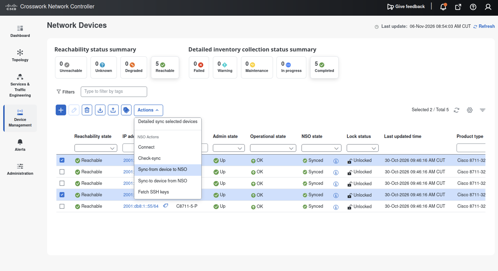


### 7.7.2 Confirmation via GUI

1. Open **Services & Traffic Engineering > VPN Services**.
2. Select `CustB_vpws`.

    

3. Click **Actions > View details**

    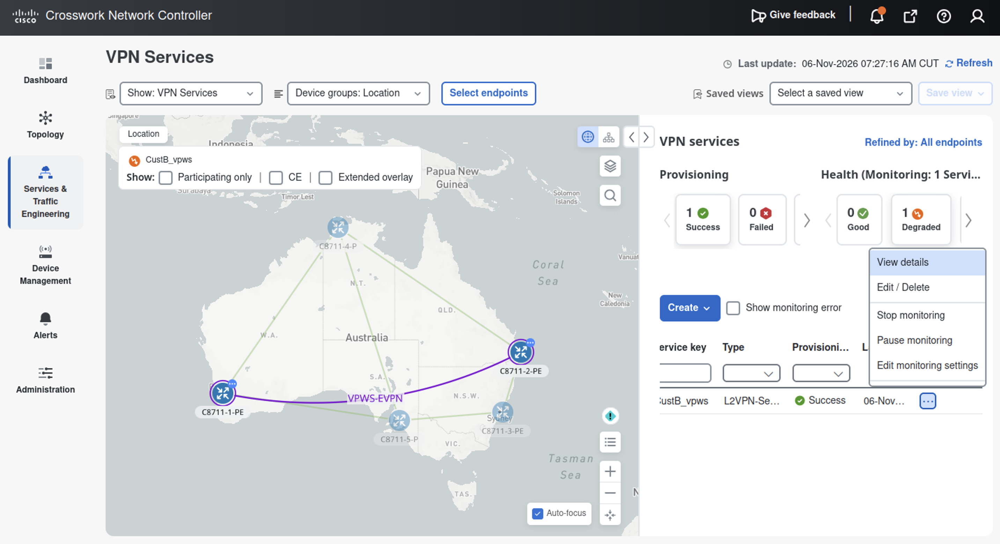

4. Go to **Transport > SRv6**, then confirm SRv6 Policy `PE1-PE2_Color10` is steering the VPWS traffic from PE1 to PE2. Since the SR policy for Color 10 is not configured on the PE2 side, traffic from PE2 to PE1 is forwarded via the IGP shortest path.

    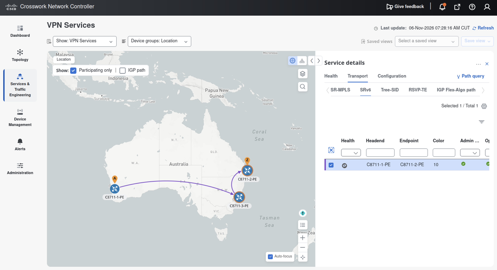


### 7.7.3 Confirmation via CLI

When checking the EVPN route information exchanged with the peer PE via BGP, you can see Route Type 1: Ethernet Auto-Discovery (EAD) routes. You can also find that Color10 is assigned to them.

On the PE1/PE2: 
<pre><code>
RP/0/RP0/CPU0:C8711-1-PE#show bgp l2vpn evpn
Fri Nov  6 08:58:50.399 UTC
BGP router identifier 1.1.1.1, local AS number 65000
BGP generic scan interval 60 secs
Non-stop routing is enabled
BGP table state: Active
Table ID: 0x0
BGP main routing table version 22
BGP NSR Initial initsync version 1 (Reached)
BGP NSR/ISSU Sync-Group versions 0/0
BGP scan interval 60 secs

Status codes: s suppressed, d damped, h history, * valid, > best
              i - internal, r RIB-failure, S stale, N Nexthop-discard
Origin codes: i - IGP, e - EGP, ? - incomplete
   Network            Next Hop            Metric LocPrf Weight Path
Route Distinguisher: 1.1.1.1:100 (default for vrf VPWS:100)
Route Distinguisher Version: 22
*> [1][0000.0000.0000.0000.0000][1]/120
                      0.0.0.0                                0 i
* i                   2001:db8::2 <mark>C:10</mark>
                                                    100      0 i
Route Distinguisher: 2.2.2.2:100
Route Distinguisher Version: 21
*>i[1][0000.0000.0000.0000.0000][1]/120
                      2001:db8::2 <mark>C:10</mark>
                                                    100      0 i

Processed 2 prefixes, 3 paths
RP/0/RP0/CPU0:C8711-1-PE#
</code></pre>

Perform a connectivity check between the CEs.

On CE1(csr1000v-CE1):
```
ce1#ping 198.21.0.200
Type escape sequence to abort.
Sending 5, 100-byte ICMP Echos to 198.21.0.200, timeout is 2 seconds:
!!!!!
Success rate is 100 percent (5/5), round-trip min/avg/max = 3/13/50 ms
ce1#
```

## 7.8 Packet Capture (Option)

We will use the packet capture feature of CML to observe the encapsulation in an IPv6 header.

**CE1 to CE2**

1. Start ping from `CE1` to `CE2`

    On CE1(csr1000v-CE1):
    ```
    ce1#ping 198.21.0.200 repeat 10000
    ```

2. Right click the link between `P5` and `PE3`

3. Start a packet capture.

4. Click the ICMP echo request from 198.21.0.100 to 198.21.0.200.

5. Find the IPv6 header. The destination address should be the PE3 uDN (fcbb:bb00:3) and the SR header contains the PE2 uDX2 (ex. fcbb:bb00:2:e002::). 

    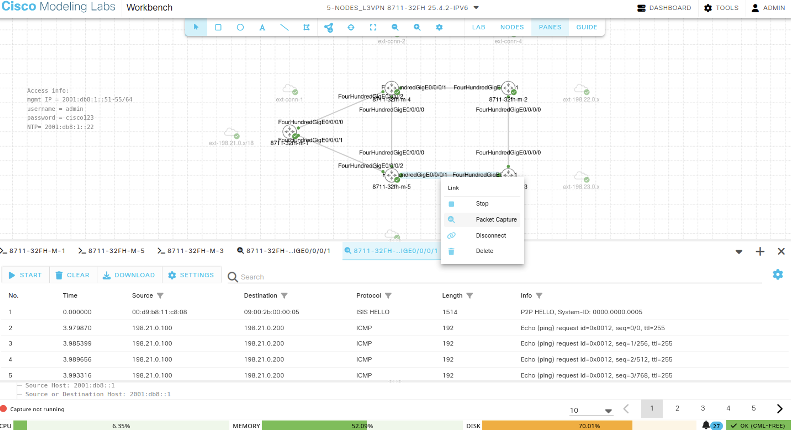
    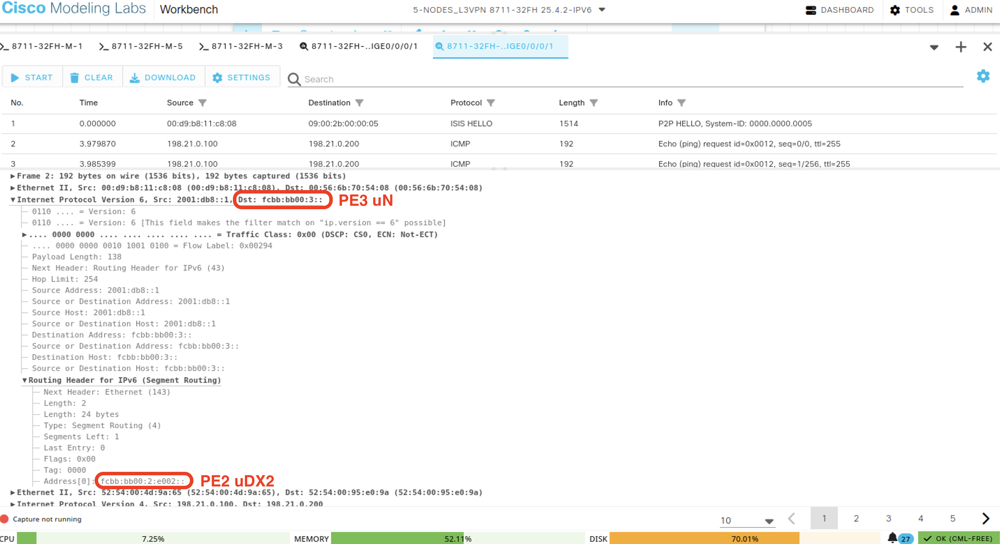

With the ub6-insert-reduced (Binding-SID insert reduced behavior), an SRH (Segment Routing Header) is inserted directly between the existing IPv6 header and the payload, instead of attaching a new IPv6 header to the outside. 

Therefore, an SR header containing the uDX2 SID is inserted into the IPv6 header in this way, and the Outer IPv6 Address contains the PE3 uN SID from the SR policy used for steering.

**CE2 to CE1**

1. Start ping from `CE2` to `CE2`

    On CE2(csr1000v-0):
    ```
    ce2#ping 198.21.0.100 repeat 10000
    ```

2. Right click the link between `P4` and `PE2`

3. Start a packet capture.

4. Click the ICMP echo request from 198.21.0.200 to 198.21.0.100.

5. Find the IPv6 header. The destination address should be the PE1 uDX2 (ex. fcbb:bb00:1:e004::). Currently, no Color 10 policy is configured on PE2, so traffic from PE2 to PE1 follows the IGP shortest path: PE2->P4->PE1.

    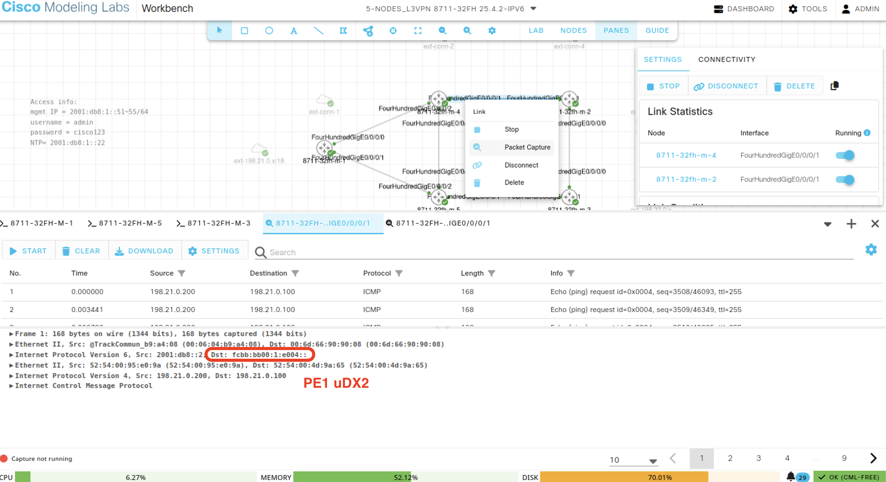


## 7.9 Service Health

1. Open **Services & Traffic Engineering > VPN Services**.
2. You can confirm the helth of `CustB_vpws` is **degraded**.
3. Click **Actions > Assurance graph**

    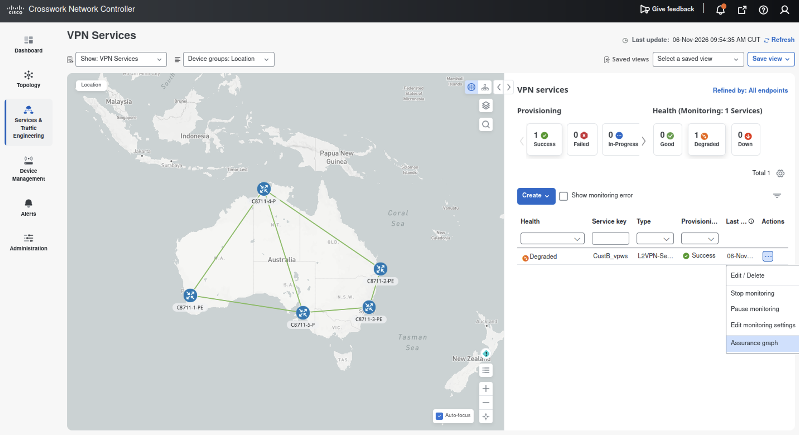

4. Drilling down into this graph leads to three symptoms.

    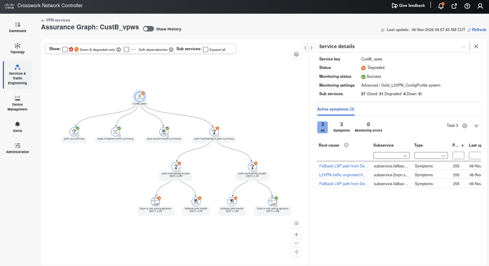

    - **Fallback LSP path from Device: C8711-2-PE to C8711-1-PE:1.1.1.1 doesn't exist.**
    - **Fallback LSP path from Device: C8711-1-PE to C8711-2-PE:2.2.2.2 doesn't exist.** 

    These two are monitoring items that check reachability to the BGP Router-id of the opposite PE. In this case, this alert is occurring because the Loopback IF IPv4 address has not been learned unlike other PEs.

    ```
    RP/0/RP0/CPU0:C8711-1-PE#show ip route
    Fri Nov  6 05:06:12.166 UTC

    % No matching routes found

    RP/0/RP0/CPU0:C8711-1-PE#
    ```

    You can check which metrics are being collected by searching for the metric name in **Administration > Heuristic Packages**.

    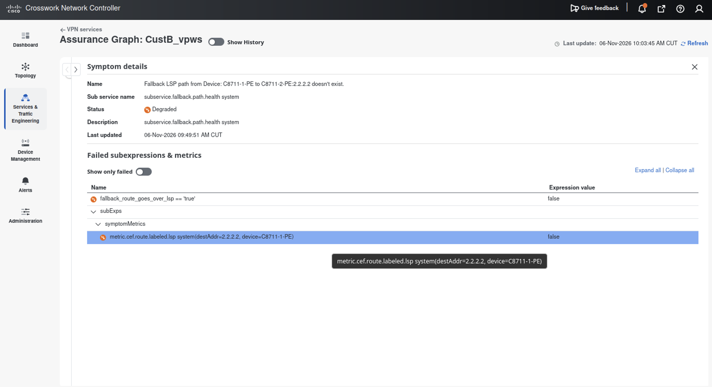
    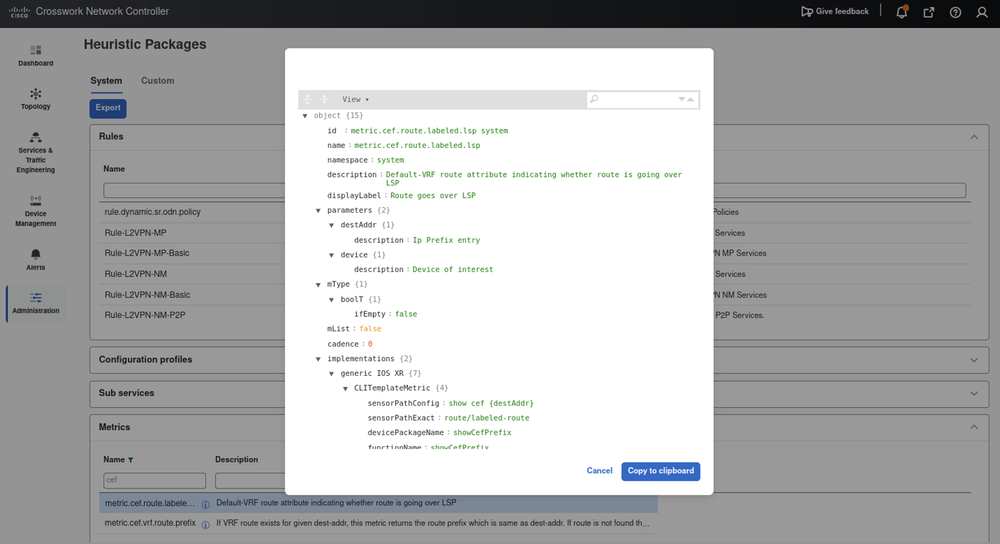

    - **L2VPN traffic originated from this node is configured to go over SR transport, but zero eligible SR policies are detected. VpnServiceId: CustB_vpws Device: C8711-2-PE**

    This symptom occurs because the Color10 policy is not configured on PE2.


## 7.10 Done when

- [ ] `CustB_vpws` is up and shown as point-to-point in VPN Services.
- [ ] The ping between CEs is succeeed.
- [ ] The SR policy is steering the traffic from PE1 to PE2.


## 7.11 Clean-up rule

First, delete the configuration set via the CLI, and then delete the VPWS service on the CNC side.

1. Delete the following configuration on the PE1/PE2.

    ```
    conf t
    router bgp 65000
     neighbor-group ibgp
      address-family l2vpn evpn
       no route-policy POLICY1 out
      !
     !
    end
    ```

2.  Go to **Device Management > Network Devices**, then check PE1 & PE2 and select `Sync-from device to NSO` from the Actions.
 
    

3. Go to **Services & Traffic Engineering > Provisioning (NSO)**, then click **L2VPN-Service**. 

4. Select **Delete dry run** from the Actions.

    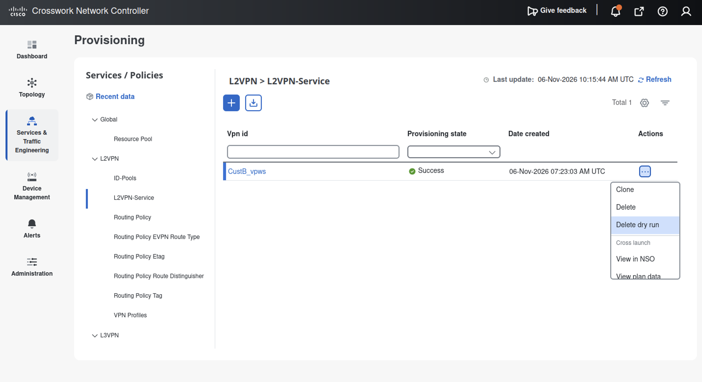

5. Check the config diff and click `Delete`.

    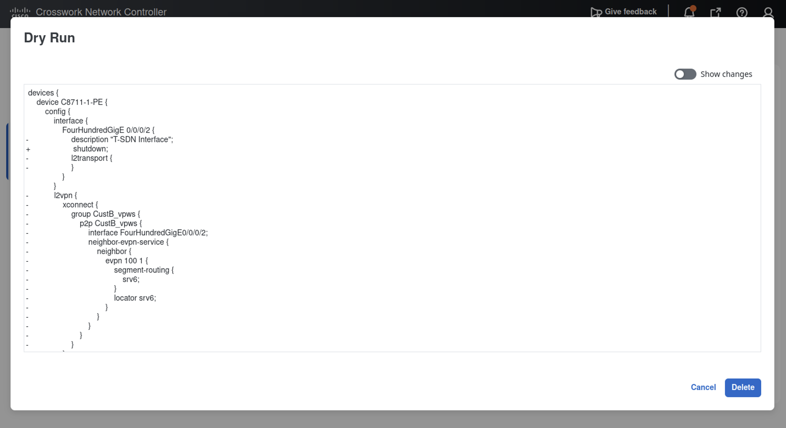


