# 8. L2VPN VPLS provisioning

**Time:** 60 minutes

**Objective:** Provision a multipoint LAN (VPLS) from CNC.

Configure VPLS with a **Single-homing** configuration on the CE1 side (connected only to PE1) and an **All-Active Multi-homing** configuration on the CE2 side (connected to both PE2 and PE3). 

Then, use an **ODN policy** to steer VPLS traffic along the path that optimizes the latency metric. 

In this lab, set the latency to `500` between PE1 and P4, and between P5 and PE3, so that traffic between PE1 and PE2 follows the blue path and traffic between PE1 and PE3 follows the orange path.

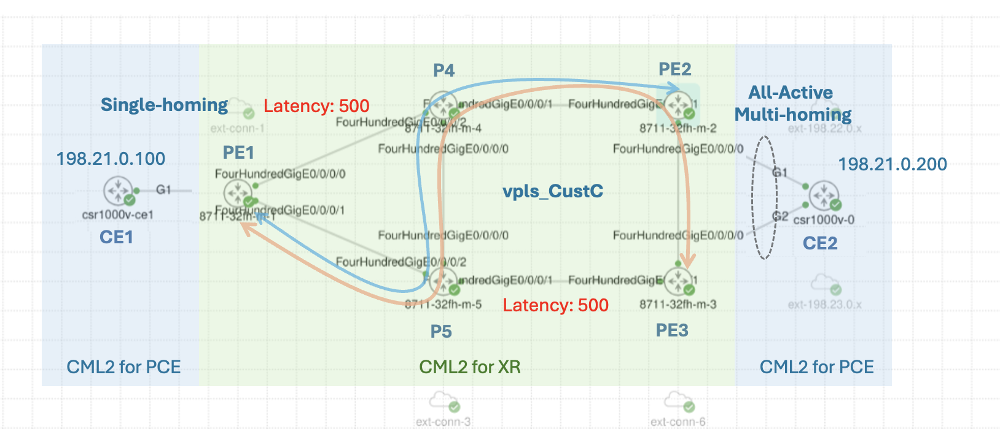

| Field | Value |
| --- | --- |
| Service name | `CustC_vpls` |
| vpn-type | multi-point (evpn) |
| Endpoints | PE1, PE2, PE3 |
| Redundancy | CE1-PE1: Single-homing, CE2-PE2&PE3: All-Active Multi-homing |
| Transport | SRv6, steered to the SRv6 ODN policy with color 30 |

## 8.1 CE Interface Settings

The CEs are located in `CML for PCE` (a different CML instance from the one for the P/PE routers).
Open `CML for PCE` from the Firefox bookmarks bar (use private window). 

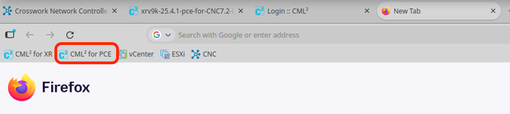

Then select the lab `xrv9k-25.4.1-pce-for-CNC7.2-ipv6`.

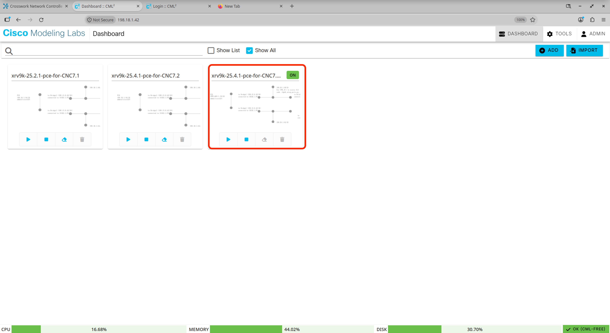

CE1 is named `csr1000v-ce1`, and CE2 is named `csr1000v-0` in the CML.

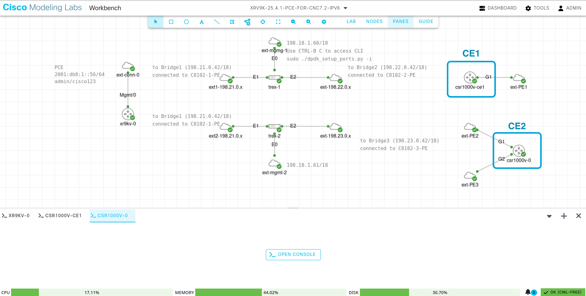


**CE1 (CSR1000V-CE1)**

Confirm that `198.21.0.100` is already configured on interface `Gi1` of CE1, which faces PE1.

<pre><code>
ce1>en
ce1#show run int GigabitEthernet 1
Building configuration...

Current configuration : 121 bytes
!
interface GigabitEthernet1
 <mark>ip address 198.21.0.100 255.255.255.0</mark>
 negotiation auto
 no mop enabled
 no mop sysid
end

ce1#
</code></pre>

**CE2 (CSR1000V-0)**

Clear the configuration of interfaces `Gi1` and `Gi2` on CE2, which face PE2 and PE3, and reconfigure them as member ports of `Port-channel 1`.

<pre><code>
conf t
default interface Gi 1
default interface Gi 2
!
interface Port-Channel 1
 <mark>ip address 198.21.0.200 255.255.255.0</mark>
!
interface range GigabitEthernet 1-2
 channel-group 1
 no negotiation auto
end
</code></pre>

## 8.2 Configure Bundle-Ether on PE2/PE3

In this lab, the PEs and CEs are connected through an external connector, so LACP negotiation cannot be performed. Therefore, force the bundle member to come up by using `mode on`.

**PE2 and PE3**
```
interface FourHundredGigE0/0/0/2
 bundle id 1 mode on
 no shut
!
interface Bundle-Ether1
 lacp system mac 2323.2323.2323
!
```

 Go to **Device Management > Network Devices**, select PE2 and PE3, and choose **Sync-from devices to NSO** from **Actions**.
 
 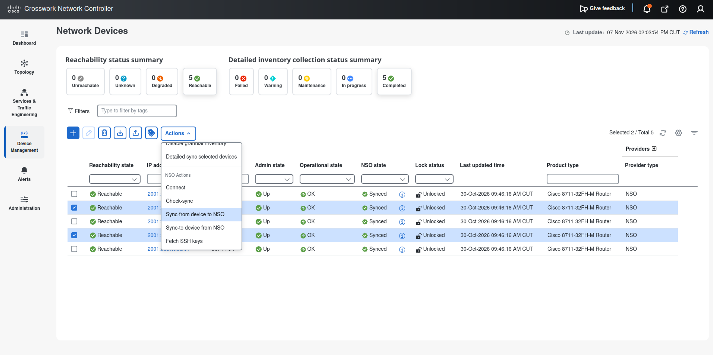


## 8.3 ODN Policy

First, set a delay metric of `500` between **PE1** and **P4**, and between **P5** and **PE3**, so that traffic between PE1 and PE2 follows the blue path and traffic between PE1 and PE3 follows the orange path.


### 8.3.1 Configure Delay Metric

**PE1**
<pre><code>
performance-measurement
 interface <mark>FourHundredGigE0/0/0/0</mark>
  delay-measurement
   advertise-delay 500
  !
 !
!
</code></pre>

**P4**
<pre><code>
performance-measurement
 interface <mark>FourHundredGigE0/0/0/2</mark>
  delay-measurement
   advertise-delay 500
  !
 !
!
</code></pre>

**P5 and PE3**
<pre><code>
performance-measurement
 interface <mark>FourHundredGigE0/0/0/1</mark>
  delay-measurement
   advertise-delay 500
  !
 !
!
</code></pre>

 Go to **Device Management > Network Devices**, select PE1, PE3, P4, and P5, and choose **Sync-from devices to NSO** from **Actions**.
 
 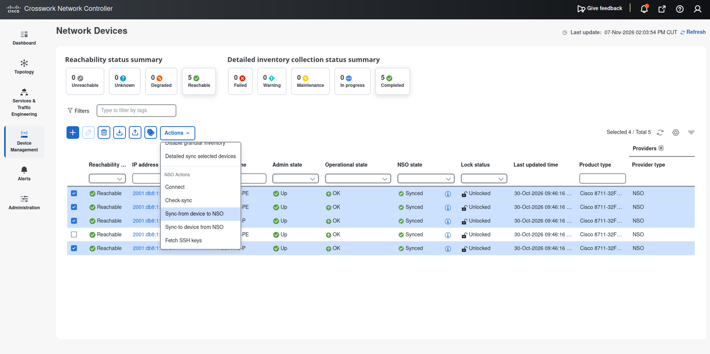

 Click the link between `PE1` and `P4`, or the link between `P5` and `PE3`, on the topology, and then confirm that the delay metric is set to `500`.

　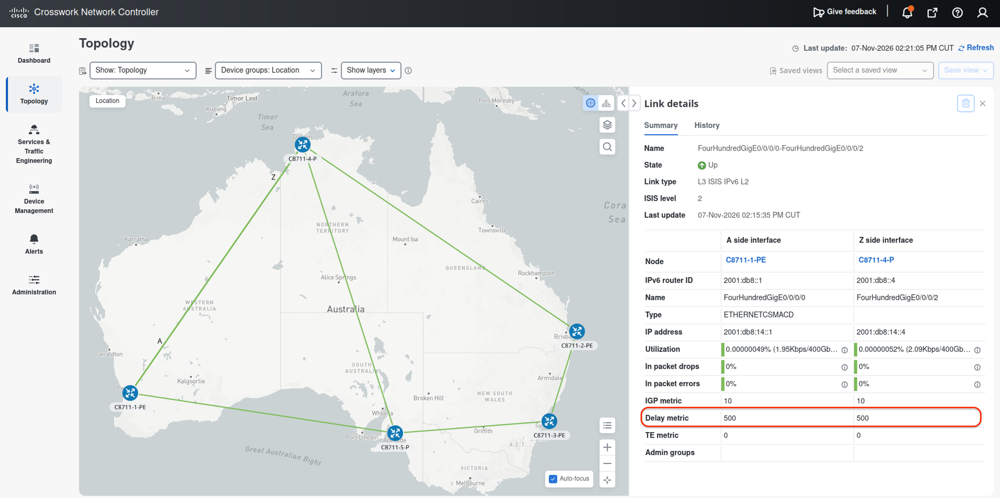

### 8.3.2 Configure ODN Policy

 Unlike the policy configured in chapter 5, an ODN policy does not require an endpoint to be configured. When a BGP route with that color is received, an SR policy is instantiated using the route's next hop as the endpoint. This has the advantage of not requiring a full mesh of policies between the PEs.

 In this lab, configure an ODN policy for color 30, with latency as the optimization objective, on all PEs.

 1. Go to **Services & Traffic Engineering > Provisioning (NSO)**
 2. Go to **SR-TE > ODN-Template**
 3. Load **Home > cnc-payloads > ODN_color30.json**

    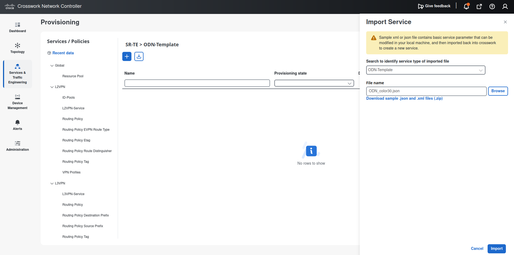

    ??? note "ODN_color30.json"
        ```json
        {
        "cisco-sr-te-cfp:sr-te": {
            "cisco-sr-te-cfp-sr-odn:odn": {
            "odn-template": [
                {
                "name": "ODN_color30",
                "srv6": {
                    "locator": {
                    "locator-name": "srv6",
                    "behavior": "ub6-insert-reduced",
                    "binding-sid-type": "srv6-dynamic"
                    }
                },
                "head-end": [
                    {
                    "name": "C8711-1-PE"
                    },
                    {
                    "name": "C8711-2-PE"
                    },
                    {
                    "name": "C8711-3-PE"
                    }
                ],
                "color": 30,
                "dynamic": {
                    "pce": {},
                    "metric-type": "latency"
                }
                }
            ]
            }
        }
        }
        ```

 4. Confirm the following parameters.

    - Head-end: C8711-1-PE, C8711-2-PE, C8711-3-PE
    - Color: 30

    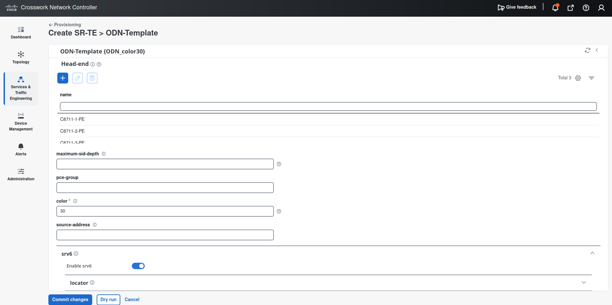

    - srv6: enable
    - locator-name: srv6
    - behavior: ub6-insert-reduced
    - binding-sid-type: srv6-dynamic

    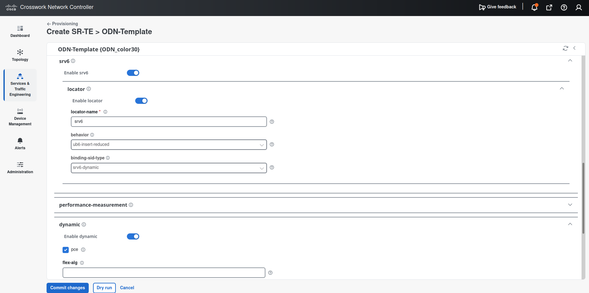

    - dynamic: enable
    - select `pce`
    - metric-type: latency

    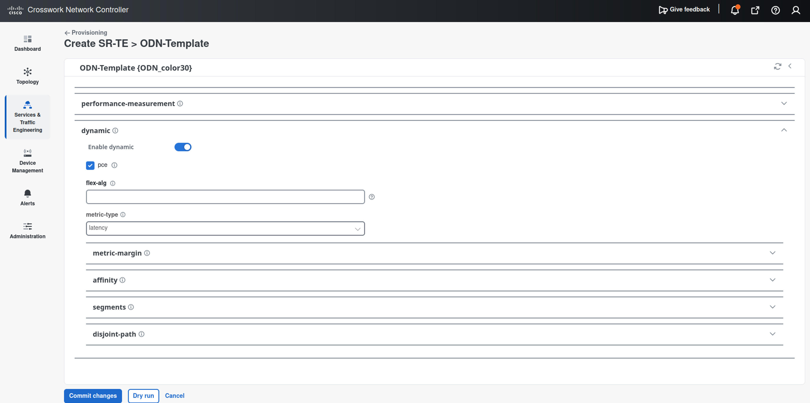

 5. Click **Dry-run**, and then click **Commit changes**.

 6. (Optional) Confirm via the CLI.

    The ODN policy is instantiated when a BGP route with color 30 is received. Therefore, although the configuration has been applied, the policy is not active yet.

    **PE1**
    ```
    RP/0/RP0/CPU0:C8711-1-PE#show run segment-routing traffic-eng on-demand color 30
    Sat Nov  7 14:48:00.616 UTC
    segment-routing
    traffic-eng
    on-demand color 30
    srv6
        locator srv6 binding-sid dynamic behavior ub6-insert-reduced
    !
    dynamic
        pcep
        !
        metric
        type latency
        !
       !
      !
     !
    !

    RP/0/RP0/CPU0:C8711-1-PE#
    RP/0/RP0/CPU0:C8711-1-PE#show segment-routing traffic-eng policy tabular
    Sat Nov  7 14:48:11.945 UTC

    'd': Dropping traffic

    Color                                Endpoint  Admin   Oper                 Binding
                                                    State  State                     SID
    ------ --------------------------------------- ------ ------ -----------------------
        10                             2001:db8::2     up     up      fcbb:bb00:1:e002::
        20                             2001:db8::3     up     up      fcbb:bb00:1:e003::
    RP/0/RP0/CPU0:C8711-1-PE#`
    ```

## 8.4 Route-Policy

To steer VPLS traffic to the ODN policy, a route policy is required that attaches the color 30 extended community to all EVPN advertisements.

### 8.4.1 Routing Policy Tag

1. Go to **Services & Traffic Engineering > Provisioning (NSO)**, then click **L2VPN > Routing Policy Tag**.

2. Confirm that the routing policy tag `COLOR_30` exists.

    - name: COLOR_30
    - tag-value: 30

    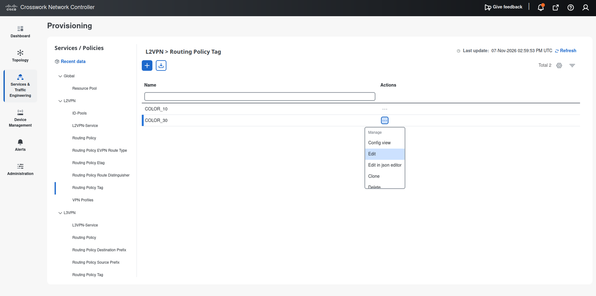
    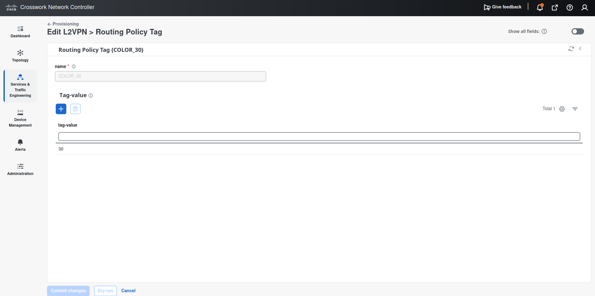


### 8.4.2 Routing Policy

1. Go to **L2VPN > Routing Policy**.

2. Confirm that the routing policy `POLICY3` exists.

    - name: POLICY3
    - statement name: statement1
    - actions
        - bgp-actions
            - enable `bgp-actions`
            - enable `set-ext-community`
            - ext-community-set-ref: COLOR_30

    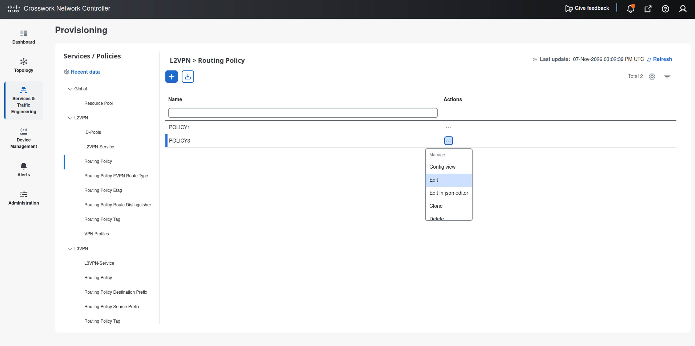
    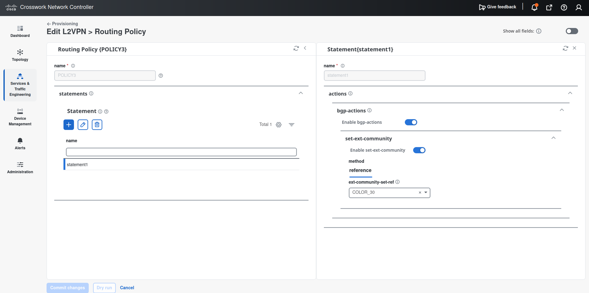


## 8.5 VPLS Provisioning

1. Go to **Services & Traffic Engineering > Provisioning (NSO)**, then click **L2VPN-Service**.

2. Load **Home > cnc-payloads > VPLS_CustC.json**.

    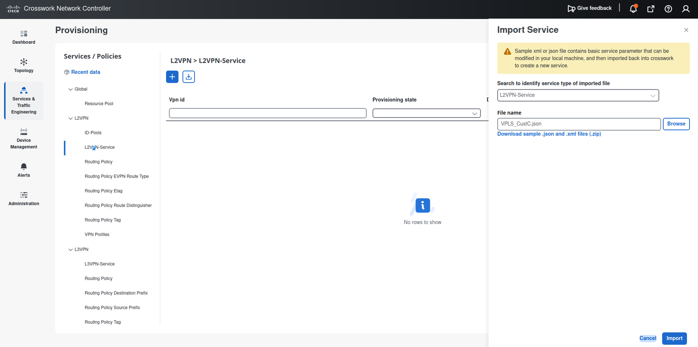

    ??? note "VPLS_CustC.json"
        ```json
            {
            "ietf-l2vpn-ntw:l2vpn-ntw": {
                "vpn-services": {
                "vpn-service": [
                    {
                    "vpn-id": "CustC_vpls",
                    "vpn-type": "ietf-vpn-common:mpls-evpn",
                    "vpn-service-topology": "ietf-vpn-common:any-to-any",
                    "vpn-nodes": {
                        "vpn-node": [
                        {
                            "vpn-node-id": "C8711-1-PE",
                            "signaling-option": {
                            "evpn-policies": {
                                "mac-learning-mode": "ietf-l2vpn-ntw:control-plane"
                            }
                            },
                            "vpn-network-accesses": {
                            "vpn-network-access": [
                                {
                                "id": "0",
                                "interface-id": "FourHundredGigE0/0/0/2",
                                    "connection": {
                                    "encapsulation": {
                                    "encap-type": "ietf-vpn-common:untagged-int"
                                    }
                                }
                                }
                            ]
                            },
                            "cisco-l2vpn-ntw:te-service-mapping": {
                            "srv6": {
                                "locator": "srv6"
                            },
                            "te-mapping": {
                                "odn": {
                                "route-policy": [
                                    "POLICY3"
                                ]
                                }
                            }
                            }
                        },
                        {
                            "vpn-node-id": "C8711-2-PE",
                            "signaling-option": {
                            "evpn-policies": {
                                "mac-learning-mode": "ietf-l2vpn-ntw:control-plane"
                            }
                            },
                            "vpn-network-accesses": {
                            "vpn-network-access": [
                                {
                                "id": "0",
                                "interface-id": "Bundle-Ether1",
                                    "connection": {
                                    "encapsulation": {
                                    "encap-type": "ietf-vpn-common:untagged-int"
                                    }
                                }
                                }
                            ]
                            },
                            "cisco-l2vpn-ntw:multi-home": {
                            "ethernet-segment-identifier": "23.23.00.00.00.00.00.00.00"
                            },
                            "cisco-l2vpn-ntw:te-service-mapping": {
                            "srv6": {
                                "locator": "srv6"
                            },
                            "te-mapping": {
                                "odn": {
                                "route-policy": [
                                    "POLICY3"
                                ]
                                }
                            }
                            }
                        },
                        {
                            "vpn-node-id": "C8711-3-PE",
                            "signaling-option": {
                            "evpn-policies": {
                                "mac-learning-mode": "ietf-l2vpn-ntw:control-plane"
                            }
                            },
                            "vpn-network-accesses": {
                            "vpn-network-access": [
                                {
                                "id": "0",
                                "interface-id": "Bundle-Ether1",
                                    "connection": {
                                    "encapsulation": {
                                    "encap-type": "ietf-vpn-common:untagged-int"
                                    }
                                }
                                }
                            ]
                            },
                            "cisco-l2vpn-ntw:multi-home": {
                            "ethernet-segment-identifier": "23.23.00.00.00.00.00.00.00"
                            },
                            "cisco-l2vpn-ntw:te-service-mapping": {
                            "srv6": {
                                "locator": "srv6"
                            },
                            "te-mapping": {
                                "odn": {
                                "route-policy": [
                                    "POLICY3"
                                ]
                                }
                            }
                            }
                        }
                        ]
                    },
                    "cisco-l2vpn-ntw:auto-evi-id": [
                        null
                    ],
                    "cisco-l2vpn-ntw:bridge-group": "BRIDGE",
                    "cisco-l2vpn-ntw:service-assurance": {
                        "monitoring-state": "enable",
                        "profile-name": "Gold_L2VPN_ConfigProfile system",
                        "rule-name": "Rule-L2VPN-MP system"
                    }
                    }
                ]
                }
            }
            }
        ```

3. Confirm that the following parameters are set.

    - vpn-id: `CustC_vpls`
    - vpn-type: `mpls-evpn`
    - vpn-service-topology: `any-to-any`
    - auto-evi-id: enabled
    - bridge-group: `BRIDGE`

    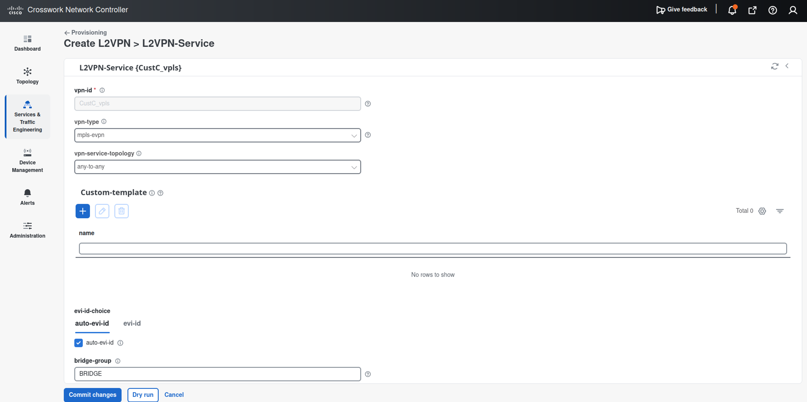

    - vpn-node: **C8711-1-PE**
    - mac-learning-mode: control-plane
    - vpn-network-access: FourHundredGigE0/0/0/2
    - encap-type: untagged-int
    - srv6 locator: `srv6`
    - te-mapping: odn policy `POLICY3`

    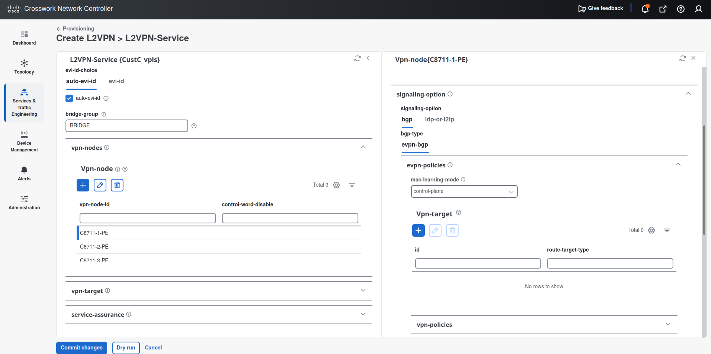
    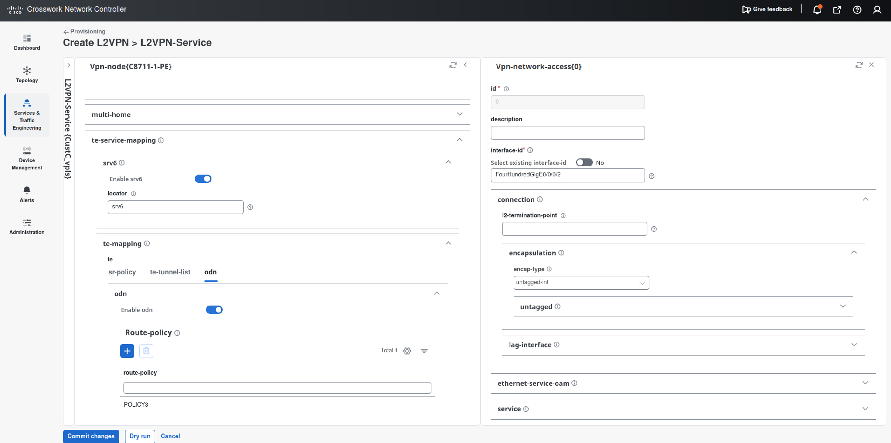

    - vpn-node: **C8711-2-PE**
    - mac-learning-mode: control-plane
    - vpn-network-access: Bundle-Ether1
    - encap-type: untagged-int
    - multi-home:
        - ethernet-segment-identifier: 23.23.00.00.00.00.00.00.00
    - srv6 locator: `srv6`
    - te-mapping: odn policy `POLICY3`

    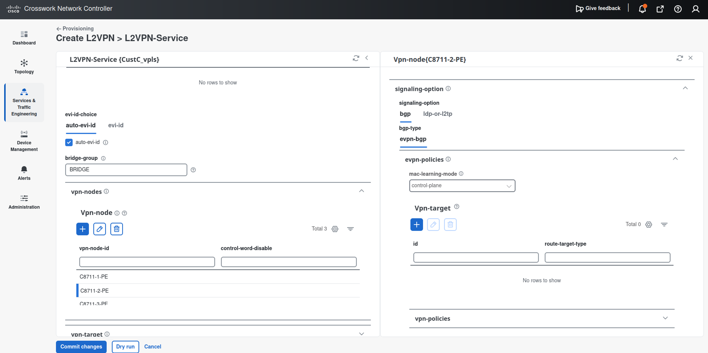
    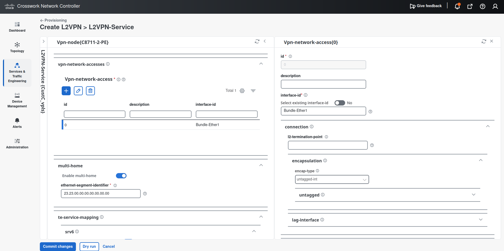
    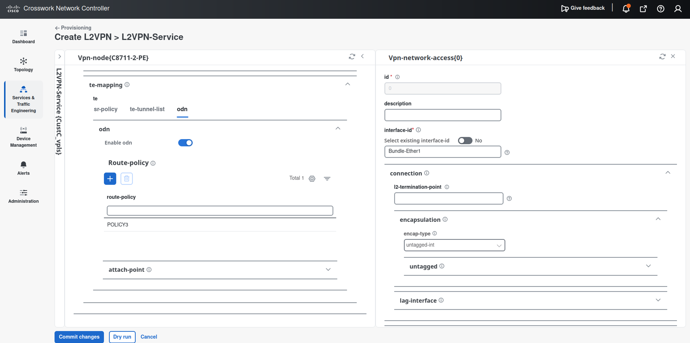

    - vpn-node: **C8711-3-PE**
    - mac-learning-mode: control-plane
    - vpn-network-access: Bundle-Ether1
    - encap-type: untagged-int
    - multi-home:
        - ethernet-segment-identifier: 23.23.00.00.00.00.00.00.00
    - srv6 locator: `srv6`
    - te-mapping: odn policy `POLICY3`

    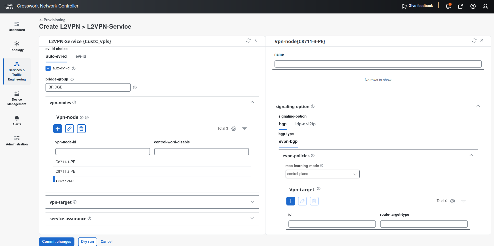
    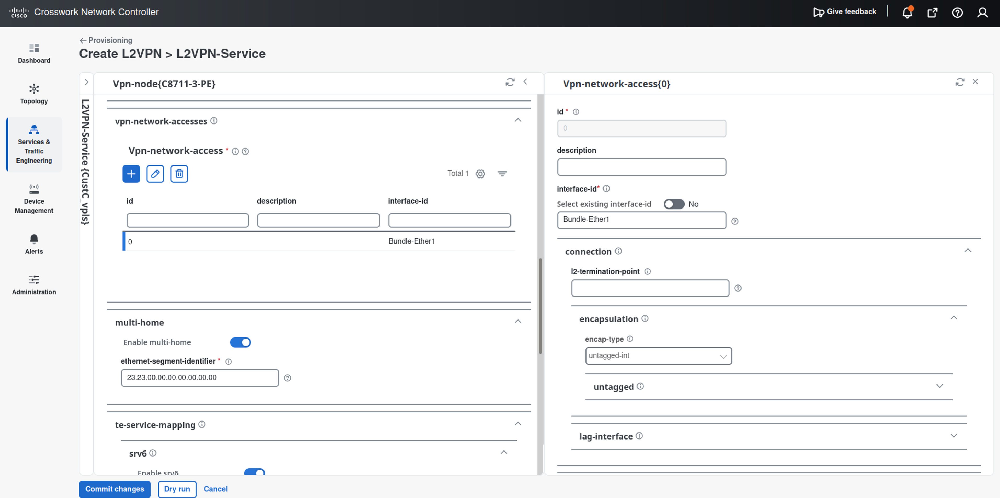
    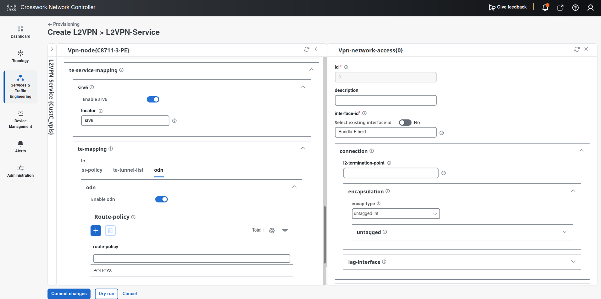


    **Service Assurance** 

    - enable `service-assurance`
    - monitoring state: enable
    - preservation: remove (delete all historical data when monitoring stops)
    - profile-name: `Gold_L2VPN_ConfigProfile system`
    - rule-name: `Rule-L2VPN-MP system`

    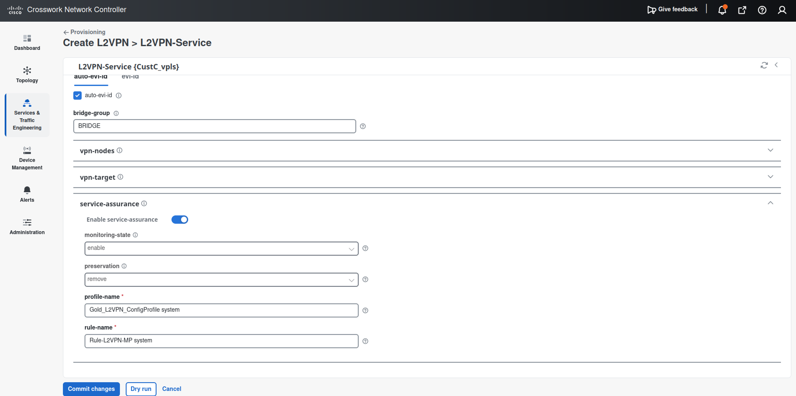

4. Click **Dry-run**, and then click **Commit changes**.


## 8.6 Confirm the VPLS

### via CNC GUI
1. Open **Services & Traffic Engineering > VPN Services**.
2. Select `CustC_vpls`.

    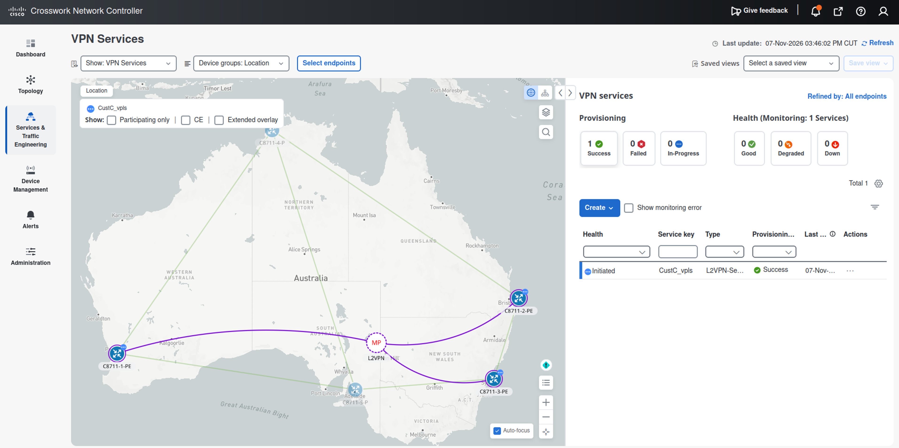


### via CLI

On PE1/PE2/PE3:  

Confirm that uDT2U/uDT2M SIDs are assigned to `CustC_vpls`.

<pre><code>
RP/0/RP0/CPU0:C8711-1-PE#show segment-routing srv6 locator srv6 sid
Sat Nov  7 15:47:22.551 UTC
SID                         Behavior          Identification                    Owner               State  RW
--------------------------  ----------------  --------------------------------  ------------------  -----  --
fcbb:bb00:1::               uN (PSP/USD)      'default':1                       sidmgr              InUse  Y
fcbb:bb00:1:e000::          uA (PSP/USD)      [FH0/0/0/0, Link-Local]:0         isis-1              InUse  Y
fcbb:bb00:1:e001::          uA (PSP/USD)      [FH0/0/0/1, Link-Local]:0         isis-1              InUse  Y
fcbb:bb00:1:e002::          uB6 (PSP/USD Insert.Red)  'srte_c_10_ep_2001:db8::2' (10, 2001:db8::2)  xtc_srv6            InUse  Y
fcbb:bb00:1:e003::          uB6 (PSP/USD Insert.Red)  'srte_c_20_ep_2001:db8::3' (20, 2001:db8::3)  xtc_srv6            InUse  Y
<mark>fcbb:bb00:1:e004::          uDT2U             100:0                             l2vpn_srv6          InUse  Y</mark>
<mark>fcbb:bb00:1:e005::          uDT2M             100:0                             l2vpn_srv6          InUse  Y</mark>
RP/0/RP0/CPU0:C8711-1-PE#
</code></pre>


Confirm that MAC addresses are learned between the PEs.

<pre><code>
RP/0/RP0/CPU0:C8711-1-PE#show evpn evi vpn-id 100 mac
Sat Nov  7 15:51:19.199 UTC

VPN-ID     Encap      MAC address    IP address                               Nexthop                                 Label    SID
---------- ---------- -------------- ---------------------------------------- --------------------------------------- -------- ---------------------------------------
100        SRv6       3e0c.fefb.7071 ::                                       FourHundredGigE0/0/0/2                  0        fcbb:bb00:1:e004::
100        SRv6       62ab.683d.a500 ::                                       2001:db8::2                             IMP-NULL fcbb:bb00:2:e002::
100        SRv6       62ab.683d.a500 ::                                       2001:db8::3                             IMP-NULL fcbb:bb00:3:e002::
100        SRv6       e613.d71f.529b ::                                       FourHundredGigE0/0/0/2                  0        fcbb:bb00:1:e004::
RP/0/RP0/CPU0:C8711-1-PE#
</code></pre>

You can confirm that PE2 and PE3 are operating in all-active multi-homing mode by using the following command.

On **PE2/PE3**:
<pre><code>
RP/0/RP0/CPU0:C8711-2-PE#show evpn ethernet-segment esi 0023.2300.0000.0000.0000 detail
Sat Nov  7 16:11:46.047 UTC

Ethernet Segment Id      Interface                          Originating IP
------------------------ ---------------------------------- --------------------
0023.2300.0000.0000.0000 BE1                                <mark>2.2.2.2</mark>
                                                            <mark>3.3.3.3</mark>
  ES to BGP Gates   : Ready
  ES to L2FIB Gates : Ready
  Main port         :
     Interface name : Bundle-Ether1
     Interface MAC  : 0006.04b9.a505
     IfHandle       : 0x7800002c
     State          : Up
     Redundancy     : Not Defined
  ESI ID            : 1
  ESI type          : 0
     Value          : 0023.2300.0000.0000.0000
  ES Import RT      : 2323.0000.0000 (from ESI)
  Topology          :
     Operational    : <mark>MH, All-active</mark>
     Configured     : All-active (AApF) (default)
  Service Carving   : Auto-selection
     Multicast      : Disabled
  Convergence       :
  Peering Details   : 2 Nexthops
     2.2.2.2 [MOD:P:00:T]
     3.3.3.3 [MOD:P:00:T]
  Service Carving Synchronization:
     Mode           : NTP_SCT
     Peer Updates   :
                 2.2.2.2 [SCT: 2026-11-07 15:45:44.1794066]
                 3.3.3.3 [SCT: 2026-11-07 15:45:47.1794066]
  Service Carving Results:
     Forwarders     : 1
     Elected        : 1
     Not Elected    : 0
  EVPN-VPWS Service Carving Results:
     Primary        : 0
     Backup         : 0
     Non-DF         : 0
  MAC Flush msg     : STP-TCN
  Peering timer     : 3 sec [not running]
  Recovery timer    : 30 sec [not running]
  Carving timer     : 0 sec [not running]
  Revert timer      : 0 sec [not running]
  HRW Reset timer   : 5 sec [not running]
  Local SHG filters :
      (mpls)                None
      (srv6)                1:16
  Remote SHG filters: 1
      (srv6)                1:16 : nexthop 2001:db8::3
  Access signal mode: Bundle OOS

RP/0/RP0/CPU0:C8711-2-PE#
</code></pre>

## 8.7 Connectivity Check

Because of lab constraints, CE2 cannot receive ARP replies, so configure a static ARP entry on CE2.

On **CE1(csr1000v-ce1)**:
```
ce1#show arp
Protocol  Address          Age (min)  Hardware Addr   Type   Interface
Internet  198.21.0.100            -   5254.004d.9a65  ARPA   GigabitEthernet1
Internet  198.21.0.200            5   001e.e699.5dc0  ARPA   GigabitEthernet1
ce1#
```

On **CE2(csr1000v-0)**:
```
ce2#show arp
Protocol  Address          Age (min)  Hardware Addr   Type   Interface
Internet  198.21.0.100            0   Incomplete      ARPA   
Internet  198.21.0.200            -   001e.e699.5dc0  ARPA   Port-channel1
ce2#
```

```
ce2#conf t
ce2(config)#arp 198.21.0.100 5254.004d.9a65 arpa 
ce2(config)#end
```

```
ce2#show arp
Protocol  Address          Age (min)  Hardware Addr   Type   Interface
Internet  198.21.0.100            -   5254.004d.9a65  ARPA  
Internet  198.21.0.200            -   001e.e699.5dc0  ARPA   Port-channel1
ce2#
```

Ping between the CEs. 

!!! warning "Note"
    This lab can be unstable because it uses external connectors for PE-CE connectivity. Pings may occasionally fail.

```
ce2#ping 198.21.0.100
Type escape sequence to abort.
Sending 5, 100-byte ICMP Echos to 198.21.0.100, timeout is 2 seconds:
!!!!!
Success rate is 100 percent (5/5), round-trip min/avg/max = 4/6/13 ms
ce2#
```

## 8.8 Automated Steering

### 8.8.1 Enable Route-Policy

The built-in L2VPN service model does not configure MP-BGP-related settings, as described above. Therefore, configure the following on PE1, PE2, and PE3 to enable the route policy.

On PE1/PE2/PE3:
```
conf t
router bgp 65000
 neighbor-group ibgp
 address-family l2vpn evpn
   route-policy POLICY3 out
  !
 !
 end
```

 Go to **Device Management > Network Devices**, select PE1, PE2, and PE3, and choose **Sync-from devices to NSO** from **Actions**.
 
 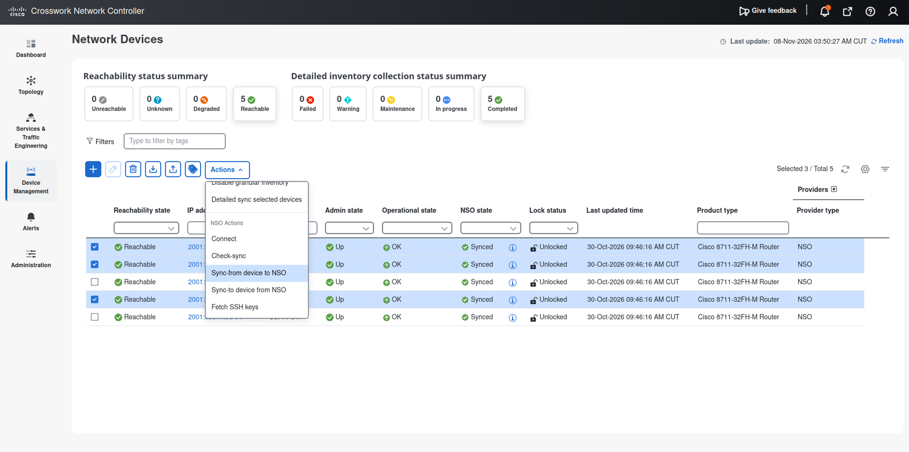


### 8.8.2 Confirmation via CLI

In the EVPN route information exchanged with the peer PEs via BGP, you can see that color 30 is assigned to the routes.

On PE1/PE2/PE3: 
<pre><code>
RP/0/RP0/CPU0:C8711-1-PE#show bgp l2vpn evpn
Sun Nov  8 03:53:50.603 UTC
BGP router identifier 1.1.1.1, local AS number 65000
BGP generic scan interval 60 secs
Non-stop routing is enabled
BGP table state: Active
Table ID: 0x0
BGP main routing table version 447
BGP NSR Initial initsync version 1 (Reached)
BGP NSR/ISSU Sync-Group versions 0/0
BGP scan interval 60 secs

Status codes: s suppressed, d damped, h history, * valid, > best
              i - internal, r RIB-failure, S stale, N Nexthop-discard
Origin codes: i - IGP, e - EGP, ? - incomplete
   Network            Next Hop            Metric LocPrf Weight Path
Route Distinguisher: 1.1.1.1:100 (default for vrf BRIDGE_evi_100)
Route Distinguisher Version: 435
*>i[1][0023.2300.0000.0000.0000][0]/120
                      2001:db8::2 <mark>C:30</mark>
                                                    100      0 i
* i                   2001:db8::3 <mark>C:30</mark>
                                                    100      0 i
*>i[1][0023.2300.0000.0000.0000][4294967295]/120
                      2001:db8::2 <mark>C:30</mark>
                                                    100      0 i
* i                   2001:db8::3 <mark>C:30</mark>
                                                    100      0 i
*>i[2][0][48][001e.e699.5dc0][0]/104
                      2001:db8::2 <mark>C:30</mark>
                                                    100      0 i
* i                   2001:db8::3 <mark>C:30</mark>
                                                    100      0 i
<--- omitted --->
</code></pre>

Confirm that the color 30 ODN policies are instantiated in a full mesh.

On PE1/PE2/PE3: 
<pre><code>
RP/0/RP0/CPU0:C8711-1-PE#show segment-routing traffic-eng policy tabular
Sun Nov  8 04:37:30.525 UTC

'd': Dropping traffic

 Color                                Endpoint  Admin   Oper                 Binding
                                                State  State                     SID
------ --------------------------------------- ------ ------ -----------------------
    10                             2001:db8::2     up     up      fcbb:bb00:1:e002::
    20                             2001:db8::3     up     up      fcbb:bb00:1:e003::
    <mark>30                             2001:db8::2     up     up      fcbb:bb00:1:e006::</mark>
    <mark>30                             2001:db8::3     up     up      fcbb:bb00:1:e007::</mark>
RP/0/RP0/CPU0:C8711-1-PE#
</code></pre>


### 8.8.3 Confirmation via GUI

1. Open **Services & Traffic Engineering > VPN Services**.
2. Select `CustC_vpls`.

    

3. Click **Actions > View details**

    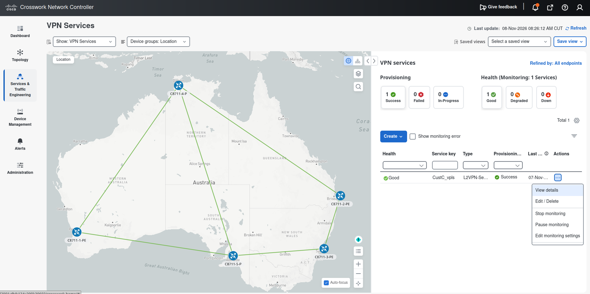

4. Go to **Transport > SRv6**, then confirm that the SRv6 policies for color 30 are steering the VPLS traffic. You can see that traffic is forwarded along paths that avoid the PE1-P4 and P5-PE3 links, where the delay metric is configured. It takes some time for all policies to be displayed.

    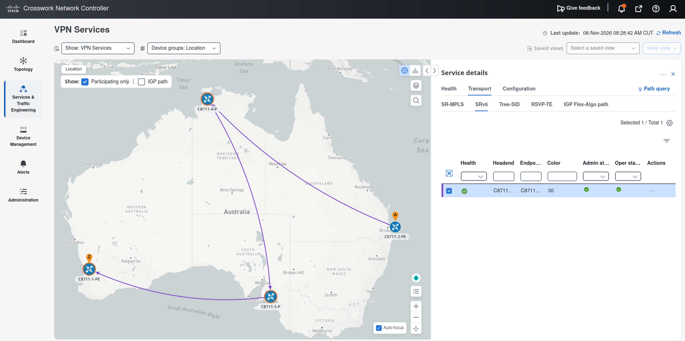


## 8.9 Packet Capture (Optional)

Use the packet capture feature of CML to observe the encapsulation in the IPv6 header.

1. Start a ping from `CE1` to `CE2`.
   Due to lab constraints, the ping may not succeed, but this is not a problem.

    On CE1(csr1000v-CE1):
    ```
    ce1#ping 198.21.0.200 repeat 100
    ```

2. Right-click the link between `P4` and `P5` and start a packet capture.

3. Select the ICMP echo request packet from 198.21.0.100 to 198.21.0.200.

4. Find the IPv6 header. The destination address contains the uN SIDs of P4 and PE2 (fcbb:bb00:4:2::), and the SR header contains the uDT2U SID of PE3 (for example, fcbb:bb00:3:e002::). 

    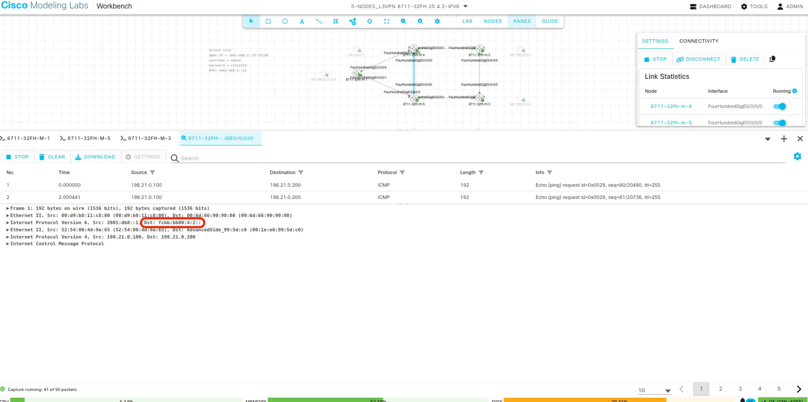
    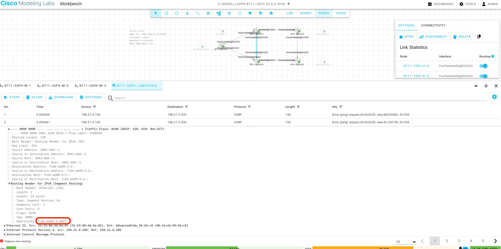

    With the ub6-insert-reduced behavior (Binding SID insert reduced), an SRH (Segment Routing Header) is inserted directly between the existing IPv6 header and the payload, instead of encapsulating the packet in a new outer IPv6 header. 

    As a result, an SRH containing the uDT2U SID is inserted after the IPv6 header, and the destination address of the IPv6 header contains the uN SIDs of P4 and PE2 from the SR policy used for steering.


5. Right click the link between `P4` and `PE2` and start a packet capture.

6. Select the ICMP echo request packet from 198.21.0.100 to 198.21.0.200.

7. Find the IPv6 header. You can see that Shift & Forward is performed at P4 and that the uN of PE2 is now at the beginning. The SR header still contains the uDT2U SID of PE3 (for example, fcbb:bb00:3:e002::). 

    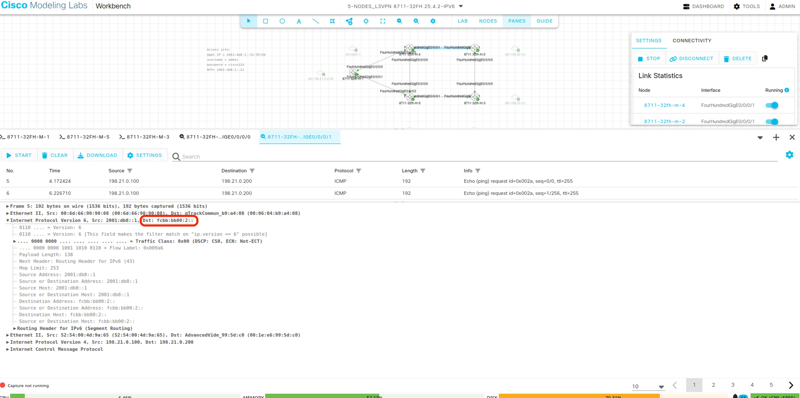

8. Right-click the link between `PE2` and `PE3` and start a packet capture.

9. Select the ICMP echo request packet from 198.21.0.100 to 198.21.0.200.

10. You can see that the last uSID (uN) in the destination address was processed at PE2, the uDT2U SID of PE3 in the SR header was copied to the destination address, and the SR header was removed.

    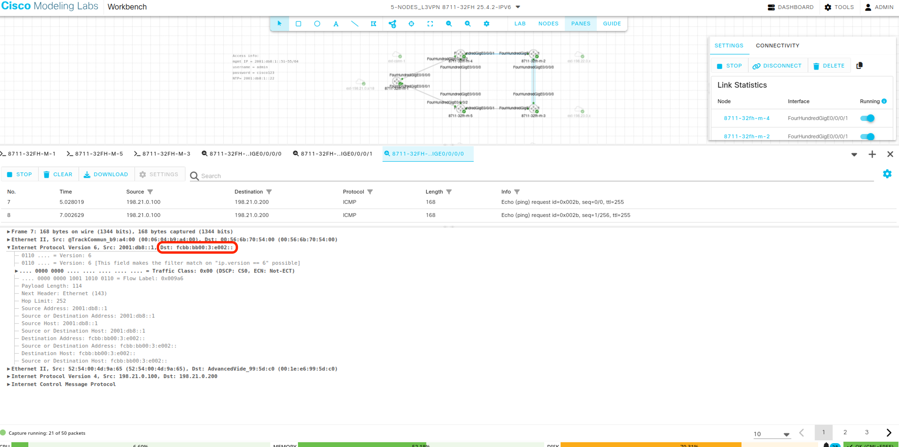


## 8.10 Service Health

1. Open **Services & Traffic Engineering > VPN Services**.
2. Confirm that the health of `CustC_vpls` is **Good**.
3. Click **Actions > Assurance graph**

    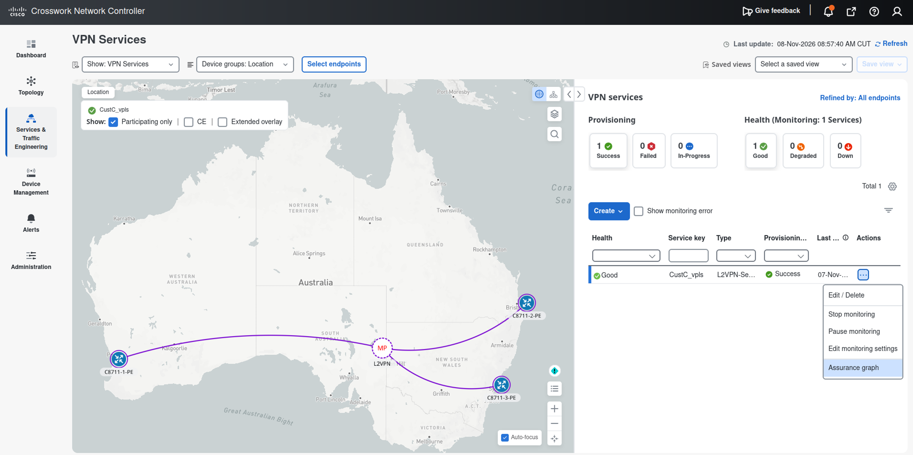

4. Drill down into this graph and check that all subservices are `Good`.

    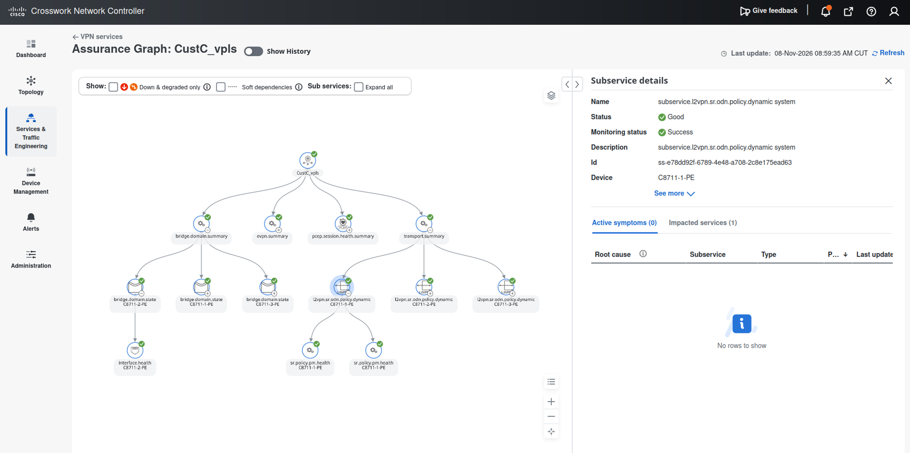

5. Turn on `Show History` and select a time when Service Health was degraded. You can then check which symptoms occurred at that time.

    In this case, although steering to the ODN policy was configured, these symptoms occurred because the ODN policy had not yet been instantiated at that point.

    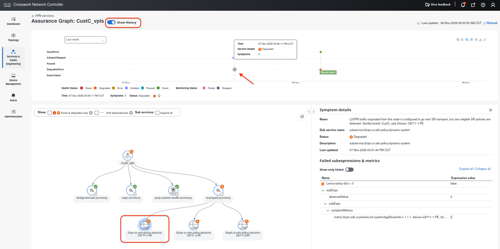

## 8.11 Done when

- [ ] `CustC_vpls` is up and shown as multi-point in VPN Services.
- [ ] The SR policy is steering the VPLS traffic.


## 8.12 Clean-up rule

First, delete the configuration that you applied via the CLI, and then delete the VPLS service in CNC.

1. Delete the following configuration on PE1, PE2, and PE3.

    ```
    conf t
    router bgp 65000
     neighbor-group ibgp
      address-family l2vpn evpn
       no route-policy POLICY3 out
      !
     !
    commit
    ```

2. Go to **Device Management > Network Devices**, select PE1, PE2, and PE3, and choose **Sync-from devices to NSO** from **Actions**.
 
    

3. Go to **Services & Traffic Engineering > Provisioning (NSO)**, then click **L2VPN-Service**. 

4. Select **Delete dry run** from **Actions**.

    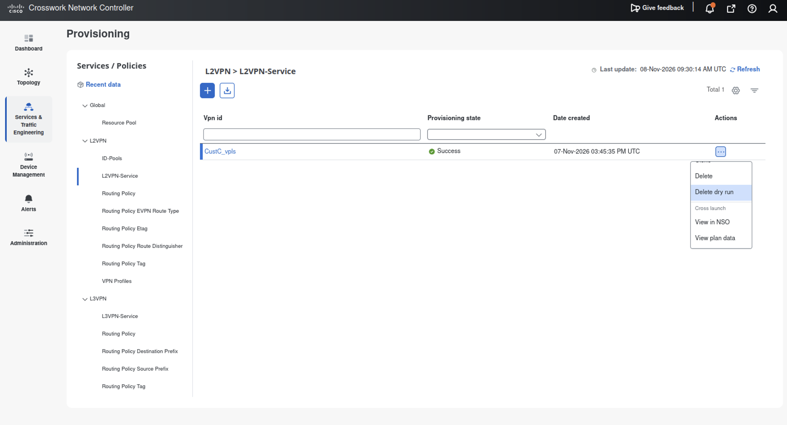

5. Check the configuration diff and click **Delete**.

    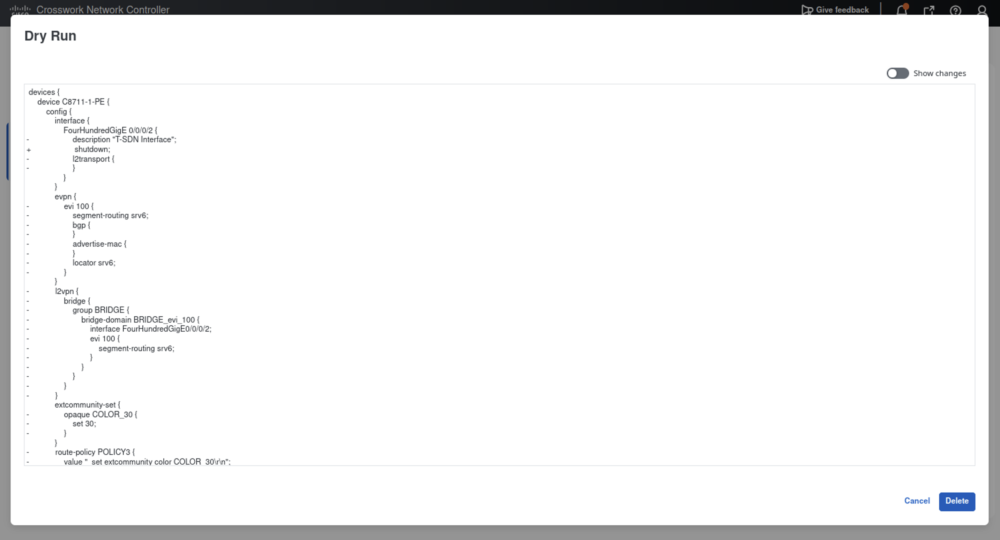


