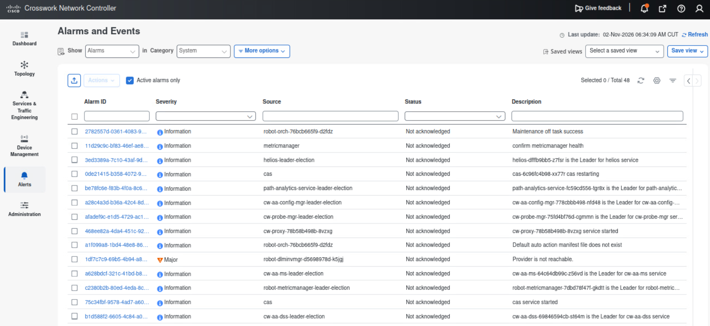
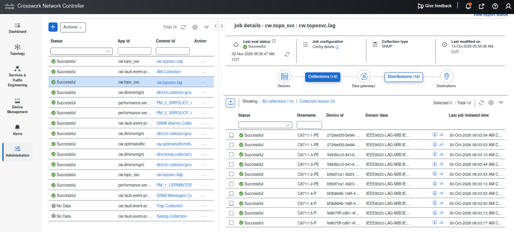
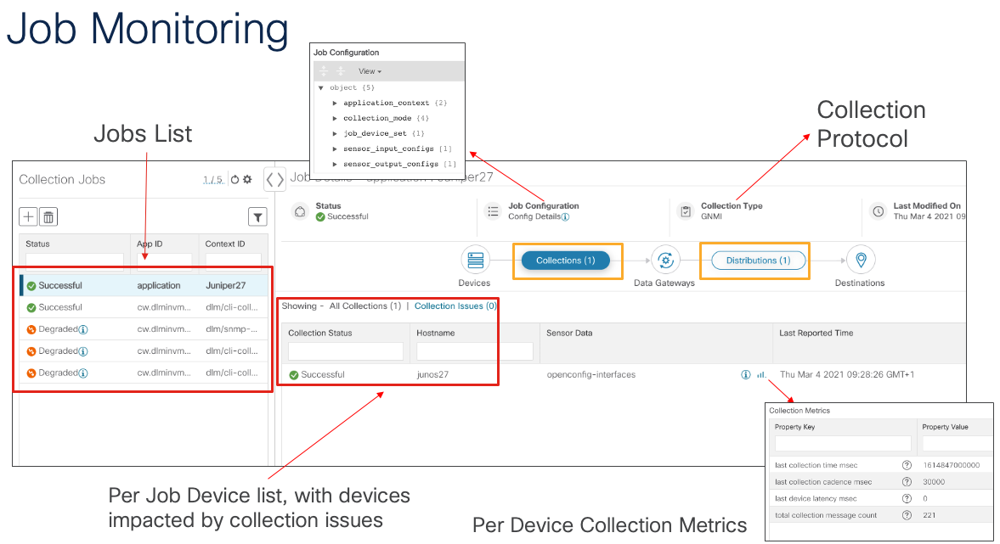
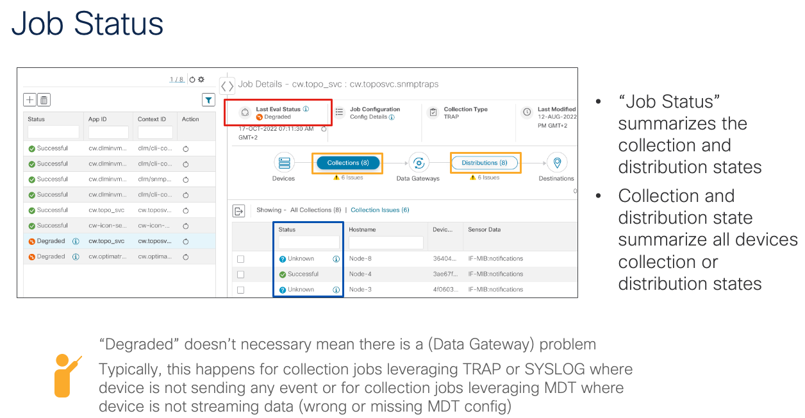
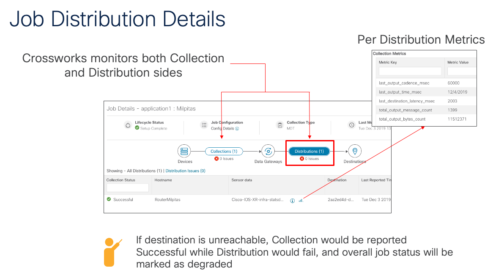
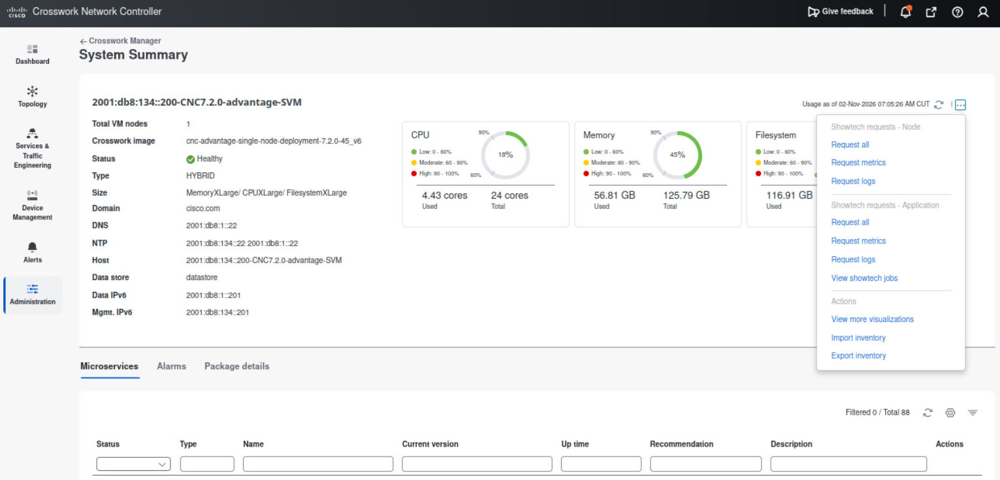
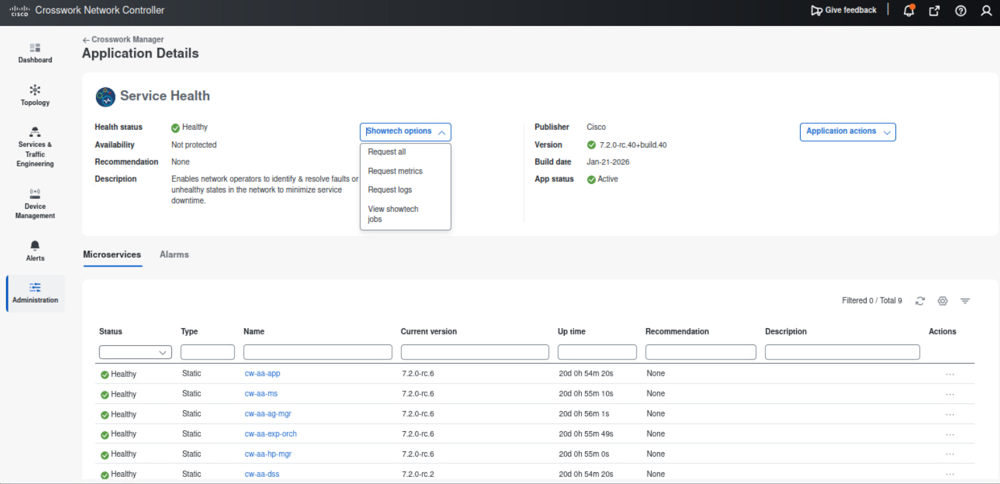
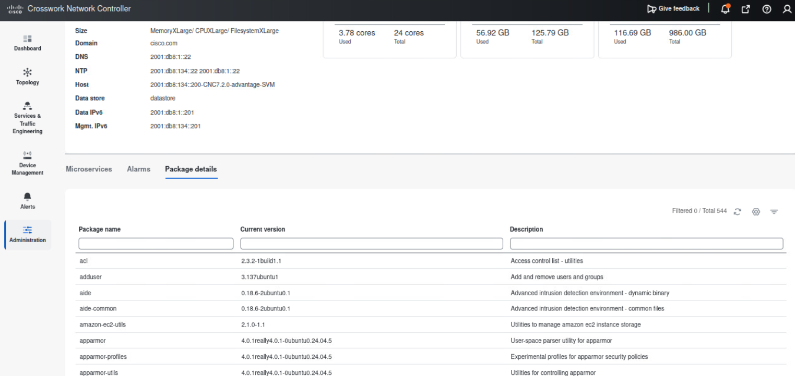

# 9. Troubleshooting

**Time:** 45 minutes.

**Objective:** Collect CNC showtech, read collection jobs, read alarms, and review the add-patch workflow. Whether to apply a patch is the instructor's decision, because CNC enters maintenance mode to install it.

This chapter covers troubleshooting the controller, not changing router configuration.

## 9.1 Alarms

1. Go to **Alerts > Alarms and Events**.

2. Filter **Alarms** by category: system, network, and device.
3. For each category, record whether any alarm is raised. System alarms relate to CNC itself (disk, application, collector). Device alarms relate to the XR nodes.
4. Open one alarm if any exist. Record severity, source, time, and description. Do not acknowledge or clear alarms unless the instructor assigns that alarm to you.
5. Switch to **Events** and find the event that triggered the alarm, if one exists.

**Result:** You know whether the platform, the network, or a device currently has a problem.

Use alarms together with the health tiles from chapter 2. An application tile can show Healthy while a system alarm is active; the alarm provides the detail.

## 9.2 Collection jobs

Empty inventory, blank utilization, and Service Health stuck on Initiated are usually collection problems, not VPN problems.

1. Go to **Administration > Collection Jobs**, or **Administration > Data Gateway Management > Collection Jobs**.
2. Open **Bulk jobs**. Bulk jobs are created by the system, the UI, or the API. Record the Status (for example, Successful) and the Context ID.
3. Open a successful job and read the device names.

4. Review the details in **Job Monitoring**.

5. If a job is Degraded, open the job details and read the error. Common causes:
    - Device not attached to a Data Gateway
    - Incorrect SNMP or CLI credentials
    - Device unreachable (the CLI checks in chapter 3 would already have shown this)
    - Destination in Error state (collection still runs, but the error count increases)

6. Review the job distribution details to understand the difference between **Collection** and **Distribution**.

**Result:** You can locate the jobs and check their status.

## 9.3 Showtech

Collect showtech before you open a TAC case. CNC 7.2 collects cluster logs and metrics from **Crosswork Manager**. Application showtech is collected per application. Data Gateway showtech is a separate encrypted download.

### Cluster and application

1. Go to **Administration > Crosswork Manager**.
2. Open **Crosswork Summary > System summary**.
3. Click **Actions** and note the showtech options:
    - **Request all** — logs and metrics
    - **Request metrics**
    - **Request logs**

4. If the instructor wants a file from this VM, collect **logs** (not Request all) so that the bundle stays small. Otherwise, only open **Actions > View showtech jobs** and review any previous job.
5. To collect showtech for one application, return to **Crosswork Health**, open the application tile (for example Service Health or Platform Infrastructure), and use that tile's showtech action. Application logs are collected separately from the cluster bundle.

6. In **View showtech jobs**, check the status. Publish or download a file only if the instructor needs it. Do not delete anything.

**Result:** You know where to start cluster showtech and application showtech, and you did not fill the disk with a collection the instructor did not ask for.

### Data Gateway (cluster only)

1. Go to **Administration > Data Gateway Management**.
2. Select the gateway.
3. Open **Actions** and find **Download Showtech**.
4. Do not download unless the instructor asks. The file is encrypted. The instructor holds the passphrase and decrypts the file if TAC requests it. Do not put a passphrase in chat or in this guide.

**Result:** You know where to find CDG showtech.

## 9.4 Add patch

CNC 7.2 installs OS security patches (SPACK) from **System management**. Application bundles are added from **Application Management**. Both are maintenance operations. Adding an OS patch automatically turns maintenance mode on, applies the patch node by node, and then turns maintenance mode off. Rollback is not supported. Even on a small lab VM, the process takes a long time.

### OS patch screens

1. Go to **Administration > Crosswork Manager**.
2. Open the **System management** tab.
3. Find **Add OS patch**. Open the dialog only to check that the source can be a URL or SCP.
4. Open **System updates** (or the list of already installed patches). Record whether this dCloud image already shows 7.2.0.
5. Open **Job History** on the System management tab. Add-to-repository and per-VM apply jobs appear here after a patch is added. Review any existing job. Do not retry a job unless the instructor is recovering from a failed apply.
6. After a successful apply (instructor only), verify the result in **Administration > Crosswork Manager > System summary > Package details**.

### Application file

1. Go to **Administration > Crosswork Manager > Application Management**.
2. Note the **Add new file** option. It is used to upload an application CAPP file or a patch bundle.
3. Do not upload a file unless the instructor provides one and asks you to.

## 9.5 If something from an earlier chapter is still broken

| Symptom | First check |
| --- | --- |
| Empty topology | SR-PCE provider, BGP-LS, `show pce ipv6 topology summary` |
| Device unreachable in Network Devices | CML node booted, management IPv6, credential profile |
| Thin inventory / no utilization | Data Gateway attachment, collection job status |
| SR policy preview empty | SRv6 tab, `show segment-routing srv6 locator`, PCEP peer |
| VPN out of sync | NSO provider, Check sync, then chapter 7 optional sync-from only if asked |
| Service Health stuck on Initiated | Parameterized service-based collection job |

## Done when

- You opened Alarms and Events and recorded what is (or is not) raised.
- You found bulk and parameterized collection jobs, including a service-based job for the VPWS when monitoring is on.
- You can start cluster showtech from System summary and you know that application and CDG showtech are separate.
- You reviewed Add OS patch and Job History without starting an unplanned maintenance window.
