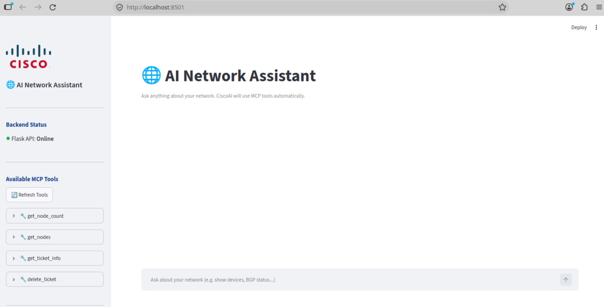

# 10. Optional: CNC MCP server

**Time:** 20 minutes

**Objective:** Ask the lab assistant one question that it can answer with a live Crosswork tool. Confirm the answer in the CNC UI.

The assistant is a chat page. When you ask a question, it may call tools on an MCP server. The MCP server communicates with CNC. 

## 10.1 Open the assistant

Access **Ubuntu2504-Desktop**, open a terminal, and run the following:
```
$ cd aiserver
$ ./main
```
Close the browser tab.

Access **Ubuntu2204-1T-Desktop**, open a terminal, and run the following:
```
$ cd cnc_mcp
$ source venv/bin/activate
$ python3 cnc_mcp_server2.py
```

Open another terminal in **Ubuntu2204-1T-Desktop** and run the following:
```
$ cd webui
$ source venv/bin/activate
$ streamlit run frontend.py
```


**Result:** The assistant is online and you can name the available tools.

## 10.2 One live question

In the chat, ask:

```text
How many nodes are in the CNC?
```

Wait for the reply. Open the tool-call detail for that turn.

Confirm all of the following:

- The assistant called the inventory count tool.
- The reply contains a number.
- You can find a matching count under **Device Management > Network Devices** or **Network Inventory**. The two screens group equipment differently, so the numbers may differ depending on what each one counts. Record both numbers and write one sentence explaining the difference. If they match, note that they match.

If the tool call fails, note the error text instead of relying on the model's guesses. A failure here usually means that the assistant cannot authenticate to CNC or cannot reach the UI address. In that case, ask the instructor to fix it. Chapters 2 and 4 already showed you the same inventory with your own login.

**Result:** You have a number from the tool and have compared it with Device Management.

## 10.3 Operator check (no write operations)

Ask a second question that does not require a write tool:

```text
The inventory count is <the number you just verified>.
What should an operator check first in Crosswork?
```

A useful answer lists checks that you already know how to perform:

- Reachability on **Device Management > Network Devices**
- The credential profile on that device
- Data Gateway mapping
- Collection job status
- SR-PCE and NSO provider status
- Active alarms for that hostname

Pick one check the assistant suggested, open the corresponding CNC page, and verify whether the suggestion is correct. If the UI contradicts the assistant, trust the UI.


## Done when

- The assistant answered the inventory question with a tool call, and you compared that number with Device Management.
